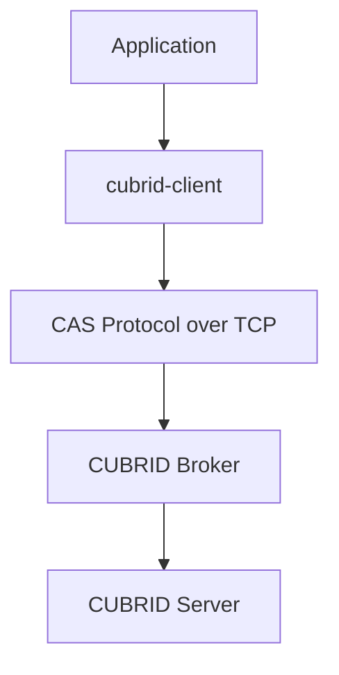
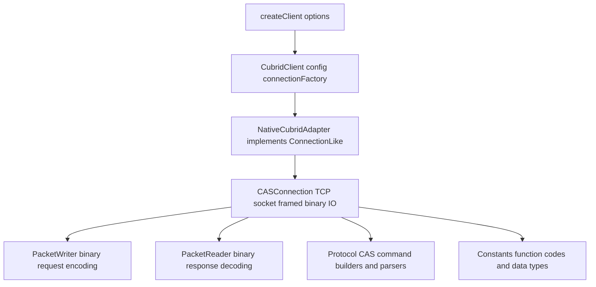
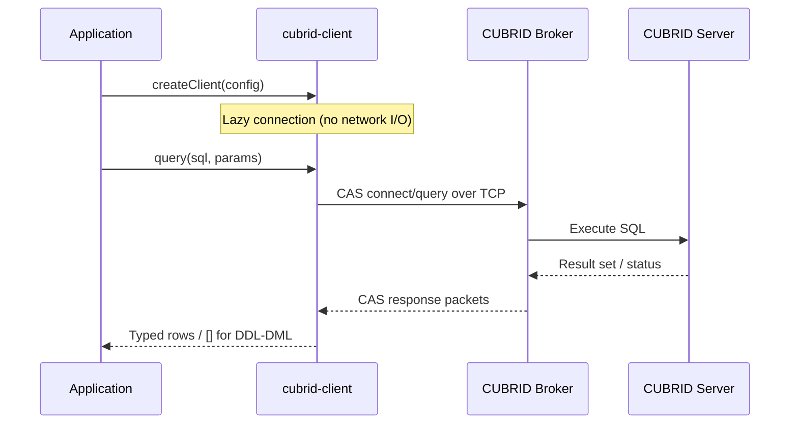
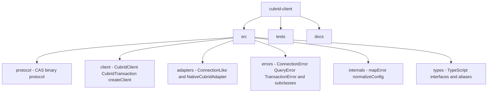

<!-- CUBRID-LAB-ICON:START -->
<p align="center">
  <a href="https://github.com/cubrid-lab/brand"></a>
</p>
<!-- CUBRID-LAB-ICON:END -->

# cubrid-client

**Modern TypeScript-first Node.js client for the CUBRID database** — zero native dependencies, built-in CAS protocol driver, Promise-based API with full type safety.

<!-- BADGES:START -->
[](https://www.npmjs.com/package/cubrid-client)
[](https://nodejs.org)
[](https://github.com/cubrid-lab/cubrid-client/actions/workflows/ci.yml)
[](https://codecov.io/gh/cubrid-lab/cubrid-client)
[](https://github.com/cubrid-lab/cubrid-client/blob/main/LICENSE)
[](https://github.com/cubrid-lab/cubrid-client)
<!-- BADGES:END -->

## Why cubrid-client?

A modern CUBRID client that speaks the CAS binary protocol directly over TCP — no legacy driver dependencies, no native bindings.

| Feature | cubrid-client |
|---------|---------------|
| Protocol | Native CAS binary over TCP |
| Dependencies | Zero runtime dependencies |
| API style | Pure async/await |
| TypeScript | Full generics (`query<T>()`) |
| Results | `Record<string, unknown>[]` objects |
| Errors | `ConnectionError`, `QueryError`, `TransactionError`, with the server's numeric `code` and a `kind` |
| Transactions | `transaction(callback, options?)` with auto commit/rollback, and `isolationLevel` and `lockTimeout` options |
| Node.js | 18+ |

## Versioning and compatibility

`cubrid-client` follows SemVer for its public runtime and TypeScript APIs:
compatible fixes use PATCH, additive options/features use MINOR, and breaking
changes (including an increase of the declared Node.js minimum) require MAJOR.
The current `engines.node` floor is Node.js 18. Types such as `query<T>()`
are compile-time declarations, not runtime validation.
See [API stability and compatibility](docs/API_STABILITY.md) for the precise
contract and migration policy. Version numbers do not establish full live
CUBRID compatibility; review the version support evidence and release notes.

## Installation

```bash
npm install cubrid-client
```

No peer dependencies required.

**Declared runtime requirement:** Node.js 18+ (CI tests Node 18, 20, 22, 24 and 26;
Node 18 and 20 are end-of-life upstream and deprecated, see the
[support schedule](docs/API_STABILITY.md#nodejs-support-schedule)). The
[real-broker CI matrix](https://github.com/cubrid-lab/cubrid-client/actions/runs/42216017228)
passed 23 integration tests (0 skipped) on CUBRID 10.2, 11.0, 11.2 and
11.4. A separate real SSL=ON CUBRID 11.4 run also passed 3/3 certificate
verification and rejection checks. This is **not exhaustive**
type, cross-version TLS or fault-injection validation;
see the [support matrix](docs/SUPPORT_MATRIX.md) before deployment.

## Quick Start

```ts
import { createClient } from "cubrid-client";

const db = createClient({
  host: "localhost",
  port: 33000,
  database: "demodb",
  user: "dba",
  password: "",
});

// Query returns an array of row objects
const rows = await db.query("SELECT * FROM athlete LIMIT 5");
console.log(rows);
// [{ code: 10000, name: 'Fernandez', ... }, ...]

await db.close();
```

See [CUBRID-to-JavaScript type behavior](docs/TYPES.md) for the current
result and input mapping, including `BIGINT` as `bigint`, decimal `NUMERIC`
as `string`, SET/MULTISET/SEQUENCE collections as arrays, and values
that cannot be decoded. The [roadmap](ROADMAP.md) tracks work that has **not** been released.

## Server Version

`getServerVersion()` returns the CUBRID server version string, for example for a compatibility check. It is the same single request as `ping()`, so it never ends an open transaction.

```ts
const version = await db.getServerVersion(); // "11.4.6.1963"
```

## Schema Introspection

`getTables()`, `getColumns()`, `getPrimaryKey()` and `getIndexes()` return typed metadata read from the catalog views, which behave the same on CUBRID 10.2 to 11.4. Pass the bare table name; matching ignores case, and a `schema` option picks the owner when CUBRID 11.2 or later has the same table name under several users.

```ts
const tables = await db.getTables(); // [{ name: "athlete", schema: "DBA", type: "table" }, ...]
const columns = await db.getColumns("athlete"); // name, position, dataType, precision, scale, nullable, defaultValue
const pk = await db.getPrimaryKey("athlete"); // { name: "pk_athlete_code", columns: ["code"] } or null
const indexes = await db.getIndexes("athlete"); // unique, reverse, primaryKey, foreignKey, filter, columns
```

The catalog lists only tables the connected user may `SELECT`, so an inaccessible table is absent from `getTables()` and rejects with a `QueryError` in the others. See the [API reference](docs/API_REFERENCE.md#schema-introspection-gettables-getcolumns-getprimarykey-getindexes) for names, owners, permissions and what is not included.

## Result Columns

`query()` returns only rows. Use `queryResult()` to also get the type, precision, scale and nullability of each column, for example to know the type of a column that is NULL in every row:

```ts
const { rows, columns } = await db.queryResult("SELECT code, name FROM athlete LIMIT 5");
// columns[0] -> { name: "code", type: "INT", precision: 10, scale: 0, nullable: false }
```

`columns` lists every select-list column, so a repeated name such as `SELECT a.id, b.id` appears twice there; each row object still has one key per name, and the last column wins. See [`QueryResult`](docs/API_REFERENCE.md#queryresult).

## Streaming Large Results

`query()` returns all rows in one array. `stream()` reads them as they are needed, holding one server reply of rows at a time:

```ts
for await (const row of db.stream<{ id: number; name: string }>(
  "SELECT id, name FROM athlete WHERE nation_code = ?",
  ["KOR"],
)) {
  await send(row);
  if (done(row)) {
    break; // Closes the server cursor. So do a thrown error and a failed read.
  }
}
```

An open stream holds its connection. Other statements on the same client wait until it ends, so **do not await `db.query()` inside the loop**: it rejects with `kind: "stream-busy"` after 5 seconds instead of hanging. Use `db.transaction()`, which has its own connection, or a second client. See [`stream()`](docs/API_REFERENCE.md#streamtsql-params-options) for cancellation, timeouts and LOB columns.

## Typed Queries

Use TypeScript generics to get fully typed query results:

```ts
type Athlete = {
  code: number;
  name: string;
  gender: string;
  nation_code: string;
  event: string;
};

const athletes = await db.query<Athlete>(
  "SELECT * FROM athlete WHERE nation_code = ? LIMIT ?",
  ["KOR", 10],
);
// athletes is Athlete[] — full autocompletion and type safety
```

## Parameterized Queries

Use `?` placeholders to safely pass parameters:

```ts
// Positional parameters
const users = await db.query(
  "SELECT * FROM users WHERE name = ? AND age > ?",
  ["Alice", 25],
);

// Supported parameter types
await db.query("INSERT INTO data (a, b, c, d, e, f, g) VALUES (?, ?, ?, ?, ?, ?, ?)", [
  "text",              // string
  42,                  // number
  true,                // boolean
  9007199254740993n,   // bigint
  new Date(),          // Date
  Buffer.from("bin"),  // Buffer
  null,                // null
]);
```

### Affected rows and generated ids

`query()` returns `[]` for `INSERT`, `UPDATE` and `DELETE`. Use `execute()` to
learn how many rows changed and the generated `AUTO_INCREMENT` value:

```ts
const { affectedRows, lastInsertId } = await db.execute(
  "INSERT INTO users (name) VALUES (?)",
  ["Alice"],
);
// affectedRows: 1, lastInsertId: 1 (a bigint beyond Number.MAX_SAFE_INTEGER)
```

`db.transaction((tx) => tx.execute(...))` works the same way. See
[`execute()`](docs/API_REFERENCE.md#executesql-params) for what the server
reports for multi-row and multi-statement inserts.

### Server-side prepared binding

`query()` and `execute()` render parameters into SQL text. To send them as typed
binds instead, use `queryPrepared()`, `queryResultPrepared()` or
`executePrepared()`, on the client or on a transaction:

```ts
const rows = await db.queryPrepared("SELECT id FROM users WHERE name = ?", [name]);
```

It is opt-in, takes more round trips than `query()` and has no reusable statement
object. See [prepared binding](docs/TYPES.md#prepared-binding) for the type
mapping, the values it refuses and where results differ.

### Date parameters are serialized in UTC

`Date` parameters are rendered as a `DATETIME'YYYY-MM-DD HH:MM:SS.mmm'`
literal using the date's **UTC** components (millisecond precision). CUBRID's
`DATETIME` type has no timezone, so the stored value reflects UTC wall-clock
time, not the client's local time. If you need local-time semantics, convert
the value yourself before passing it, or store an explicit UTC offset alongside
it.

### How parameters are escaped

Parameters are rendered into the SQL text client-side, with escaping that is
aware of the server's `no_backslash_escapes` setting. On first use, the client
probes the server (`SELECT CHAR_LENGTH('\\')`) and pins the correct mode for
the connection:

- **`no_backslash_escapes=yes`** (the CUBRID default): the backslash is an
  ordinary character. Only the single quote is doubled (`'` → `''`); backslashes,
  newlines, and carriage returns are preserved verbatim. This means a Windows
  path like `C:\temp\file.txt` round-trips unchanged.
- **`no_backslash_escapes=no`**: backslash-escape processing is active, so
  backslashes are doubled and `\r` / `\n` are backslash-escaped in addition to
  doubling the single quote.

> **Rejected bytes:** string parameters containing a NUL (`0x00`) or Ctrl-Z
> (`0x1A`) byte are rejected with a `QueryError`, because CUBRID cannot store a
> NUL in a string literal and defines no safe literal escape for `0x1A`. Encode
> such values as binary using a `Buffer` parameter (rendered as `X'..'`) instead.

## Transactions

### Automatic (Recommended)

`transaction()` creates an isolated connection, auto-commits on success, and auto-rolls back on error:

```ts
await db.transaction(async (tx) => {
  await tx.query("INSERT INTO orders (item, qty) VALUES (?, ?)", ["Widget", 1]);
  await tx.query(
    "UPDATE inventory SET qty = qty - 1 WHERE item = ?",
    ["Widget"],
  );
  // Auto-committed here
});
// If any query throws, everything is rolled back automatically.
```

The callback owns one transaction with exactly one outcome. You normally do not
call `tx.commit()` or `tx.rollback()`, but both remain available, for example to
decline a change without treating it as an error. The client then skips its own
commit or rollback and still returns the callback's value:

```ts
const placed = await db.transaction(async (tx) => {
  const [stock] = await tx.query<{ qty: number }>(
    "SELECT qty FROM inventory WHERE item = ?",
    ["Widget"],
  );
  if (!stock || stock.qty < 1) {
    await tx.rollback();
    return false;
  }
  await tx.query("INSERT INTO orders (item, qty) VALUES (?, ?)", ["Widget", 1]);
  return true;
});
```

Once the transaction is complete, `tx.query()`, `tx.queryResult()`, `tx.execute()`,
`tx.commit()` and `tx.rollback()` reject with `TransactionError` and send nothing
to the server. If the rollback or
the connection close also fails, `error.cause` stays the original failure and the
later ones are on `error.rollbackError` and `error.closeError`. Await every
statement: one that is still running when the commit starts and then fails
rolls the transaction back. See the
[transaction lifecycle](docs/API_REFERENCE.md#transaction-lifecycle) for every
outcome and the [compatibility notes](docs/API_STABILITY.md#transaction-callback-guards).

### Isolation level and lock timeout

Set them on the client, or on one transaction. They are applied before the transaction starts, and again on any session that replaces the first one, so they never disappear silently after a reconnect.

```typescript
const db = createClient({ host, database, user, lockTimeout: 5000 });

await db.transaction(async (tx) => {
  await tx.query('UPDATE stock SET qty = qty - 1 WHERE id = ?', [1]);
}, { isolationLevel: 'repeatable read', lockTimeout: 0 });
```

`serializable` behaves like `repeatable read` on CUBRID 10.2 to 11.4, and it still allows write skew. See [what each level does](docs/CONNECTION.md#isolation-level-and-lock-timeout), and [Autocommit](docs/CONNECTION.md#autocommit) for its behavior after a reconnect.

### Manual

For fine-grained control on the shared connection:

```ts
await db.beginTransaction();
try {
  await db.query("INSERT INTO logs (msg) VALUES (?)", ["step 1"]);
  await db.query("INSERT INTO logs (msg) VALUES (?)", ["step 2"]);
  await db.commit();
} catch (error) {
  await db.rollback();
  throw error;
}
```

## TLS/SSL

Connect to an SSL-enabled CUBRID broker (`SSL=ON` in `cubrid_broker.conf`) by
setting the `ssl` option. Certificates are verified against the system trust
store by default (`rejectUnauthorized: true`), and the minimum negotiated
protocol is TLS 1.2.

```ts
// Simplest form: enable TLS with default certificate verification
const db = createClient({
  host: "localhost",
  database: "demodb",
  user: "dba",
  ssl: true,
});
```

For self-signed or private-CA broker certificates, pass an options object:

```ts
import { readFileSync } from "node:fs";

const db = createClient({
  host: "db.internal",
  database: "demodb",
  user: "dba",
  ssl: {
    ca: readFileSync("broker-ca.pem", "utf8"), // trust a private CA
    servername: "db.internal",                 // override SNI / cert hostname
    // rejectUnauthorized: false,               // opt out of verification (NOT recommended)
  },
});
```

`ClientSSLOptions` fields:

| Field | Type | Default | Description |
|-------|------|---------|-------------|
| `rejectUnauthorized` | `boolean` | `true` | Reject connections whose certificate cannot be verified |
| `ca` | `string \| Buffer \| Array` | *(system store)* | Trusted CA certificate(s) for verification |
| `servername` | `string` | `host` | Server name for SNI and certificate hostname checks |

> The client uses a STARTTLS-style upgrade on the same broker port (`33000`):
> it negotiates the CAS handshake, then upgrades the socket to TLS before the
> database login. The plaintext (non-SSL) path is unaffected when `ssl` is
> omitted or `false`.


## Error Handling

Every error includes the original driver error as `.cause`:

```ts
import { createClient, ConnectionError, QueryError, TransactionError } from "cubrid-client";

const db = createClient({ host: "localhost", database: "demodb", user: "dba" });

try {
  await db.query("SELECT * FROM nonexistent_table");
} catch (error) {
  if (error instanceof ConnectionError) {
    console.error("Connection failed:", error.message);
  } else if (error instanceof QueryError) {
    console.error("Query failed:", error.message);
    console.error("Driver error:", error.cause);
  } else if (error instanceof TransactionError) {
    console.error("Transaction failed:", error.message);
  }
}
```

Errors also say what happened without parsing a message. `error.code` is the numeric server code and `error.kind` classifies known failures. Outside a transaction, `ConstraintError`, `SqlSyntaxError`, `DeadlockError` and `LockTimeoutError` extend `QueryError`. See [Error details](docs/API_REFERENCE.md#error-details).

```ts
import { ConstraintError } from "cubrid-client";

try {
  await db.query("INSERT INTO users (email) VALUES (?)", [email]);
} catch (error) {
  if (error instanceof ConstraintError && error.kind === "unique-violation") {
    console.error("Already registered:", error.code); // -670
  }
}
```

## API Reference

### `createClient(options): CubridClient`

Creates a client instance. Connection is established lazily on first query.

| Option | Type | Default | Description |
|--------|------|---------|-------------|
| `host` | `string` | *(required)* | Server hostname |
| `port` | `number` | `33000` | Broker port |
| `database` | `string` | *(required)* | Database name |
| `user` | `string` | *(required)* | Database user |
| `password` | `string` | `""` | Password |
| `connectionTimeout` | `number` | — | Connection timeout (ms) |
| `maxConnectionRetryCount` | `number` | `0` | Retries after a failed TCP connect to the broker (see [Connection retries](docs/CONNECTION.md#connection-retries)) |
| `readTimeout` | `number` | — | Fail a query after this many ms with no activity from the server (see [Read timeout](docs/CONNECTION.md#read-timeout)). Unset means no timeout for queries; the connect handshake still gives up after 10 s |
| `fetchSize` | `number` | `100` | Rows requested per FETCH. CUBRID 10.2 to 11.4 ignore it and send about 16 KiB per reply (see [`fetchSize`](docs/API_REFERENCE.md#clientoptions)) |
| `maxLobBytes` | `number` | 64 MiB | Most BLOB and CLOB content one query may load, in bytes. A query over it rejects (see [BLOB and CLOB columns](docs/TYPES.md#blob-and-clob-columns)) |
| `isolationLevel` | `"read committed" \| "repeatable read" \| "serializable"` | Server default | Isolation level of every session this client opens, restored after a reconnect (see [Isolation Level and Lock Timeout](docs/CONNECTION.md#isolation-level-and-lock-timeout)) |
| `lockTimeout` | `number` | Server default | Longest a statement waits for a lock, in ms. `0` does not wait and `-1` has no limit. Restored after a reconnect |
| `ssl` | `boolean \| ClientSSLOptions` | `false` | Enable TLS. `true` for defaults, or an object for cert/verification control (see [TLS/SSL](#tlsssl)) |

### `client.stream<T>(sql, params?, options?): AsyncGenerator<T>`

Reads a result row by row with `for await`, with bounded memory. See [Streaming Large Results](#streaming-large-results).

### `client.query<T>(sql, params?): Promise<T[]>`

Executes SQL and returns typed row objects. DDL/DML statements return `[]`. BLOB columns return a complete `Buffer` and CLOB columns a complete `string`.

### `client.transaction<T>(callback, options?): Promise<T>`

Runs `callback` in an isolated transaction with exactly one commit or rollback. `options` can set `isolationLevel` and `lockTimeout` for that transaction.

### `client.beginTransaction(): Promise<void>`

Starts a transaction on the shared connection.

### `client.commit(): Promise<void>`

Commits the active transaction on the shared connection.

### `client.rollback(): Promise<void>`

Rolls back the active transaction on the shared connection.

### `client.close(): Promise<void>`

Closes the shared connection. Safe to call multiple times.

> 📖 Full API documentation: [docs/API_REFERENCE.md](docs/API_REFERENCE.md)

## Architecture

`cubrid-client` implements the CUBRID CAS binary protocol directly over TCP sockets:







No external protocol drivers needed — the entire CAS handshake, query execution, and result parsing is implemented in TypeScript.

## Documentation

| Document | Description |
|----------|-------------|
| [API Reference](docs/API_REFERENCE.md) | Complete method signatures, type definitions, error classes |
| [Connection Guide](docs/CONNECTION.md) | Connection options, lazy connection, lifecycle, Docker setup |
| [Troubleshooting](docs/TROUBLESHOOTING.md) | Common errors, debugging tips, performance advice |
| [Architecture](docs/architecture.md) | Internal design and module responsibilities |

## Project Layout



## Development

```bash
git clone https://github.com/cubrid-lab/cubrid-client.git
cd cubrid-client
npm install
npm run build        # TypeScript compilation (tsup)
npm test             # Run offline tests
npm run test:coverage # Coverage report (99%+ statements)
npm run typecheck    # tsc --noEmit
npm run api:check    # public API vs api/index.d.ts (run after build)
```

### Integration Tests

Integration tests run against a live CUBRID server. They self-skip their
database-dependent cases when no server is reachable, so they are safe to run
anywhere. Point them at a running CUBRID broker on `127.0.0.1:33000` with a
database named `testdb` and user `dba` (empty password):

```bash
npm run test:integration              # DB-dependent cases self-skip if unreachable
```

> CI runs this step too, but no CUBRID server is provisioned there, so only the
> offline cases execute and a warning annotation is emitted. To exercise the full
> suite, run the command above against your own CUBRID instance.

## Ecosystem

| Package | Description |
|---------|-------------|
| [cubrid-client](https://github.com/cubrid-lab/cubrid-client) | TypeScript client (this package) |
| [drizzle-cubrid](https://github.com/cubrid-lab/drizzle-cubrid) | Drizzle ORM dialect for CUBRID |

## Roadmap

See [`ROADMAP.md`](ROADMAP.md) for this project's direction and next milestones.

For the ecosystem-wide view, see the [CUBRID Labs Ecosystem Roadmap](https://github.com/cubrid-lab/.github/blob/main/ROADMAP.md) and [Project Board](https://github.com/orgs/cubrid-lab/projects/2).

## Disclaimer

This project is part of [CUBRID Lab](https://github.com/cubrid-lab), an independent open-source initiative for CUBRID developer tooling, and is not affiliated with, sponsored by, or endorsed by CUBRID Corporation or the official CUBRID project.

## License

[MIT](LICENSE)
