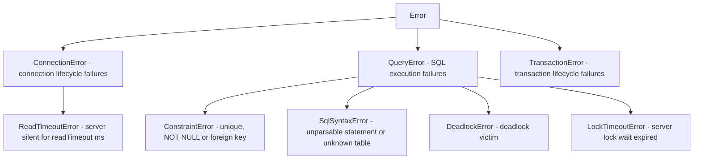

# API Reference

Complete reference for every public export of `cubrid-client`.

---

## Table of Contents

- [createClient()](#createclient)
- [CubridClient](#cubridclient)
- [CubridTransaction](#cubridtransaction)
- [Error Classes](#error-classes)
  - [ConnectionError](#connectionerror)
  - [QueryError](#queryerror)
  - [TransactionError](#transactionerror)
  - [ReadTimeoutError](#readtimeouterror)
  - [Error details](#error-details)
- [Types](#types)
  - [ClientOptions](#clientoptions)
  - [ClientConfig](#clientconfig)
  - [ConnectionFactory](#connectionfactory)
  - [ConnectionLike](#connectionlike)
  - [Queryable](#queryable)
  - [TransactionClient](#transactionclient-interface)
  - [TransactionCallback](#transactioncallback)
  - [ResultTransactionClient](#resulttransactionclient)
  - [QueryParam](#queryparam)
  - [QueryParams](#queryparams)
  - [QueryResultRow](#queryresultrow)
  - [QueryResult](#queryresult)
  - [ColumnInfo](#columninfo)

---

## createClient()

Factory function that creates a new `CubridClient` instance.

### Signature

```ts
function createClient(options: ClientOptions): CubridClient;
```

### Parameters

| Parameter | Type | Description |
|-----------|------|-------------|
| `options` | [`ClientOptions`](#clientoptions) | Connection and behavior configuration |

### Returns

A new [`CubridClient`](#cubridclient) instance. The connection is **not** opened immediately — it is established lazily on the first `query()` or `transaction()` call.

### Example

```ts
import { createClient } from "cubrid-client";

const db = createClient({
  host: "localhost",
  port: 33000,
  database: "demodb",
  user: "dba",
  password: "",
});

// Connection opens automatically on first query
const rows = await db.query("SELECT * FROM athlete LIMIT 5");
console.log(rows);

await db.close();
```

### How It Works

1. `options` are normalized into a full `ClientConfig` (defaults applied for `port`, `password`).
2. A `connectionFactory` is resolved — either from `options.connectionFactory` or the built-in `NodeCubridAdapter`.
3. A `CubridClient` is returned with lazy connection initialization.

---

## CubridClient

The main client class. Manages a shared connection for non-transactional queries and creates isolated connections for transactions.

```ts
class CubridClient implements Queryable
```

### Connection Model

- **Non-transactional queries** reuse a single shared connection (created lazily on first use).
- **Transactions** allocate a dedicated isolated connection via the `connectionFactory`, ensuring transaction isolation. The isolated connection is closed automatically when the transaction completes.

### Methods

#### `query<T>(sql, params?)`

Executes a SQL statement and returns typed result rows.

```ts
async query<T extends QueryResultRow = QueryResultRow>(
  sql: string,
  params?: QueryParams,
): Promise<T[]>
```

| Parameter | Type | Default | Description |
|-----------|------|---------|-------------|
| `sql` | `string` | — | SQL statement. Use `?` for parameter placeholders. |
| `params` | [`QueryParams`](#queryparams) | `undefined` | Positional parameter values |

**Returns:** `Promise<T[]>` — Array of result rows typed as `T`.

**Throws:** [`QueryError`](#queryerror) if execution fails.

**Type Parameter:** `T` defaults to `QueryResultRow` (`Record<string, unknown>`). Pass a custom type for typed results.

Queries issued at the same time, for example with `Promise.all`, run one at a time in the order issued and each returns exactly its own rows. See [Concurrent Statements on One Connection](CONNECTION.md#concurrent-statements-on-one-connection).

##### Examples

```ts
// Untyped query — rows are Record<string, unknown>[]
const rows = await db.query("SELECT * FROM athlete LIMIT 10");

// Typed query — rows are User[]
type User = { id: number; name: string; email: string };
const users = await db.query<User>(
  "SELECT id, name, email FROM users WHERE active = ?",
  [true],
);
console.log(users[0].name); // TypeScript knows this is a string

// Parameterized INSERT
await db.query(
  "INSERT INTO users (name, email) VALUES (?, ?)",
  ["Alice", "alice@example.com"],
);

// DDL statements return an empty array
await db.query("CREATE TABLE IF NOT EXISTS logs (id INT AUTO_INCREMENT, msg VARCHAR(200))");
```

> **Note:** DDL and DML statements (`INSERT`, `UPDATE`, `DELETE`, `CREATE`, `DROP`, `ALTER`, etc.) are automatically routed through the driver's `execute()` method to avoid fetch-phase errors. They return an empty array `[]`.

---

#### `queryResult<T>(sql, params?)`

Executes a SQL statement like `query()` and returns its rows together with the metadata of the columns that produced them.

```ts
async queryResult<T extends QueryResultRow = QueryResultRow>(
  sql: string,
  params?: QueryParams,
): Promise<QueryResult<T>>
```

**Returns:** a [`QueryResult<T>`](#queryresult): `rows` is exactly what `query<T>()` returns, and `columns` describes every select-list column in order. `query()` itself is unchanged and still returns `T[]`.

**Throws:** [`QueryError`](#queryerror) if execution fails, including when a custom `connectionFactory` connection has no `queryResult()` method.

```ts
const { rows, columns } = await db.queryResult(
  "SELECT a.id, b.id, a.note FROM a JOIN b ON a.id = b.a_id",
);
// columns: [
//   { name: "id", type: "INT", precision: 10, scale: 0, nullable: false },
//   { name: "id", type: "INT", precision: 10, scale: 0, nullable: false },
//   { name: "note", type: "VARCHAR", precision: 100, scale: 0, nullable: true },
// ]
```

---

#### `transaction<T>(callback)`

Executes a callback within an isolated transactional connection. Commits on success, rolls back on failure.

```ts
async transaction<T>(callback: TransactionCallback<T, ResultTransactionClient>): Promise<T>
```

| Parameter | Type | Description |
|-----------|------|-------------|
| `callback` | [`TransactionCallback<T, ResultTransactionClient>`](#transactioncallback) | Async function receiving a [`ResultTransactionClient`](#resulttransactionclient), a [`TransactionClient`](#transactionclient-interface) that also has `queryResult()`. A callback written against `TransactionClient` is still accepted. |

**Returns:** `Promise<T>` — The return value of the callback.

**Throws:** [`TransactionError`](#transactionerror) if the transaction or rollback fails.

##### How It Works

1. A **new isolated connection** is created via `connectionFactory`.
2. `beginTransaction()` is called on that connection.
3. The `callback` receives a [`CubridTransaction`](#cubridtransaction) instance scoped to that connection.
4. If the callback resolves successfully, `commit()` is called.
5. If the callback throws, `rollback()` is called, and the error is re-thrown as a `TransactionError` (a [`ReadTimeoutError`](#readtimeouterror) is re-thrown as-is).
6. The isolated connection is **always closed** in a `finally` block, regardless of outcome.

##### Examples

```ts
// Simple transaction
await db.transaction(async (tx) => {
  await tx.query("INSERT INTO accounts (owner, balance) VALUES (?, ?)", ["Alice", 1000]);
  await tx.query("INSERT INTO accounts (owner, balance) VALUES (?, ?)", ["Bob", 500]);
});

// Transaction with return value
const newId = await db.transaction(async (tx) => {
  await tx.query(
    "INSERT INTO orders (customer, total) VALUES (?, ?)",
    ["Alice", 99.99],
  );
  const rows = await tx.query<{ id: number }>(
    "SELECT LAST_INSERT_ID() AS id",
  );
  return rows[0].id;
});
console.log(`Created order #${newId}`);

// Error handling — automatic rollback
try {
  await db.transaction(async (tx) => {
    await tx.query("UPDATE accounts SET balance = balance - 100 WHERE owner = ?", ["Alice"]);
    await tx.query("UPDATE accounts SET balance = balance + 100 WHERE owner = ?", ["Bob"]);

    // If this throws, both UPDATEs are rolled back
    const [alice] = await tx.query<{ balance: number }>(
      "SELECT balance FROM accounts WHERE owner = ?",
      ["Alice"],
    );
    if (alice.balance < 0) {
      throw new Error("Insufficient funds");
    }
  });
} catch (error) {
  console.error("Transaction rolled back:", error);
}
```

---

#### `beginTransaction()`

Manually begins a transaction on the shared connection. Prefer `transaction()` for automatic commit/rollback.

```ts
async beginTransaction(): Promise<void>
```

**Throws:** [`TransactionError`](#transactionerror) on failure.

---

#### `commit()`

Manually commits the current transaction on the shared connection.

```ts
async commit(): Promise<void>
```

**Throws:** [`TransactionError`](#transactionerror) on failure.

---

#### `rollback()`

Manually rolls back the current transaction on the shared connection.

```ts
async rollback(): Promise<void>
```

**Throws:** [`TransactionError`](#transactionerror) on failure.

---

#### `ping()`

Checks that the connection and its database server are alive, and returns the server version. It opens the shared connection if needed.

```ts
async ping(): Promise<string>
```

Inside a manual transaction a ping leaves the transaction open: the work before it can still be committed or rolled back. Outside a transaction it sends a commit, which ends the session's empty transaction and closes nothing the client still needs, because statements on one connection run [one at a time](CONNECTION.md#concurrent-statements-on-one-connection).

**Returns:** The server version, for example `11.4.6.1963`.

**Throws:** [`ConnectionError`](#connectionerror) if the health check fails. If it fails inside a transaction, treat that transaction as lost.

---

#### `getServerVersion()`

Returns the CUBRID server version. It opens the shared connection if needed.

```ts
async getServerVersion(): Promise<string>
```

It sends the same single version request as [`ping()`](#ping), so it has the same effect on a transaction: inside a manual transaction it leaves the transaction open, and outside one it commits the session's empty transaction. It adds no extra network call and performs no caching, so it reports the server the shared connection is currently attached to, after any reconnect. Use it for compatibility checks; use `ping()` for health checks.

**Returns:** The version string as the server reports it, without a trailing NUL, for example `11.4.6.1963`. It is not parsed or normalized.

**Throws:** [`ConnectionError`](#connectionerror) if the request fails or if a custom `connectionFactory` connection has no `ping()` method (see [`ConnectionLike`](#connectionlike)). Inside a transaction, treat a failure as a lost transaction. The `debug` log entry for this call has `operation: "ping"`.

---

#### `close()`

Closes the shared connection after the statements issued before it have finished. After calling `close()`, the client can no longer execute queries. If no connection was opened, this is a no-op.

```ts
async close(): Promise<void>
```

**Throws:** [`ConnectionError`](#connectionerror) if closing fails.

##### Example

```ts
const db = createClient({ host: "localhost", database: "demodb", user: "dba" });

try {
  const rows = await db.query("SELECT COUNT(*) AS cnt FROM athlete");
  console.log(rows);
} finally {
  await db.close(); // Always close when done
}
```

---

## CubridTransaction

A transaction-scoped client that delegates queries to the isolated transactional connection. You do **not** create this class directly — it is provided to you inside the `transaction()` callback.

```ts
class CubridTransaction implements ResultTransactionClient
```

### Methods

#### `query<T>(sql, params?)`

Same signature and behavior as [`CubridClient.query()`](#queryt-sql-params), but executes within the transaction's isolated connection.

```ts
async query<T extends QueryResultRow = QueryResultRow>(
  sql: string,
  params?: QueryParams,
): Promise<T[]>
```

**Throws:** [`TransactionError`](#transactionerror) if execution fails.

#### `commit()`

Commits the transaction. Called automatically by `CubridClient.transaction()` on success.

```ts
commit(): Promise<void>
```

#### `rollback()`

Rolls back the transaction. Called automatically by `CubridClient.transaction()` on failure.

```ts
rollback(): Promise<void>
```

---

## Error Classes

All errors extend the native `Error` class and use the standard [`ErrorOptions.cause`](https://developer.mozilla.org/en-US/docs/Web/JavaScript/Reference/Global_Objects/Error/cause) property to preserve the original driver error.

### Error Hierarchy



### Common Pattern

```ts
import { ConnectionError, QueryError, TransactionError } from "cubrid-client";

try {
  const rows = await db.query("SELECT * FROM nonexistent_table");
} catch (error) {
  if (error instanceof ConnectionError) {
    console.error("Connection problem:", error.message);
    console.error("Driver error:", error.cause); // Original driver error
  } else if (error instanceof QueryError) {
    console.error("Query failed:", error.message);
    console.error("Driver error:", error.cause);
  } else if (error instanceof TransactionError) {
    console.error("Transaction failed:", error.message);
    console.error("Driver error:", error.cause);
  }
}
```

### ConnectionError

Thrown when the client cannot establish, maintain, or close a connection.

```ts
class ConnectionError extends Error {
  name = "ConnectionError";
  cause?: Error; // Original driver error
}
```

**When thrown:**

| Situation | Example Message |
|-----------|----------------|
| Initial connection fails | `"Failed to connect to CUBRID."` |
| Closing connection fails | `"Failed to close client connection."` |
| Close on adapter fails | `"Failed to close CUBRID connection."` |

### QueryError

Thrown when a SQL statement fails to execute.

```ts
class QueryError extends Error {
  name = "QueryError";
  cause?: Error; // Original driver error
  readonly code?: number; // See "Error details"
  readonly origin?: "server" | "cas";
  readonly sqlState?: string;
  readonly kind?: CubridErrorKind;
}
```

Outside a transaction, the failures in the table below reject with a subclass of `QueryError`, so `instanceof QueryError` still holds. Its `name` is the subclass name, for example `"ConstraintError"`.

| Class | `kind` |
|-------|--------|
| `ConstraintError` | `unique-violation`, `not-null-violation`, `foreign-key-violation` |
| `SqlSyntaxError` | `syntax` |
| `DeadlockError` | `deadlock` |
| `LockTimeoutError` | `lock-timeout` |

**When thrown:**

| Situation | Example Message |
|-----------|----------------|
| SELECT fails | `"Query failed."` |
| Invalid SQL syntax | `"Failed to execute CUBRID query."` |
| Table does not exist | `"Failed to execute CUBRID query."` |

### TransactionError

Thrown when a transaction operation fails (begin, commit, rollback, or query within a transaction).

```ts
class TransactionError extends Error {
  name = "TransactionError";
  cause?: Error; // Original driver error
  readonly code?: number; // See "Error details"
  readonly origin?: "server" | "cas";
  readonly sqlState?: string;
  readonly kind?: CubridErrorKind;
}
```

A failure inside a transaction stays a `TransactionError`, as it was before these subclasses existed. Test `error.kind`, which has the same value in both places, or find the `ConstraintError` and the like further down `error.cause`.

**When thrown:**

| Situation | Example Message |
|-----------|----------------|
| Begin fails | `"Failed to begin transaction."` |
| Commit fails | `"Failed to commit."` |
| Rollback fails | `"Failed to rollback."` |
| Query inside transaction fails | `"Transaction query failed."` |
| Transaction callback throws | `"Transaction failed."` |

### ReadTimeoutError

Thrown when `readTimeout` is set and the server shows no activity for that many milliseconds while a response is awaited. It reaches the caller as-is from `query()`, `transaction()`, `commit()`, `rollback()` and `ping()`, instead of being wrapped in a `QueryError` or `TransactionError`.

```ts
class ReadTimeoutError extends ConnectionError {
  name = "ReadTimeoutError";
  readonly timeoutMs: number; // The readTimeout that expired
}
```

The connection has been discarded. The outcome of the request on the server is unknown, so do not retry a write or a `COMMIT` blindly. See [Read timeout](CONNECTION.md#read-timeout).

```ts
import { ReadTimeoutError } from "cubrid-client";

try {
  await db.query("SELECT * FROM big_table");
} catch (error) {
  if (error instanceof ReadTimeoutError) {
    console.error(`No response for ${error.timeoutMs}ms`);
  }
}
```

### Accessing the Original Error

### Error details

`QueryError`, `TransactionError` and `ConnectionError` expose the same read-only properties, so a failure can be identified without parsing a message. Every property is `undefined` when it does not apply.

| Property | Type | Meaning |
|----------|------|---------|
| `code` | `number` | Numeric code of the CAS error reply. Client-side failures have none. |
| `origin` | `"server" \| "cas"` | Who assigned `code`. The database server and the CAS process number their errors in ranges that overlap, so compare a code together with its origin. Only `server` codes have a `kind`. |
| `kind` | `CubridErrorKind` | Classification of a known failure. |
| `sqlState` | `string` | Never set by this driver: CAS error replies carry no SQLSTATE and CUBRID documents no mapping from its codes. It stays available for a custom `connectionFactory` that has a real value to report. |

```ts
import { QueryError, TransactionError } from "cubrid-client";

try {
  await db.transaction(async (tx) => {
    await tx.query("INSERT INTO users (email) VALUES (?)", [email]);
  });
} catch (error) {
  if (error instanceof TransactionError && error.kind === "unique-violation") {
    return "That address is already registered.";
  }
  throw error;
}
```

`kind` is set only for the codes below. Each one was reported by live CUBRID 10.2, 11.0, 11.2 and 11.4 servers, except where noted. Any other server error keeps its `code` and `origin` and has no `kind`, including `-73` and `-76`, which the CUBRID headers name as lock timeouts but which were never observed.

| `kind` | `code` | Reported when |
|--------|--------|---------------|
| `unique-violation` | `-670` | A primary key or unique index rejected a value |
| `unique-violation` | `-886` | The same, on a server with `print_key_value_on_unique_error=yes` |
| `not-null-violation` | `-631` | `NULL` into a `NOT NULL` column. A literal `SET col = NULL` is rejected earlier as `semantic` |
| `foreign-key-violation` | `-922` | No parent row matches |
| `foreign-key-violation` | `-924` | A child row refers to the row being changed |
| `foreign-key-violation` | `-1284` | `TRUNCATE` of a referenced table (11.2 and later; earlier servers report `-924`) |
| `syntax` | `-493` | The statement cannot be parsed, or it names an unknown table |
| `semantic` | `-494` | Unknown column or function, a missing privilege, a type mismatch or a constant division by zero |
| `deadlock` | `-72` | Deadlock victim, or a lock escalation with `rollback_on_lock_escalation=yes`. The server rolled back **the whole transaction**; see below |
| `deadlock` | `-967`, `-968` | Deadlock victim while a finite lock timeout is set (table lock, row lock). Only the statement failed and the transaction stays open |
| `lock-timeout` | `-74`, `-75` | A lock wait expired (table lock, row lock). Only the statement failed and the transaction stays open |
| `interrupted` | `-4` | The server stopped the statement, for example with `cubrid killtran` |
| `authentication` | `-165`, `-171` | Unknown user, wrong password |
| `connection-lost` | `-111` | `cub_server` died, taking the transaction with it |

Failures detected by the client have a `kind` but no `code` or `origin`:

| `kind` | Reported when |
|--------|---------------|
| `connection-lost` | The socket closed, or the session that held the transaction is gone. The outcome of a request that was in flight is unknown |
| `read-timeout` | [`ReadTimeoutError`](#readtimeouterror): the client stopped waiting for a response. A server lock wait that expires is `lock-timeout` instead |

After any `deadlock`, roll back and retry the transaction from its start.

**After `-72` the server has already rolled the transaction back.** A statement sent next would start a new server transaction and a later commit would persist it alone, so on the same connection every later `query()`, `commit()` and `beginTransaction()` rejects without sending anything, with the same `code` and `kind`, until you acknowledge the loss:

- `rollback()` acknowledges it and resolves. This is what the usual `catch` block does, so the original error still reaches the caller.
- A rejected `commit()` also acknowledges it. It never reports success.

The connection itself stays usable: it is not closed or reopened, and it is back in **autocommit** afterwards, so call `beginTransaction()` before redoing the work. Inside `transaction()`, a callback that catches the error and carries on gets rejections from `tx.query()`, and `transaction()` itself rejects with a `TransactionError` instead of committing.

Only `-72` is treated this way. The server's reply carries no other signal: its transaction status still says active. On CUBRID 10.2, 11.0, 11.2 and 11.4, `-72` was also what `rollback_on_lock_escalation=yes` reported, and `-74`, `-75`, `-967` and `-968` left the transaction open with its earlier statements intact. A statement rejected with those codes can be followed by more statements and a commit.

All error classes preserve the original driver error via the standard `cause` property:

```ts
try {
  await db.query("INVALID SQL");
} catch (error) {
  if (error instanceof QueryError) {
    // Human-readable message from cubrid-client
    console.error(error.message); // "Failed to execute CUBRID query."

    // Original error from the underlying driver
    console.error(error.cause?.message); // Driver-specific error message
  }
}
```

---

## Types

All types are exported as TypeScript type-only exports and are available for import:

```ts
import type {
  ClientOptions,
  ClientConfig,
  ClientLogger,
  ClientLogFields,
  ClientLogLevel,
  ConnectionFactory,
  ConnectionLike,
  Queryable,
  TransactionClient,
  TransactionCallback,
  ResultTransactionClient,
} from "cubrid-client";

import type { QueryParam, QueryParams } from "cubrid-client";
import type { QueryResultRow } from "cubrid-client";
```

### ClientOptions

Configuration object passed to [`createClient()`](#createclient). All connection details needed to connect to a CUBRID database.

```ts
interface ClientOptions {
  host: string;
  port?: number;
  database: string;
  user: string;
  password?: string;
  connectionTimeout?: number;
  readTimeout?: number;
  maxConnectionRetryCount?: number;
  logger?: unknown;
  connectionFactory?: ConnectionFactory;
}
```

| Field | Type | Default | Description |
|-------|------|---------|-------------|
| `host` | `string` | — | CUBRID broker hostname or IP address |
| `port` | `number` | `33000` | CUBRID broker port |
| `database` | `string` | — | Database name to connect to |
| `user` | `string` | — | Database user (e.g., `"dba"`) |
| `password` | `string` | `""` | Database password |
| `connectionTimeout` | `number` | `undefined` | Connection timeout in milliseconds |
| `readTimeout` | `number` | `undefined` | Milliseconds of server inactivity before a request fails with [`ReadTimeoutError`](#readtimeouterror) and the connection is discarded. `undefined` or `0` means no timeout for requests; the connect handshake then still gives up after 10 seconds of inactivity. Other values must be between 1 and 2147483647, or `createClient()` throws a `RangeError`. See [Read timeout](CONNECTION.md#read-timeout) |
| `maxConnectionRetryCount` | `number` | `undefined` | Retries after a failed first attempt to open the TCP connection to the broker (refused, unreachable, timed out). Non-negative integer, default `0`; anything else throws a `RangeError`. See [Connection retries](CONNECTION.md#connection-retries) |
| `logger` | `unknown` (see `ClientLogger`) | `undefined` | Receives redacted diagnostics for connections, queries and transactions. See [Logging](CONNECTION.md#logging) |
| `connectionFactory` | [`ConnectionFactory`](#connectionfactory) | Built-in `NodeCubridAdapter` | Custom factory for creating connections |

### ClientConfig

Normalized configuration with all defaults applied. Created internally by `normalizeConfig()`.

```ts
interface ClientConfig {
  host: string;
  port: number;
  database: string;
  user: string;
  password: string;
  connectionTimeout?: number | undefined;
  readTimeout?: number | undefined;
  maxConnectionRetryCount?: number | undefined;
  logger?: unknown;
}
```

### ConnectionFactory

A function that creates a new connection. Used internally by `CubridClient` for both the shared connection and per-transaction isolated connections.

```ts
type ConnectionFactory = (
  config: ClientConfig,
) => ConnectionLike | Promise<ConnectionLike>;
```

**Custom factory example:**

```ts
import { createClient } from "cubrid-client";
import type { ConnectionFactory, ClientConfig, ConnectionLike } from "cubrid-client";

// Custom connection factory with logging
const myFactory: ConnectionFactory = (config: ClientConfig): ConnectionLike => {
  console.log(`Connecting to ${config.host}:${config.port}/${config.database}`);
  // Return any object that implements ConnectionLike
  return new MyCustomAdapter(config);
};

const db = createClient({
  host: "localhost",
  database: "demodb",
  user: "dba",
  connectionFactory: myFactory,
});
```

### ConnectionLike

Interface that any connection adapter must implement. This is the contract between `CubridClient` and the underlying database driver.

```ts
interface ConnectionLike {
  connect(): Promise<void>;
  query<T extends QueryResultRow = QueryResultRow>(
    sql: string,
    params?: QueryParams,
  ): Promise<T[]>;
  queryResult?<T extends QueryResultRow = QueryResultRow>(
    sql: string,
    params?: QueryParams,
  ): Promise<QueryResult<T>>;
  beginTransaction(): Promise<void>;
  commit(): Promise<void>;
  rollback(): Promise<void>;
  close(): Promise<void>;
}
```

`queryResult` is optional so existing custom adapters keep compiling. Calling `queryResult()` on a client or transaction fails when its connection does not provide it.

### Queryable

Interface for any object that can execute queries.

```ts
interface Queryable {
  query<T extends QueryResultRow = QueryResultRow>(
    sql: string,
    params?: QueryParams,
  ): Promise<T[]>;
}
```

Both `CubridClient` and `CubridTransaction` implement this interface, so you can write functions that accept either:

```ts
import type { Queryable } from "cubrid-client";

async function getUsers(db: Queryable) {
  return db.query<{ id: number; name: string }>("SELECT id, name FROM users");
}

// Works with both client and transaction
const users1 = await getUsers(db);
const users2 = await db.transaction(async (tx) => getUsers(tx));
```

### ResultQueryable

Interface for any object that can return rows with their column metadata. `CubridClient` and `CubridTransaction` implement it. It is not part of `TransactionClient`, so 1.x code that implements that interface keeps compiling; see [`ResultTransactionClient`](#resulttransactionclient).

```ts
interface ResultQueryable {
  queryResult<T extends QueryResultRow = QueryResultRow>(
    sql: string,
    params?: QueryParams,
  ): Promise<QueryResult<T>>;
}
```

### TransactionClient (Interface)

Interface for the transaction-scoped client provided to `transaction()` callbacks.

```ts
interface TransactionClient extends Queryable {
  commit(): Promise<void>;
  rollback(): Promise<void>;
}
```

### TransactionCallback

Type for the callback function passed to `transaction()`.

```ts
type TransactionCallback<
  T,
  Tx extends TransactionClient = TransactionClient,
> = (tx: Tx) => Promise<T>;
```

### ResultTransactionClient

The transaction client that `transaction()` passes to its callback: a `TransactionClient` that can also return column metadata.

```ts
interface ResultTransactionClient extends TransactionClient, ResultQueryable {}
```

### QueryParam

Union type for all supported query parameter values.

```ts
type QueryParam =
  | string
  | number
  | boolean
  | bigint
  | Date
  | Buffer
  | null;
```

| Type | SQL Mapping | Example |
|------|-------------|---------|
| `string` | `VARCHAR` / `CHAR` / `STRING` | `"Alice"` |
| `number` | `INTEGER` / `FLOAT` / `DOUBLE` | `42`, `3.14` |
| `boolean` | `SMALLINT` (0 or 1) | `true` |
| `bigint` | `BIGINT` | `9007199254740993n` |
| `Date` | `DATETIME` / `TIMESTAMP` | `new Date()` |
| `Buffer` | `BLOB` / `BIT VARYING` | `Buffer.from("data")` |
| `null` | `NULL` | `null` |

Note: `BIGINT` columns in query results are returned as JavaScript `bigint` values (not `number`), so the full signed 64-bit range is preserved.

`SET`, `MULTISET` and `SEQUENCE` columns return JavaScript arrays, typed by the
exported `CollectionValue`. See [collection columns](TYPES.md#collection-columns)
for duplicates, order, NULL elements and the mixed-type limitation.

```ts
import type { CollectionValue } from "cubrid-client";

type Tagged = { id: number; tags: CollectionValue | null };
const rows = await db.query<Tagged>("SELECT id, tags FROM article");
```

Unsupported non-NULL CUBRID wire values (including timezone-aware, OBJECT and
unsupported collection element values that do not yet have a decoder) reject the
query with a `QueryError` rather than silently appearing as SQL `null`, and the
connection stays usable. Its `cause` chain holds an error named
`UnsupportedValueError`, which identifies the column name and CAS type number. A
cell or collection length that does not match its value also
rejects, so a malformed length cannot shift the following columns; a malformed
reply also drops the connection, which rolls back an open transaction, and its
chain holds an error named `MalformedReplyError`. Both `name` values are stable,
although the classes are not exported. A genuine
SQL NULL is still returned as `null`; an empty SQL string is still `""`. JSON
columns return their text as a `string`. See
[values that cannot be decoded](TYPES.md#values-that-cannot-be-decoded) and
[#111](https://github.com/cubrid-lab/cubrid-client/issues/111) for type coverage.

### QueryParams

Array of query parameter values.

```ts
type QueryParams = readonly QueryParam[];
```

### QueryResultRow

Default type for result row objects. Column names become keys.

```ts
type QueryResultRow = Record<string, unknown>;
```

Override this with a custom type via the generic parameter on `query<T>()`:

```ts
type Athlete = {
  code: number;
  name: string;
  nation_code: string;
};

const athletes = await db.query<Athlete>("SELECT * FROM athlete LIMIT 5");
// athletes is Athlete[] — fully typed
```

### QueryResult

Rows together with the columns that produced them, as returned by `queryResult()`.

```ts
interface QueryResult<T extends QueryResultRow = QueryResultRow> {
  rows: T[];
  columns: ColumnInfo[];
}
```

- `columns` has one entry for every select-list column, in order. A column that holds only NULL, or a query that returns no rows, still reports its type.
- **Duplicate column names.** `SELECT a.id, b.id` gives two entries named `id` in `columns`. Each row object is keyed by name exactly as `query()` returns it, so only one value per name survives and the **last** column with that name wins. Alias the columns (`a.id AS a_id`) when you need every value; the repeated names in `columns` tell you when a collision happened.
- A statement without a result set (INSERT, UPDATE, DELETE, DDL) returns `rows: []` and `columns: []`.

### ColumnInfo

One column of a `QueryResult`.

```ts
interface ColumnInfo {
  name: string;
  type: string;
  elementType?: string;
  precision: number;
  scale: number;
  nullable: boolean;
}
```

| Field | Meaning |
|-------|---------|
| `name` | The column label: its alias, or its name when it has none. |
| `type` | The CUBRID type name the server reports, such as `INT`, `BIGINT`, `VARCHAR`, `CHAR`, `NUMERIC`, `DATETIME` or `NULL` (an untyped `NULL` literal), or `UNKNOWN(<id>)` for a wire type id this driver does not name. The name is the server's wire type, so a JSON column reports `VARCHAR` (see [TYPES.md](TYPES.md)). |
| `elementType` | Set only for `SET`, `MULTISET` and `SEQUENCE`, which are the `type`. It is the declared element type, or `NULL` for a collection declared without one. |
| `precision`, `scale` | The values the server reports. They depend on the type: `VARCHAR(20)` is precision 20, `NUMERIC(10,3)` is 10 and 3, `INT` is 10 and `DATETIME` is 23 and 3. Types without a meaningful size report `0`, and a `CHAR` expression such as a string literal can report `-1`. |
| `nullable` | `false` only when the server reports the column as NOT NULL. It is `true` for a nullable table column, for the right side of an outer join and for expressions. |
