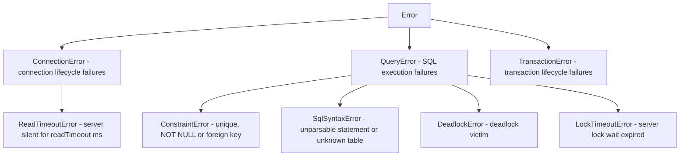

# API Reference

Complete reference for every public export of `cubrid-client`.

---

## Table of Contents

- [createClient()](#createclient)
- [CubridClient](#cubridclient)
- [createPool()](#createpool)
- [CubridPool](#cubridpool)
- [CubridTransaction](#cubridtransaction)
- [Query helpers: escapeIdentifier() and buildWhere()](#query-helpers-escapeidentifier-and-buildwhere)
- [Error Classes](#error-classes)
  - [ConnectionError](#connectionerror)
  - [QueryError](#queryerror)
  - [TransactionError](#transactionerror)
  - [ReadTimeoutError](#readtimeouterror)
  - [Error details](#error-details)
- [Types](#types)
  - [ClientOptions](#clientoptions)
  - [ClientConfig](#clientconfig)
  - [ConnectionFactory](#connectionfactory)
  - [ConnectionLike](#connectionlike)
  - [Queryable](#queryable)
  - [Executable](#executable)
  - [ExecutableTransactionClient](#executabletransactionclient)
  - [Streamable](#streamable)
  - [StreamOptions](#streamoptions)
  - [QueryOptions](#queryoptions)
  - [ArrayRowOptions and ArrayStreamOptions](#arrayrowoptions-and-arraystreamoptions)
  - [ExecuteOptions](#executeoptions)
  - [PreparedQueryable](#preparedqueryable)
  - [PreparedTransactionClient](#preparedtransactionclient)
  - [BatchExecutable](#batchexecutable)
  - [BatchTransactionClient](#batchtransactionclient)
  - [ExecuteResult](#executeresult)
  - [ExecuteManyResult](#executemanyresult)
  - [TransactionClient](#transactionclient-interface)
  - [TransactionCallback](#transactioncallback)
  - [ResultTransactionClient](#resulttransactionclient)
  - [QueryParam](#queryparam)
  - [QueryParams](#queryparams)
  - [zoned() and ZonedParam](#zoned-and-zonedparam)
  - [blob() and clob()](#blob-and-clob)
  - [LobParam, BlobSource and ClobSource](#lobparam-blobsource-and-clobsource)
  - [PreparedQueryParam](#preparedqueryparam)
  - [QueryResultRow](#queryresultrow)
  - [QueryResult](#queryresult)
  - [ArrayQueryResult](#arrayqueryresult)
  - [ArrayRowQueryable](#arrayrowqueryable)
  - [ColumnInfo](#columninfo)
  - [Schema introspection types](#schema-introspection-types)
  - [PoolOptions, PoolStats and PoolConnection](#pooloptions-poolstats-and-poolconnection)

---

## createClient()

Factory function that creates a new `CubridClient` instance.

### Signature

```ts
function createClient(options: ClientOptions): CubridClient;
```

### Parameters

| Parameter | Type | Description |
|-----------|------|-------------|
| `options` | [`ClientOptions`](#clientoptions) | Connection and behavior configuration |

### Returns

A new [`CubridClient`](#cubridclient) instance. The connection is **not** opened immediately — it is established lazily on the first `query()` or `transaction()` call.

### Example

```ts
import { createClient } from "cubrid-client";

const db = createClient({
  host: "localhost",
  port: 33000,
  database: "demodb",
  user: "dba",
  password: "",
});

// Connection opens automatically on first query
const rows = await db.query("SELECT * FROM athlete LIMIT 5");
console.log(rows);

await db.close();
```

### How It Works

1. `options` are normalized into a full `ClientConfig` (defaults applied for `port`, `password`).
2. A `connectionFactory` is resolved — either from `options.connectionFactory` or the built-in `NativeCubridAdapter`.
3. A `CubridClient` is returned with lazy connection initialization.

---

## CubridClient

The main client class. Manages a shared connection for non-transactional queries and creates isolated connections for transactions.

```ts
class CubridClient implements Queryable, Executable
```

### Connection Model

- **Non-transactional queries** reuse a single shared connection (created lazily on first use).
- **Transactions** allocate a dedicated isolated connection via the `connectionFactory`, ensuring transaction isolation. The isolated connection is closed automatically when the transaction completes.

### Methods

#### `query<T>(sql, params?)`

Executes a SQL statement and returns typed result rows.

```ts
async query<T extends QueryResultRow = QueryResultRow>(
  sql: string,
  params?: QueryParams,
  options?: QueryOptions,
): Promise<T[]>
```

| Parameter | Type | Default | Description |
|-----------|------|---------|-------------|
| `sql` | `string` | — | SQL statement. Use `?` for parameter placeholders. |
| `params` | [`QueryParams`](#queryparams) | `undefined` | Positional parameter values |
| `options` | [`QueryOptions`](#queryoptions) | `undefined` | `signal` and a per-statement `readTimeout`. See [Cancelling one statement](#cancelling-one-statement) |

**Returns:** `Promise<T[]>` — Array of result rows typed as `T`.

**Throws:** [`QueryError`](#queryerror) if execution fails, or if a value is [refused](TYPES.md#sending-javascript-parameters), or the number of values differs from the SQL's `?` markers, before anything is sent. A `RangeError` or `TypeError` for an invalid option, [`ReadTimeoutError`](#readtimeouterror) after `readTimeout`, and `signal.reason`, unchanged, after an abort.

**Type Parameter:** `T` defaults to `QueryResultRow` (`Record<string, unknown>`). Pass a custom type for typed results.

Queries issued at the same time, for example with `Promise.all`, run one at a time in the order issued and each returns exactly its own rows. See [Concurrent Statements on One Connection](CONNECTION.md#concurrent-statements-on-one-connection).

BLOB columns return a complete `Buffer` and CLOB columns a complete `string`, loaded before the promise settles and bounded by [`maxLobBytes`](#clientoptions). See [BLOB and CLOB columns](TYPES.md#blob-and-clob-columns).

##### Examples

```ts
// Untyped query — rows are Record<string, unknown>[]
const rows = await db.query("SELECT * FROM athlete LIMIT 10");

// Typed query — rows are User[]
type User = { id: number; name: string; email: string };
const users = await db.query<User>(
  "SELECT id, name, email FROM users WHERE active = ?",
  [true],
);
console.log(users[0].name); // TypeScript knows this is a string

// Parameterized INSERT
await db.query(
  "INSERT INTO users (name, email) VALUES (?, ?)",
  ["Alice", "alice@example.com"],
);

// DDL statements return an empty array
await db.query("CREATE TABLE IF NOT EXISTS logs (id INT AUTO_INCREMENT, msg VARCHAR(200))");
```

> **Note:** DDL and DML statements (`INSERT`, `UPDATE`, `DELETE`, `CREATE`, `DROP`, `ALTER`, etc.) are handled without a fetch phase. `query()` returns an empty array `[]` for them; call [`execute()`](#executesql-params) instead to get the affected row count and generated id.

---

#### `queryResult<T>(sql, params?)`

Executes a SQL statement like `query()` and returns its rows together with the metadata of the columns that produced them.

```ts
async queryResult<T extends QueryResultRow = QueryResultRow>(
  sql: string,
  params?: QueryParams,
  options?: QueryOptions,
): Promise<QueryResult<T>>
```

**Returns:** a [`QueryResult<T>`](#queryresult): `rows` is exactly what `query<T>()` returns, and `columns` describes every select-list column in order. `query()` itself is unchanged and still returns `T[]`. With `rowMode: "array"` it returns an [`ArrayQueryResult<T>`](#arrayqueryresult) instead; see [Array rows](#array-rows-rowmode-array).

**Throws:** [`QueryError`](#queryerror) if execution fails or a value is [refused](TYPES.md#sending-javascript-parameters), or the number of values differs from the SQL's `?` markers, before anything is sent, including when a custom `connectionFactory` connection has no `queryResult()` method.

```ts
const { rows, columns } = await db.queryResult(
  "SELECT a.id, b.id, a.note FROM a JOIN b ON a.id = b.a_id",
);
// columns: [
//   { name: "id", type: "INT", precision: 10, scale: 0, nullable: false },
//   { name: "id", type: "INT", precision: 10, scale: 0, nullable: false },
//   { name: "note", type: "VARCHAR", precision: 100, scale: 0, nullable: true },
// ]
```

#### Array rows: `rowMode: "array"`

A row object holds one value per column **name**, so `SELECT t1.id, t2.id` keeps only the second `id` (see [QueryResult](#queryresult)). Pass `{ rowMode: "array" }` as the options to get each row as an array of its values in select-list order instead. Every column keeps its own value, whatever its name: repeated, differing only in case, or `__proto__`.

```ts
const { rows, columns } = await db.queryResult(
  "SELECT t1.id, t2.id, t1.label FROM t1 LEFT JOIN t2 ON t2.t1_id = t1.id",
  undefined,
  { rowMode: "array" },
);
// columns.map((c) => c.name): ["id", "id", "label"]
// rows: [[1, 10, "one"], [3, null, null]]

const pairs = await db.query<[number, number | null]>(
  "SELECT t1.id, t2.id FROM t1 LEFT JOIN t2 ON t2.t1_id = t1.id",
  [],
  { rowMode: "array", signal: AbortSignal.timeout(5000) },
);
```

| Method | `rowMode: "array"` returns |
|--------|----------------------------|
| `query<T>()`, `queryPrepared<T>()` | `Promise<T[]>`, `T` an array type, `unknown[]` by default |
| `queryResult<T>()`, `queryResultPrepared<T>()` | `Promise<ArrayQueryResult<T>>`: `columns[i]` describes index `i` of every row |
| `stream<T>()` | `AsyncGenerator<T>` yielding one array per row |

- **Where.** On `CubridClient`, `CubridPool`, a pool connection, the `tx` of `transaction()` (client and pool), a [transaction scope](#begintransactionscopeoptions), `CubridTransaction` and `NativeCubridAdapter`. `execute()`, `executePrepared()` and `executeMany()` return no rows and do not declare it; at runtime they check its value like any other option and otherwise ignore it. It is a per-statement option: there is no client-wide setting, because the row type of every `query<T>()` would then depend on how the client was created.
- **Object mode is the default and is unchanged.** Leave `rowMode` out for rows keyed by name. Any other value than `"object"` or `"array"` rejects with a `TypeError` before anything is sent.
- **Values are the same as in object mode**: the same types, NULL as `null`, BLOB as `Buffer` and CLOB as `string`, loaded under `maxLobBytes`. In array mode **every** LOB column is read and counts towards the limit, including one whose name repeats; in object mode the LOB of a column that a later same-named column replaces is not read.
- **Streams** yield arrays and report no column names. When you need them, use `queryResult()` with `rowMode: "array"`, or alias the columns.
- **Types.** `T` describes a row, for example `[number, string | null]` or `readonly [number]`, and as with object rows it is not checked at runtime. `query<MyRowObject>(sql, params, { rowMode: "array" })` does not compile.
- **Custom connections.** A `connectionFactory` connection receives `rowMode` in its options. When it returns rows that are not arrays, the statement rejects with `Underlying connection does not support rowMode "array".` as its cause: a `QueryError`, or a `TransactionError` inside a transaction. A result with no rows cannot be wrong and is returned.

**TypeScript limits.** Array mode is typed by an overload placed before the existing signature, which is unchanged, so 1.x code compiles and resolves as before:

- Pass the options as a literal or as a value typed [`ArrayRowOptions`](#arrayrowoptions-and-arraystreamoptions) (or written `as const`). In an untyped variable, `rowMode` widens to `string`: `{ rowMode: "array" }` alone does not compile, but with another option, such as `{ rowMode: "array", readTimeout: 5000 }`, it matches the object signature, and the rows, arrays at runtime, are typed as objects.
- `rowMode: "object"` written out does not compile; leave it out. It is accepted at runtime.
- A value typed `{ rowMode?: "object" | "array" }` matches the object signature, so its rows are typed as objects even when they are arrays. Choose the mode where you call.
- Through a union with an interface you can implement, such as `CubridClient | TransactionClient` or `Queryable`, only object mode is offered.

**In 1.x without array mode,** alias the columns: `SELECT t1.id AS t1_id, t2.id AS t2_id`. See the [migration notes](API_STABILITY.md#array-rows).

#### `execute(sql, params?)`

Runs a statement and returns how many rows it changed and, after an `INSERT`, the generated `AUTO_INCREMENT` value, instead of rows. Use it for `INSERT`, `UPDATE`, `DELETE`, `MERGE` and DDL; use [`query()`](#queryt-sql-params) for `SELECT`. `query()` is unchanged and still returns `[]` for those statements.

```ts
async execute(sql: string, params?: QueryParams, options?: ExecuteOptions): Promise<ExecuteResult>
```

`options` is a [`QueryOptions`](#queryoptions) with one more field, `generatedKeys`: see [Generated ids](#generated-ids).

**Returns:** [`ExecuteResult`](#executeresult) `{ affectedRows, lastInsertId? }`.

**Throws:** [`QueryError`](#queryerror) if execution fails, if a value is [refused](TYPES.md#sending-javascript-parameters), or the number of values differs from the SQL's `?` markers, before anything is sent, or if the connection returned by a custom `connectionFactory` has no `execute()` method.

```ts
const created = await db.execute("INSERT INTO users (name) VALUES (?)", ["Alice"]);
console.log(created); // { affectedRows: 1, lastInsertId: 1 }

const updated = await db.execute("UPDATE users SET name = ? WHERE id = ?", ["Alicia", 1]);
console.log(updated.affectedRows); // 1, or 0 when no row matched
```

What the server reports, checked on CUBRID 10.2, 11.0, 11.2 and 11.4 (the replies are byte for byte identical):

- `affectedRows` is the server's count for `INSERT`, `UPDATE`, `DELETE` and `MERGE`, and 0 for DDL and `SELECT`. A multi-statement string (`"INSERT ...; INSERT ..."`) reports the sum over its statements. `REPLACE` over an existing row counts the deleted row and the inserted one (2).
- `lastInsertId`: see [Generated ids](#generated-ids) below.
- In autocommit mode `execute()` sends the statement without the autocommit flag, reads the value, then commits with a separate `END_TRAN` request (rolling back if anything failed), because the CAS may go to another client once the statement commits and the value stays with the session. The statement is committed before `execute()` resolves, as with `query()`, at the cost of one more round trip. Inside a transaction nothing is committed until you commit.
- Statements issued at the same time still run one at a time, in the order issued, whether they use `query()` or `execute()`.

##### Generated ids

`lastInsertId` is optional. It is never guessed: when `execute()` cannot be sure the value belongs to the statement, it leaves it out, and you read the key back yourself. There are two ways to get it, checked on CUBRID 10.2, 11.0, 11.2 and 11.4.

**Default: the session's last insert id.** After an `INSERT` the server keeps its last generated `AUTO_INCREMENT` value for the whole [session](CONNECTION.md#session-reuse), through `COMMIT`, `ROLLBACK` and failed statements, and reports it again after an `INSERT` into a table without `AUTO_INCREMENT`. So `execute()` reads that value (`GET_LAST_INSERT_ID`) before and after the statement and reports it only when it changed. `lastInsertId` is set only when all of these hold:

- The SQL is one `INSERT` or `REPLACE` with `VALUES`, `SET` or `DEFAULT VALUES`, and its text calls nothing: no `SELECT` and no `name(...)` apart from the column list and `VALUES (...)`. A stored function can insert into another table and leave that table's id as the session's value, and built-in functions such as `NOW()` are refused too, because a name alone cannot tell them apart. `?` markers are fine.
- The value after the statement differs from the one just before it.

So `lastInsertId` is **undefined** for:

- an `INSERT` into a table without `AUTO_INCREMENT`, or one that supplies the key itself;
- an `INSERT` that generates the same number the session already held, such as tables `A` and `B` that both generate `1`, one after the other: `A` reports `1`, `B` none;
- `INSERT ... SELECT`, an `INSERT` whose values call any function, and a multi-statement string;
- `UPDATE`, `DELETE`, `MERGE`, `CALL` and DDL.

A multi-row `INSERT` reports the **first** id it generated. One case the client cannot see: a trigger on the table that calls a stored procedure or function which itself inserts into an `AUTO_INCREMENT` table can leave **that** id as the session's value (seen with PL/CSQL on 11.4). The same can happen through a view whose `WITH CHECK OPTION` condition calls such a function. Do not rely on the default `lastInsertId` for such a table or view.

Cost: one `GET_LAST_INSERT_ID` request after the statement, and one more before it unless the previous statement on the session was an `execute()` `INSERT` of this kind. An `INSERT` that cannot report an id costs nothing extra.

**`{ generatedKeys: true }`: the statement's own keys.** The statement is sent with the `RETURN_GENERATED_KEYS` execute flag and `execute()` then asks its handle for the keys it generated (`GET_GENERATED_KEYS`, what JDBC's `RETURN_GENERATED_KEYS` uses), before the handle is released and before `COMMIT`. These belong to the statement alone, so tables that generate the same number, `INSERT ... SELECT` and functions in the values all report the right key, and a supplied key or a table without `AUTO_INCREMENT` reports none. A multi-row `INSERT` or `INSERT ... SELECT` reports the first generated key. `lastInsertId` is undefined for a table with two `AUTO_INCREMENT` columns. The option applies only to SQL that is one `INSERT` or `REPLACE`: for anything else, a multi-statement string included (the server would answer only for its first statement), the flag is not sent and `execute()` behaves as without the option.

```ts
const a = await db.execute("INSERT INTO a (v) VALUES (?)", [1], { generatedKeys: true });
const b = await db.execute("INSERT INTO b (v) VALUES (?)", [1], { generatedKeys: true });
// a.lastInsertId === 1 and b.lastInsertId === 1
```

Cost: one `GET_GENERATED_KEYS` request after the statement, never a request before it. It works with `execute()` and `executePrepared()`, in autocommit mode and in a transaction. If that request fails, `execute()` rejects: in autocommit mode the `INSERT` is rolled back, but inside a transaction its row stays in the transaction, as for any statement whose follow-up request fails, so roll back. The same holds for the default's `GET_LAST_INSERT_ID` request.

On CUBRID 11.0, 11.2 and 11.4 the server can also leave a generated key out: it answers with the inserted row but without its key, or, for a multi-row `INSERT`, with a reply whose column descriptions are missing, and `lastInsertId` is then absent. Live tests saw it mostly on the first `INSERT`s into a table just created or recreated, by another session or by the same one, often enough to matter in tests that recreate tables, and never with a wrong key; 10.2 did not do it. Asking again does not help, so it is not retried.

> **Warning:** on CUBRID 11.0, 11.2 and 11.4 the server rejects an `INSERT` that generates a key when it runs the insert itself on the client side, which it does for a table with an `INSERT` trigger (and for `REPLACE` or `ON DUPLICATE KEY UPDATE` on a table with `DELETE` or `UPDATE` triggers). The statement fails with "Instances of a reusable OID class are non-referable" and changes nothing; it is not retried. 10.2 runs it. JDBC's `RETURN_GENERATED_KEYS` fails the same way. Leave `generatedKeys` off for such tables.

The value is a `number` while it is a safe integer and a `bigint` beyond `Number.MAX_SAFE_INTEGER`, in both modes, so no precision is lost.

**Changed in this release** (both are 1.x behaviour changes in what is reported, not in the types): the default no longer reports an id for a multi-statement string, an `INSERT ... SELECT` or an `INSERT` whose values call a function, and it now reads the session's value again after any other statement, a `SELECT` included, which costs that one request. Before, a `CREATE TABLE ... AS SELECT` into an `AUTO_INCREMENT` column or a `SELECT` of a function that inserts could leave its id to be reported by the next `INSERT` into a table without `AUTO_INCREMENT`, and a function in the values could have its own insert's id reported.

---

#### `queryPrepared<T>(sql, params?)`, `queryResultPrepared<T>(sql, params?)`, `executePrepared(sql, params?)`

Opt-in server-side binding: the same results as `query()`, `queryResult()` and `execute()`, with the values sent as typed binds instead of SQL text.

```ts
async queryPrepared<T extends QueryResultRow = QueryResultRow>(
  sql: string,
  params?: readonly PreparedQueryParam[],
  options?: QueryOptions,
): Promise<T[]>

async queryResultPrepared<T extends QueryResultRow = QueryResultRow>(
  sql: string,
  params?: readonly PreparedQueryParam[],
  options?: QueryOptions,
): Promise<QueryResult<T>>

async executePrepared(
  sql: string,
  params?: readonly PreparedQueryParam[],
  options?: ExecuteOptions,
): Promise<ExecuteResult>
```

**Throws:** [`QueryError`](#queryerror) if execution fails, if a value is refused, if the number of values differs from the statement's markers, or if a custom `connectionFactory` connection does not provide the method. They never fall back to SQL literals. A [`blob()` or `clob()`](#blob-and-clob) stream that was already read, a stream chunk of the wrong type and CLOB content that is not valid UTF-8 reject with a `TypeError`, unwrapped.

```ts
const rows = await db.queryPrepared<{ id: number }>("SELECT id FROM users WHERE name = ?", [name]);
const { affectedRows } = await db.executePrepared("UPDATE users SET name = ? WHERE id = ?", [name, 1]);
```

- **Types.** [Prepared binding](TYPES.md#prepared-binding) lists each JavaScript type, what is refused and how the result can differ from the literal path.
- **Lifecycle.** Each call prepares, executes and releases its own handle, so a handle is never kept between calls or carried to another session. There is no reusable statement object.
- **Autocommit.** The statement runs in a transaction of its own that ends with an explicit commit, or a rollback if anything failed.
- **Cost.** A call takes more round trips than `query()`; see the [measurements](PERFORMANCE.md#prepared-binding). Do not expect it to be faster.
- **BLOB and CLOB content.** A [`blob()` or `clob()`](#blob-and-clob) value is uploaded with LOB_NEW and LOB_WRITE after PREPARE and before EXECUTE, so bad SQL fails before any upload. The content belongs to the statement's transaction: in autocommit mode a failure rolls it back with the statement, and inside a transaction it is committed or rolled back with the transaction. `readTimeout` limits each LOB_NEW and LOB_WRITE reply, and `signal` also stops a wait on a stream source; nothing else limits a source that never yields. The upload holds the connection's turn, so a source must not wait on a statement of the same client or transaction: that statement would wait for the upload forever. See [writing BLOB and CLOB](TYPES.md#writing-blob-and-clob).

```ts
import { blob, clob } from "cubrid-client";

await db.executePrepared("UPDATE docs SET body = ?, notes = ? WHERE id = ?", [
  blob(pdfBytes),
  clob(markdownText),
  1,
]);
```

#### `executeMany(sql, paramSets, options?)`

Runs one `INSERT`, `UPDATE`, `DELETE` or `MERGE` once per parameter set, with [server-side binding](TYPES.md#prepared-binding): one PREPARE, then one EXECUTE_ARRAY request carrying every set, instead of a round trip per set.

```ts
async executeMany(
  sql: string,
  paramSets: readonly QueryParams[],
  options?: QueryOptions,
): Promise<ExecuteManyResult>
```

```ts
const { affectedRows, results } = await db.executeMany(
  "INSERT INTO users (id, name) VALUES (?, ?)",
  [
    [1, "Alice"],
    [2, "Bob"],
  ],
);
// affectedRows: 2, results: [1, 1]
```

**Returns:** [`ExecuteManyResult`](#executemanyresult): `affectedRows`, the rows changed by all sets together, and `results`, the rows each set changed, in the order of `paramSets`. It resolves only when every set ran without error.

**Throws:** [`QueryError`](#queryerror), or a [`TransactionError`](#transactionerror) on `tx` and a transaction scope, when a set fails, when the statement or a value is refused, or when the connection does not provide `executeMany` (a custom `connectionFactory`). It never falls back to one statement per set.

When the server reports one or more sets as failed, the error is the class the first failure has alone (a unique violation is a [`ConstraintError`](#queryerror)), with that failure's `code`, `origin` and `kind`, and a [`batch`](#error-details) property with every set's outcome:

```ts
try {
  await db.executeMany("INSERT INTO users (id, name) VALUES (?, ?)", rows);
} catch (error) {
  if (error instanceof QueryError && error.batch) {
    const [first] = error.batch.failures;
    console.error(`row ${first.index} failed (${first.code}): ${first.message}`);
    // error.batch.rolledBack is true here: nothing was committed.
  }
  throw error;
}
```

What happens in each case:

| Case | On the client (autocommit) | Inside `transaction()` or a scope |
|------|----------------------------|-----------------------------------|
| Every set succeeds | Committed once, after the last set. Resolves | Resolves. The rows are part of the transaction |
| The server reports a set as failed | Nothing is committed: the whole batch is rolled back. Rejects with `batch.rolledBack: true` | Rejects with `batch.rolledBack: false`. The transaction stays open and is left to the caller; see below |
| The server fails the whole request: a deadlock (`-72`) or a server crash, which the CAS never reports per set while autocommit is off, or any error for the request itself | Rolled back. Rejects with that error and no `batch` | As for any statement: after `-72` the server has already rolled back the transaction. Without `batch`, sets of earlier requests of the same call may still be in the transaction, so roll back |
| A value, the SQL text, or sets of different sizes are refused | Nothing is sent | Nothing is sent |
| The statement is a `SELECT`, has no `?` marker, or a set's size is not its marker count | Refused after PREPARE, before any set runs. Rolled back | Refused before any set runs. The transaction is untouched |
| `paramSets` is empty | Resolves `{ affectedRows: 0, results: [] }`, nothing is sent | The same |
| An abort or a `readTimeout` while a request is in flight | Rejects as in [Cancelling one statement](#cancelling-one-statement). The connection is discarded and the server discards the uncommitted batch. Only an abort during the final COMMIT, or the handle release after it, leaves the outcome unknown: the batch may be committed | The transaction is lost, as for any statement |

- **A failed set inside a transaction.** A set fails with its own error, such as a constraint or lock timeout; the server undoes that set's changes, but the sets that succeeded, including any after the failed one in the same request, are still in the open transaction. Roll back to discard them, or commit to keep them. `batch.results` says which sets they are. The `transaction()` callback rolls back if the error escapes it.
- **The server keeps going after a failed set**, within one request: `batch.executed` counts the sets it ran, and `batch.results` holds a count for each set that succeeded and `null` for each that failed or never ran.
- **A failed ROLLBACK** after a failed set in autocommit mode discards the session, so the server drops the batch with it and no later statement can commit it. Statements queued behind it then fail as after a lost connection.
- **Large batches** are split into several EXECUTE_ARRAY requests of about 1 MiB of encoded values each (a larger set goes alone), all on the same prepared handle, session and transaction. After a request with a failed set, the rest are not sent. Every value is encoded and checked when the method is called, so the encoded sets are held until it settles; one request at a time is built from them.
- **Single statement only.** EXECUTE_ARRAY runs only the first statement of `a; b` on CUBRID 10.2 to 11.4 and reports success, so SQL text with anything but comments after a `;` is refused. A trailing `;` is accepted.
- **No retry or replay.** A failed batch is never sent again. [`QueryOptions`](#queryoptions) apply to every request of the call: each EXECUTE_ARRAY, the END_TRAN and the handle release.
- **Types.** The values follow the [prepared binding](TYPES.md#prepared-binding) rules of `executePrepared()`.
- **`lastInsertId`** is not reported. A later `execute()` still reports its own generated id correctly.
- **Cost.** See the [measurements](PERFORMANCE.md#batch-execution).

#### Cancelling one statement

Every statement method of the client, of the `transaction()` callback's `tx` and of a [`beginTransactionScope()`](#begintransactionscopeoptions) handle takes [`QueryOptions`](#queryoptions) as its optional last argument: `query`, `queryResult`, `execute`, `queryPrepared`, `queryResultPrepared`, `executePrepared` and `executeMany`.

```ts
// Give up after 2 seconds, whatever the client's readTimeout.
const rows = await db.query("SELECT * FROM big_report", [], {
  signal: AbortSignal.timeout(2000),
});

// A tighter inactivity limit for this one statement, or 0 for none.
await db.execute("UPDATE stats SET n = n + 1", [], { readTimeout: 500 });
```

What happens depends on where the statement is when the signal aborts:

| When | Result | On the wire and the session |
|------|--------|-----------------------------|
| Already aborted when called | Rejects at once with `signal.reason` | Nothing is sent, and no connection is opened |
| Waiting behind other statements on the connection | Leaves the queue and rejects with `signal.reason` | Nothing is sent. The session and the other statements are unaffected |
| Sent: waiting for its reply, or for any FETCH, LOB_NEW, LOB_WRITE, LOB_READ or END_TRAN of the same statement, or for the next chunk of a [`blob()` or `clob()`](#blob-and-clob) stream it is uploading | Rejects with `signal.reason` as soon as the signal aborts | The CAS socket is discarded, so a late reply can never be read as another request's answer. The statement is never retried or replayed |
| Already settled | Nothing | The abort is ignored |

- **The outcome is unknown after an abort in flight.** The server may still run the statement to its end, and in autocommit mode it may be committed; nothing asks the server to stop it. Verify the outcome before running a statement that is not idempotent again, as after a [`ReadTimeoutError`](#readtimeouterror).
- **Inside a transaction an abort in flight loses the transaction.** Its connection is gone and the server rolls back the uncommitted work. The next statement and `commit()` fail with the existing connection-lost errors (a [`TransactionError`](#transactionerror) on `tx`), and nothing reaches a new session until the transaction is ended. Statements queued behind an aborted one behave as they do after a read timeout: they fail without being sent, and the next statement issued reconnects.
- **The reason is passed on unchanged.** The promise rejects with the exact `signal.reason` (an `AbortError` `DOMException` for `controller.abort()` without a reason, a `TimeoutError` for `AbortSignal.timeout()`), never wrapped in a `QueryError`, and it gains no [`outcomeUnknown`](#unknown-outcomes). `transaction()` itself still wraps an error that its callback rethrows in a `TransactionError`, with the reason as `cause` and `outcomeUnknown: true` when the aborted statement had been sent.
- **`readTimeout`** behaves exactly like [the client's](CONNECTION.md#read-timeout), for this statement and all of its follow-up requests only: an inactivity limit that rejects with `ReadTimeoutError` and discards the socket. `0` means no timeout for this statement, even when the client has one. Time spent waiting behind other statements does not count.
- **Validation.** A `readTimeout` that the client option would refuse rejects with a `RangeError`, and a `signal` that is not an `AbortSignal` (or options that are not an object) with a `TypeError`, before anything is queued or sent.
- The abort listener is removed when the statement settles, so one signal can be passed to any number of statements.
- `stream()` has its own [`signal`](#streamoptions) and does not take `QueryOptions`. `commit()`, `rollback()` and `ping()` take no options.

---

#### `stream<T>(sql, params?, options?)`

Runs a statement and reads its rows one at a time, without holding the whole result in memory.

```ts
stream<T extends QueryResultRow = QueryResultRow>(
  sql: string,
  params?: QueryParams,
  options?: StreamOptions,
): AsyncGenerator<T, void, undefined>
```

| Parameter | Type | Default | Description |
|-----------|------|---------|-------------|
| `sql` | `string` | — | SQL statement. Use `?` for parameter placeholders. |
| `params` | [`QueryParams`](#queryparams) | `undefined` | Positional parameter values |
| `options` | [`StreamOptions`](#streamoptions) | `undefined` | `fetchSize`, `signal` and `consumerTimeout`, and `rowMode: "array"` to read each row as an array ([Array rows](#array-rows-rowmode-array)) |

**Throws:** `RangeError` or `TypeError` at once for an invalid option. Everything else rejects the read that met it: [`QueryError`](#queryerror) for a failed statement or FETCH, or when a value is [refused](TYPES.md#sending-javascript-parameters), or the number of values differs from the SQL's `?` markers, before anything is sent, [`ReadTimeoutError`](#readtimeouterror) after `readTimeout`, and `signal.reason`, unchanged, after an abort. Rows that arrived before a failure are delivered first.

```ts
for await (const row of db.stream<{ id: number }>("SELECT id FROM orders", [], {
  signal: AbortSignal.timeout(60_000),
})) {
  await process(row);
}
```

Nothing is sent until the first read, which queues the statement like any other. A statement that is not a SELECT runs and yields no rows. Only the first statement of a multi-statement string yields rows, as in `query()`.

**Memory.** The driver holds one server reply of rows and sends the next FETCH only when the consumer has read that reply, so a slow consumer slows the server down rather than filling memory. A reply holds about 16 KiB of rows, or one row when a row is larger. Reading 1,000,000 rows (477 MiB of column data) grew the heap by 0.9 MiB, against 560 MiB for `query()`; see [Performance](PERFORMANCE.md#streaming-memory).

**The connection is held until the stream ends.** On CUBRID 10.2 to 11.4 a statement that ends a transaction closes every other cursor on the session, so an open stream [keeps its turn](CONNECTION.md#concurrent-statements-on-one-connection) until its last reply has arrived or it is closed. Statements issued on this client meanwhile wait. Once the last reply has arrived the turn is released, while the consumer may still be reading those rows.

**Do not await a statement of the same client inside the loop.** The statement waits for the stream and the stream waits for the loop, so neither could ever finish. The driver cannot tell that statement from unrelated code on the connection, so it applies a limit: a statement rejects with `kind: "stream-busy"` once the consumer has asked for no row for `consumerTimeout` milliseconds, 5000 by default, while the statement waits. It sends nothing, it has the class it would otherwise fail with, and the stream stays usable.

```ts
// Wrong: rejects with kind "stream-busy" on any result larger than one reply.
for await (const order of db.stream("SELECT id FROM orders")) {
  await db.query("SELECT * FROM lines WHERE order_id = ?", [order.id]);
}

// Right: transaction() has its own connection. So does a second client.
for await (const order of db.stream("SELECT id FROM orders")) {
  await db.transaction((tx) => tx.query("SELECT * FROM lines WHERE order_id = ?", [order.id]));
}
```

That first loop can work on a small result, because the turn is released with the last reply. Do not rely on it. A consumer that pauses for longer than `consumerTimeout` while unrelated code issues statements causes the same rejection; raise the limit, or give streams a client of their own.

**Closing.** `break`, `return` and a throw from the loop body close the stream, and so does a failed read. The query handle is released, and in autocommit mode the transaction the SELECT opened is ended too, because closing the handle alone leaves its table lock held. Inside a transaction opened with [`beginTransaction()`](#begintransaction) the stream takes part in it, and the transaction stays open. Code that drives the iterator by hand must call `return()`; until then later statements get `stream-busy`. [`close()`](#close) ends an open stream, whose next read rejects.

**Aborting.** `signal` stops the stream even while the consumer is not reading: the handle is released and the turn ends at once, and the next read rejects with `signal.reason`, dropping any rows still held. A stream that waits for its turn is never sent. A reply already awaited cannot be interrupted, so the read rejects when it arrives, and `readTimeout` limits that wait. The session stays usable.

**Timeouts.** `readTimeout` applies to each request of the stream and discards the connection like any other read timeout. Time the consumer spends between reads does not count. For a limit on the whole stream use `AbortSignal.timeout()`.

**Errors keep their usual meaning.** A malformed reply drops the session. A `-72` from a FETCH marks the transaction as [rolled back](#error-details) and later statements reject until you acknowledge it. An error from a decoded value or a server error leaves the session usable.

**BLOB and CLOB columns.** `maxLobBytes` applies to **each row**, not to the whole result as in `query()`. Content is read when its row is reached, so a stream holds one row's content at a time and a result larger than the limit can be read in full. A row over the limit rejects when it is reached. See [BLOB and CLOB columns](TYPES.md#blob-and-clob-columns).

**While a stream is open** the server keeps a transaction open for it, in autocommit mode too. Its shared table lock blocks DDL on those tables, and the session keeps its CAS. Keep slow work out of the loop if other clients need them.

`stream()` is not available on the `tx` of a `transaction()` callback. [`TransactionClient`](#transactionclient-interface) is unchanged.

#### `transaction<T>(callback, options?)`

Executes a callback within an isolated transactional connection. Commits on success, rolls back on failure.

```ts
async transaction<T>(
  callback: TransactionCallback<T, ResultTransactionClient & ExecutableTransactionClient & PreparedTransactionClient>,
  options?: TransactionOptions,
): Promise<T>
```

| Parameter | Type | Description |
|-----------|------|-------------|
| `callback` | [`TransactionCallback<T, ResultTransactionClient & ExecutableTransactionClient & PreparedTransactionClient>`](#transactioncallback) | Async function receiving a [`ResultTransactionClient`](#resulttransactionclient) (a [`TransactionClient`](#transactionclient-interface) that also has `queryResult()`) that is also an [`ExecutableTransactionClient`](#executabletransactionclient) (it also has `execute()`). A callback written against `TransactionClient` is still accepted. |
| `options` | [`TransactionOptions`](#transactionoptions) | Optional `isolationLevel` and `lockTimeout` for this transaction only. Each one replaces the client's value, and the shared connection is not affected. They are applied before the transaction begins, so they cover all of it. See [Isolation Level and Lock Timeout](CONNECTION.md#isolation-level-and-lock-timeout) |

**Returns:** `Promise<T>` — The return value of the callback.

**Throws:** [`TransactionError`](#transactionerror) if the transaction fails, with the first failure in `cause`. See the [transaction lifecycle](#transaction-lifecycle) for the exceptions. An invalid option rejects with a `RangeError` before any connection is opened. A setting the connection cannot apply rejects with a `TransactionError` before the callback runs.

##### How It Works

1. A **new isolated connection** is created via `connectionFactory`.
2. The `isolationLevel` and `lockTimeout` in effect are applied to it, if any.
3. `beginTransaction()` is called on that connection.
4. The `callback` receives a [`CubridTransaction`](#cubridtransaction) instance scoped to that connection.
5. If the callback resolves successfully and has not completed the transaction itself, `commit()` is called once.
6. If the callback throws, `rollback()` is called once unless the transaction is already complete, and the error is re-thrown as a `TransactionError` (a [`ReadTimeoutError`](#readtimeouterror) is re-thrown as-is).
7. The isolated connection is **always closed**, regardless of outcome.

##### Transaction lifecycle

A callback transaction has exactly one terminal outcome. Before `commit()` or `rollback()` is sent, the client waits for queries that are still running, so the end of the transaction is the last thing sent on its connection. If such a query never settles and no `readTimeout` is set, the transaction waits with it.

| The callback... | Server sees | `transaction()` |
|---|---|---|
| Resolves | One commit | Resolves with its value |
| Throws | One rollback | Rejects, `cause` is the callback's error |
| Resolves, then the commit fails | One commit, then one rollback | Rejects, `cause` is the commit error |
| Resolves after a statement failed that nothing [observed](#observed-and-unobserved-statement-failures), whenever the failure arrived | One rollback, never a commit | Rejects, `cause` is the statement's error |
| Calls `tx.commit()` and resolves | One commit | Resolves with its value |
| Calls `tx.rollback()` and resolves | One rollback | Resolves with its value |
| Calls `tx.commit()` and then throws | One commit, **no rollback: the work stays committed** | Rejects, `cause` is the callback's error |
| Calls `tx.rollback()` and then throws | One rollback | Rejects, `cause` is the callback's error |
| Calls `tx.commit()`, it fails, and the callback resolves anyway | One commit, then one rollback | Rejects, `cause` is the commit error |
| Calls `tx.rollback()`, it fails, and the callback resolves anyway | One rollback, never a commit | Rejects, `cause` is the rollback error |

`beginTransaction()` failing skips the callback, and no commit or rollback is sent because no transaction started. `transaction()` rejects with that failure as `cause`.

##### Observed and unobserved statement failures

These rules apply to every statement method of `tx`: `query()`, `queryResult()`, `execute()`, the prepared methods and `executeMany()`. **A failed statement stops the commit only if nothing observed it.** A statement is observed when a rejection handler is attached to the promise it returned, directly or further down a chain of `.then(onFulfilled)` calls. `await` (including `try`/`catch` around it), `.catch()`, `.then(onFulfilled, onRejected)`, `.finally()`, `Promise.all()`, `Promise.allSettled()`, `Promise.race()`, `Promise.any()`, `Promise.resolve()` and returning the promise from an async function all attach one. What counts is whether code attached a handler, not when the failure arrived, so the outcome is the same whether the server replies before the callback returns or after ([ADR 0009](adr/0009-unobserved-statement-failures-roll-back.md)).

| In the callback | Server sees | `transaction()` |
|---|---|---|
| A failed statement awaited and caught, then more work | One commit | Resolves |
| `await Promise.allSettled([...])` with a failed statement | One commit | Resolves |
| `tx.query(sql).catch(handler)` that fails, not awaited | One commit (if the handler sends statements, see below) | Resolves |
| `void tx.query(sql)` that fails | One rollback | Rejects, `cause` is the statement's error |
| A statement promise kept but never touched, that fails | One rollback | Rejects, `cause` is the statement's error |
| `tx.query(sql).then(f)` that fails, with no rejection handler further down | One rollback | Rejects; Node.js also reports the derived promise's rejection |
| A statement still running when the callback returns | The client waits for it, then decides as in the rows above | As above |
| The callback throws after an unobserved failure | One rollback | Rejects, `cause` is the callback's error |
| `tx.commit()` after an unobserved failure | One rollback; `tx.commit()` rejects with the statement's error | Rejects |

- The client sends COMMIT or ROLLBACK only after every statement of the transaction settled, so the end of the transaction is always the last thing sent on its connection. If such a statement never settles and no `readTimeout` is set, the transaction waits with it.
- An unobserved failure is reported by `transaction()` (or by `tx.commit()`), so it never also raises an unhandled rejection. If several statements failed unobserved, the `cause` is the first one issued, whichever failed first.
- Observing a failure is the decision to carry on. CUBRID keeps the transaction open after a failed statement, with the earlier statements intact, so the rest commits. To undo everything instead, rethrow inside the callback or call `tx.rollback()`. The client does not judge what a handler does: `.finally()`, a `Promise.all()` or `Promise.race()` left unhandled, and a fire-and-forget `(async () => { await tx.query(sql) })()` all count as observed, so the rest commits and Node.js reports the derived promise's rejection, which ends the process under its default settings.
- Observation goes through the promise's own `then()`. Code that calls `Promise.prototype.then.call(promise, ...)` directly bypasses it, so such a failure counts as unobserved and rolls back.
- After a `-72` deadlock or a lost connection the built-in adapter refuses the commit whether or not the failure was observed, because the server has already ended the transaction.

**Work that runs after the callback returned** is outside the guarantee that the outcome does not depend on timing. A statement issued from such code, for example a fallback sent from a detached `.catch()`, is sent if it comes before the callback returns and refused if it comes after, depending on when replies arrive. As a best effort, when a handler attached directly to a statement the commit was waiting for issues it, the commit is refused as well and the transaction rolls back rather than committing the rest without it; a statement issued further down a chain, or after another `await`, comes after the decision and is merely refused. Send every statement from the callback itself and await it.

During a rollback, a statement that fails changes nothing: the work is being discarded anyway and the original failure stays as `cause`.

**Use after completion.** Once `commit()` or `rollback()` has been called, every later `tx.query()`, `tx.queryResult()`, `tx.execute()`, `tx.commit()` and `tx.rollback()` rejects with a `TransactionError` and sends nothing to the server, including from a `tx` kept after `transaction()` settled. After an explicit `tx.commit()` such a statement does not change the commit. While the client commits on behalf of a callback that already returned, it refuses the commit too, as described under [work that runs after the callback returned](#observed-and-unobserved-statement-failures). Only the first completion counts: a failed `commit()` or `rollback()` is not retried.

**Failures during cleanup.** A rollback or close failure never replaces the original failure. `cause` keeps the original, and the later failures are on [`rollbackError`](#transactionerror) and `closeError`. Closing the connection ends the server session, so uncommitted work is discarded even when the rollback failed. There are two cases to check:

- A [`ReadTimeoutError`](#readtimeouterror) is re-thrown unchanged, so later rollback and close failures are not reported on it.
- If the commit succeeded and only the close failed, `transaction()` rejects with the close error, as it always has: a `ConnectionError` from the built-in adapter, not a `TransactionError`. **The work is committed**, so do not retry it blindly.

##### Examples

```ts
// Simple transaction
await db.transaction(async (tx) => {
  await tx.query("INSERT INTO accounts (owner, balance) VALUES (?, ?)", ["Alice", 1000]);
  await tx.query("INSERT INTO accounts (owner, balance) VALUES (?, ?)", ["Bob", 500]);
});

// Transaction with return value
const newId = await db.transaction(async (tx) => {
  await tx.query(
    "INSERT INTO orders (customer, total) VALUES (?, ?)",
    ["Alice", 99.99],
  );
  const rows = await tx.query<{ id: number }>(
    "SELECT LAST_INSERT_ID() AS id",
  );
  return rows[0].id;
});
console.log(`Created order #${newId}`);

// Error handling — automatic rollback
try {
  await db.transaction(async (tx) => {
    await tx.query("UPDATE accounts SET balance = balance - 100 WHERE owner = ?", ["Alice"]);
    await tx.query("UPDATE accounts SET balance = balance + 100 WHERE owner = ?", ["Bob"]);

    // If this throws, both UPDATEs are rolled back
    const [alice] = await tx.query<{ balance: number }>(
      "SELECT balance FROM accounts WHERE owner = ?",
      ["Alice"],
    );
    if (alice.balance < 0) {
      throw new Error("Insufficient funds");
    }
  });
} catch (error) {
  console.error("Transaction rolled back:", error);
}
```

---

#### `beginTransactionScope(options?)`

Begins a manual transaction on a **dedicated connection** and returns a [`TransactionScope`](#transactionscope) handle that owns it. Use it when the transaction's work cannot be written as one `transaction()` callback, for example when commit is decided elsewhere.

```ts
async beginTransactionScope(options?: TransactionOptions): Promise<TransactionScope>
```

```ts
const tx = await db.beginTransactionScope({ isolationLevel: "serializable" });
try {
  await tx.query("UPDATE accounts SET balance = balance - ? WHERE id = ?", [100, 1]);
  await tx.query("UPDATE accounts SET balance = balance + ? WHERE id = ?", [100, 2]);
  await tx.commit();
} catch (error) {
  await tx.rollback().catch(() => {});
  throw error;
}
```

- Only statements sent through `tx` belong to the transaction. `db.query()` and the other client methods keep using the shared connection in autocommit, so an unrelated caller can never join it, and two scopes never share a connection.
- `options` works as for [`transaction()`](#transactiontcallback-options): client settings apply first, then these, on the new connection before the transaction begins. Invalid options throw a `RangeError` before any connection opens.
- Exactly one `commit()` or `rollback()` ends it, and either one closes its connection. Every later call on `tx`, including a second `commit()`, rejects with a [`TransactionError`](#transactionerror) without reaching the server.
- `commit()` first waits for statements of `tx` still running. If a statement of the scope failed and nothing [observed](#observed-and-unobserved-statement-failures) its promise, whenever it failed, or the COMMIT itself is refused, it rolls back instead and rejects with a `TransactionError`; `rollbackError` and `closeError` are set when those also failed (a `ReadTimeoutError` is passed on unchanged, without them). A failure the caller awaited or otherwise observed is the caller's to handle and does not stop the commit. A connection that fails to close after a successful commit does not turn the commit into a failure, unlike `transaction()`, which rejects with the close error.
- [`close()`](#close) discards every scope that was not ended: it closes the scope's connection, without waiting for its statements still running, and the server rolls back the uncommitted work. Such a statement fails with a connection error, and later calls on `tx` reject with `Transaction was discarded because the client was closed.`
- A failed BEGIN closes the new connection and rejects with `Failed to begin transaction.`; no handle is returned.

**Throws:** `RangeError` for invalid options, [`TransactionError`](#transactionerror) on failure.

---

#### `beginTransaction()`

> **Deprecated.** Use [`beginTransactionScope()`](#begintransactionscopeoptions) or [`transaction()`](#transactiontcallback-options). It is kept, with its behavior unchanged, for all of 1.x.

Manually begins a transaction on the **shared connection**.

**Concurrency limitation:** `beginTransaction()`, ordinary `db.query()`/`db.execute()`, `commit()` and `rollback()` have no caller or ownership token. Packet-level serialization alone cannot distinguish the task that began a manual transaction from an unrelated asynchronous caller. **Any call using the same client during that transaction may become part of it**, including another request's read or write. Sharing one manually transacting client between concurrent requests is therefore unsafe. [`beginTransactionScope()`](#begintransactionscopeoptions) is the replacement with an ownership guarantee ([#112](https://github.com/cubrid-lab/cubrid-client/issues/112)).

```ts
async beginTransaction(): Promise<void>
```

**Throws:** [`TransactionError`](#transactionerror) on failure.

---

#### `commit()`

> **Deprecated** with [`beginTransaction()`](#begintransaction). Use the `commit()` of a [`TransactionScope`](#transactionscope).

Manually commits the current transaction on the shared connection.

```ts
async commit(): Promise<void>
```

**Throws:** [`TransactionError`](#transactionerror) on failure.

---

#### `rollback()`

> **Deprecated** with [`beginTransaction()`](#begintransaction). Use the `rollback()` of a [`TransactionScope`](#transactionscope).

Manually rolls back the current transaction on the shared connection.

```ts
async rollback(): Promise<void>
```

**Throws:** [`TransactionError`](#transactionerror) on failure.

---

#### `ping()`

Checks that the connection and its database server are alive, and returns the server version. It opens the shared connection if needed.

```ts
async ping(): Promise<string>
```

Inside a manual transaction a ping leaves the transaction open: the work before it can still be committed or rolled back. Outside a transaction it sends a commit, which ends the session's empty transaction and closes nothing the client still needs, because statements on one connection run [one at a time](CONNECTION.md#concurrent-statements-on-one-connection).

**Returns:** The server version, for example `11.4.6.1963`.

**Throws:** [`ConnectionError`](#connectionerror) if the health check fails. If it fails inside a transaction, treat that transaction as lost.

---

#### `getServerVersion()`

Returns the CUBRID server version. It opens the shared connection if needed.

```ts
async getServerVersion(): Promise<string>
```

It sends the same requests as [`ping()`](#ping), so it has the same effect on a transaction: inside a manual transaction it leaves the transaction open, and outside one it commits the session's empty transaction. It performs no caching, so it reports the server the shared connection is currently attached to, after any reconnect. Use it for compatibility checks; use `ping()` for health checks.

**Returns:** The version string as the server reports it, without a trailing NUL, for example `11.4.6.1963`. It is not parsed or normalized.

**Throws:** [`ConnectionError`](#connectionerror) if the request fails or if a custom `connectionFactory` connection has no `ping()` method (see [`ConnectionLike`](#connectionlike)). Inside a transaction, treat a failure as a lost transaction. The `debug` log entry for this call has `operation: "ping"`.

---

#### Schema introspection: `getTables()`, `getColumns()`, `getPrimaryKey()`, `getIndexes()`

Read-only, typed metadata for tables, views, columns, primary keys and indexes.

```ts
getTables(options?: SchemaOptions): Promise<SchemaTable[]>
getColumns(table: string, options?: SchemaOptions): Promise<SchemaColumn[]>
getPrimaryKey(table: string, options?: SchemaOptions): Promise<SchemaPrimaryKey | null>
getIndexes(table: string, options?: SchemaOptions): Promise<SchemaIndex[]>
```

See [Schema introspection types](#schema-introspection-types) for the result shapes. The methods are on `CubridClient` only; `TransactionClient` and the `tx` of `transaction()` do not have them. Inside a manual transaction started with `beginTransaction()` they run in that transaction like `query()`.

- **How it reads.** They run bound `SELECT` statements over the catalog views `db_class`, `db_attribute`, `db_index` and `db_index_key`, not the CAS `SCHEMA_INFO` request. The views return the same columns on CUBRID 10.2, 11.0, 11.2 and 11.4, and a catalog query needs no result handle to consume or close. `getColumns`, `getPrimaryKey` and `getIndexes` send a first query to find the table, so each call takes two or three round trips and the answer is not one atomic snapshot if other sessions change the schema meanwhile.
- **Names.** Pass the bare table name, without quotes or brackets. CUBRID stores identifiers in lower case whatever case or quoting the `CREATE` used (`CREATE TABLE "MixedCase"` creates `mixedcase`), so names are matched without regard to case. Quote characters are not stripped: `"mixedcase"` finds nothing. A name with spaces or other characters is taken literally. Names are only ever sent as bound parameters, never joined into SQL text.
- **Schema.** CUBRID calls the owner of a table its schema. `SchemaOptions.schema` selects one owner, without regard to case. Since CUBRID 11.2 two users may own a table with the same name; if the name is ambiguous and `schema` is omitted, the call rejects with a `QueryError` that lists the owners. Before 11.2 a table name is unique, so `schema` only has to match the owner (`CREATE TABLE other_user.t` there still creates a table owned by the creator).
- **Permissions.** The catalog views list only what the connected user may `SELECT`, and the server returns no error for the rest. `getTables()` leaves an inaccessible table out, and `getColumns()`, `getPrimaryKey()` and `getIndexes()` reject with a `QueryError` whose message says the table "was not found, or the connected user may not SELECT from it": the two cases cannot be told apart. A failure of the catalog query itself, such as a lost connection, is mapped like any `query()` failure.
- **Scope.** System classes (`db_class`, `_db_class`, ...) are not listed by `getTables()`. Foreign keys appear as indexes (`foreignKey: true`) without their referenced table. Auto-increment, comments, partitions, triggers, collection element types, schema diffing and DDL generation are not included.

**Throws:** `TypeError` for an empty `table` or `schema`. [`QueryError`](#queryerror) for an unknown, inaccessible or ambiguous table, or when the catalog query fails (the same mapping as `query()`, so a lost connection is reported as for `query()`).

```ts
const tables = await db.getTables(); // [{ name: "athlete", schema: "DBA", type: "table" }, ...]
const columns = await db.getColumns("athlete");
const pk = await db.getPrimaryKey("athlete"); // { name: "pk_athlete_code", columns: ["code"] }
const indexes = await db.getIndexes("athlete", { schema: "dba" });
```

---

#### `close()`

Closes the shared connection after statements and multi-query schema inspections started before it have finished. After calling `close()`, the client can no longer execute queries: a `query()`, `queryResult()`, `execute()`, `ping()`, `getServerVersion()`, `getTables()`, `getColumns()`, `getPrimaryKey()`, `getIndexes()`, `transaction()`, `beginTransactionScope()`, `beginTransaction()`, `commit()` or `rollback()` issued after `close()` is called, even in the same tick, rejects with an error whose `cause` is `Client is closed.`, and no connection is opened. A [`TransactionScope`](#transactionscope) not yet ended is discarded: its connection is closed, concurrently with the shared one and without waiting for its running statements, and the server rolls its work back; later calls on it reject. `close()` resolves once those connections are closed, including the one of a `beginTransactionScope()` still opening. If no connection was opened, closing it is a no-op.

`transaction()` calls made before `close()` are tracked from the moment they are called (#246):

| When `close()` is called, the `transaction()` is | Outcome | `close()` |
|------|---------|-----------|
| Opening its connection (`connectionFactory` running) | Nothing is sent on the connection once it opens: it is closed, the callback never runs, and `transaction()` rejects with a `TransactionError` whose `cause` is `Client is closed.` | Waits for that connection to open and close |
| Applying its options or sending BEGIN | The callback never runs. The transaction is rolled back, its connection closed, and `transaction()` rejects as above | Waits for the rollback and the connection close |
| Running its callback, including a statement in flight | The callback runs to its end on its own connection, which stays usable; it commits or rolls back as it would have | Waits for the callback, its COMMIT or ROLLBACK and its connection close |
| In an explicit `tx.commit()` or `tx.rollback()` | Completes | Waits for it and the connection close |

So `close()` never resolves before such a transaction's outcome is decided, and no COMMIT is sent after it resolves. A callback's failure, rollback failure (`rollbackError`) and close failure (`closeError`) reach the `transaction()` caller, not `close()`. Callbacks are waited for alongside the shared connection's close and the scope discards, never before them, because a callback statement may be waiting for a lock that one of them holds.

Calling `close()` again, while it runs or after, returns the same promise. A failed `close()` is therefore not retried: it rejects again with the same error, and [`destroy()`](#destroy) is the way to release what is left. Once `destroy()` has run, `close()` resolves.

A `close()` awaited inside a running `transaction()` callback closes the shared connection and the scopes as usual but waits for no `transaction()` callback: it would wait for its own, and two callbacks closing the client would wait for each other. Those callbacks, its own included, then commit or roll back after that `close()` resolved, each on its own connection. A `close()` called outside every callback, even later, still waits for all of them, and so does one made from a timer or promise chain a callback started, once that callback has returned. While the callback is still running, such a call counts as inside it.

```ts
close(): Promise<void>
```

**Throws:** [`ConnectionError`](#connectionerror) if closing fails.

`close()` is graceful: with no `readTimeout`, a server that never answers the running statement makes it wait forever, and so does a `transaction()` callback that never returns or a `connectionFactory` that never settles. Use [`destroy()`](#destroy) to stop waiting: a running `close()` then resolves at once. No COMMIT is sent after `destroy()`, so the callbacks it was waiting for fail; a COMMIT already in flight has an unknown outcome.

##### Example

```ts
const db = createClient({ host: "localhost", database: "demodb", user: "dba" });

try {
  const rows = await db.query("SELECT COUNT(*) AS cnt FROM athlete");
  console.log(rows);
} finally {
  await db.close(); // Always close when done
}
```

#### `destroy()`

```ts
async destroy(): Promise<void>
```

Tears down every connection of the client at once, without waiting for anything on them and without sending CON_CLOSE: the shared connection, the connections of [`TransactionScope`](#transactionscope) handles and of running `transaction()` callbacks, including one still connecting, in a broker or TLS handshake or between connect retries. It closes the client as `close()` does, in the same tick, and resolves at once. It never rejects.

| What | Outcome |
|------|---------|
| The statement in flight | Rejects with kind `connection-lost` (a `QueryError`, `TransactionError` or `ConnectionError` as for any lost connection). Its outcome on the server is unknown; it is never retried |
| Statements queued behind it, on that connection | Reject with kind `connection-lost` without being sent |
| A running `close()` | Resolves |
| An open `stream()` | Its next read rejects with kind `connection-lost` |
| A `TransactionScope` not ended | Discarded; later calls on it reject |
| A `transaction()` callback | Its statements reject; no COMMIT is sent, so it rejects with a `TransactionError` |
| Later `destroy()` and `close()` | Resolve |
| Any later statement | Rejects with `cause` `Client is closed.` |

A destroyed connection never opens another session, so no reply that arrives late can answer another request. The server ends each session and rolls back its open transaction once it notices the client is gone; while it is still executing a statement, that can be only when the statement finishes, so locks may be held until then. A connection from a custom `connectionFactory` without a `destroy()` method is closed instead, without waiting for its `close()`. A connection is reached only once the factory has returned it; an async factory still running is destroyed when it returns. See [Destroying a client](CONNECTION.md#destroying-a-client) and [Connection limits](CONNECTION.md#connection-limits).

```ts
const closing = db.close();
const timer = setTimeout(() => void db.destroy(), 5000); // give up after 5 s
try {
  await closing;
} finally {
  clearTimeout(timer);
}
```

---

## createPool()

Creates a [`CubridPool`](#cubridpool): several connections to one database, each
lent to one caller at a time.

```ts
function createPool(options: PoolOptions): CubridPool;
```

`new CubridPool(options)` does the same.

`options` takes every [`ClientOptions`](#clientoptions) field, applied to each
connection the pool opens, and these limits. An invalid value throws a
`RangeError` from `createPool()`; nothing is opened before that.

| Option | Default | Meaning |
|--------|---------|---------|
| `max` | `10` | Most connections at once, counting those still being opened. An integer of at least 1 |
| `min` | `0` | Connections kept open even when idle, opened in the background after `createPool()` and after one is closed. A failure to open one is only logged. An integer from 0 to `max` |
| `acquireTimeoutMs` | `30000` | Longest a caller waits for a connection, then it rejects with a [`ConnectionError`](#connectionerror) of `kind: "pool-timeout"` and nothing is sent. It includes the time to open a connection. The wait does not count towards `readTimeout`. An integer from 1 to 2147483647 |
| `maxWaitingClients` | `Infinity` | Most callers waiting at once. One more rejects at once with `kind: "pool-full"`. A non-negative integer or `Infinity` |
| `idleTimeoutMs` | `30000` | An idle connection is closed after this many milliseconds, never going below `min`. `0` keeps idle connections. An integer from 0 to 2147483647 |
| `maxLifetimeMs` | none | A connection older than this is closed when its lease ends or while it is idle, never during a lease. Each connection's limit is up to 10% shorter, so connections opened together do not all close at once. An integer from 1 to 2147483647 |
| `validateAfterIdleMs` | none | A connection idle at least this long is checked with `ping()` before it is lent; one that fails is closed and the caller gets another. `0` checks before every lease. An integer from 0 to 2147483647 |

```ts
import { createPool } from "cubrid-client";

const pool = createPool({ host: "localhost", database: "demodb", user: "dba", max: 5 });
const rows = await pool.query("SELECT name FROM athlete WHERE code = ?", [10999]);
await pool.close();
```

---

## CubridPool

```ts
class CubridPool
  implements Queryable, ResultQueryable, Executable, PreparedQueryable, BatchExecutable, Streamable
```

### Leases

Every method borrows a connection (a *lease*) and gives it back:

| Method | Holds its connection |
|--------|----------------------|
| `query()`, `queryResult()`, `execute()`, the `Prepared` methods, `executeMany()`, `ping()`, `getServerVersion()` | For that statement |
| `getTables()`, `getColumns()`, `getPrimaryKey()`, `getIndexes()` | For every catalog query of that call |
| `stream()` | From its first read until it ends, breaks or fails |
| `connection(fn, options?)` | Until `fn` settles |
| `transaction(callback, options?)` | Until it commits or rolls back |
| `beginTransactionScope(options?)` | Until `commit()` or `rollback()` |

These methods have the signatures, options and errors of the
[`CubridClient`](#cubridclient) methods of the same name, with three differences:

- A statement waits for a free connection first. `QueryOptions.signal` also
  cancels that wait, which then rejects with `signal.reason`. A failure to lease
  rejects with a [`ConnectionError`](#connectionerror) of `kind` `pool-timeout`,
  `pool-full` or `pool-closed`, or with the failure to open the connection opened
  for that caller; `beginTransactionScope()` wraps it in a `TransactionError` that
  keeps the `kind`, as it does every failure to begin.
- A query awaited inside a `stream()` loop runs on another connection, or waits
  for one, instead of being refused with `stream-busy`. With `max: 1` it waits
  until `acquireTimeoutMs`.
- `executeMany()` runs in autocommit mode on its connection, so a failed batch is
  rolled back, as on the client.

The `Prepared` methods take `blob()` and `clob()` values, as on the client, and
`query()`, `queryResult()`, `execute()` and `stream()` refuse them with a
`TypeError` before leasing a connection.

The deprecated `beginTransaction()`, `commit()` and `rollback()` of the client do
not exist on the pool.

Callers are served in arrival order. A connection released while callers wait goes
straight to the first of them, so a caller arriving later cannot take it first. A
failed open rejects only the caller it was opened for.

### Reuse

A connection goes back to the pool only when its session is clean. It is closed,
never rolled back for reuse, when:

| Reason (`pool.destroy`) | When |
|-------------------------|------|
| `in-transaction` | A transaction is still open on the session, the server ended one the caller did not acknowledge, a rollback failed, or a scope was discarded by `close()` |
| `error` | The session is closed, `transaction()` or `beginTransactionScope()` failed before its transaction began, or a custom `ConnectionLike` (which cannot report its state) had a call fail during the lease |
| `busy` | A statement or stream of the lease is still running, for example one the `connection()` callback did not await |
| `failed-exchange` | A request of the lease has an unknown outcome: a read timeout or an abort while it was on the wire |
| `options` | The `transaction()` or `beginTransactionScope()` options differ from the pool's own `isolationLevel` or `lockTimeout`. They cannot be undone, so set them on the pool instead |
| `lifetime` | The connection is older than `maxLifetimeMs` |

Idle connections are also closed for `idle` (`idleTimeoutMs`), `validation`
(`validateAfterIdleMs`) and `closed` (`close()`). Session variables and other
session state set in autocommit mode stay on a reused connection, **including an
isolation level or lock timeout changed with SQL** such as `SET TRANSACTION
ISOLATION LEVEL`: the pool cannot see it, and the next caller inherits it. Use the
pool's `isolationLevel` and `lockTimeout` options instead. The rule and
its reasons are in [ADR 0008](adr/0008-pool-reuse-invariant.md).

### `connection(fn, options?)`

```ts
connection<T>(fn: (connection: PoolConnection) => Promise<T>, options?: PoolConnectionOptions): Promise<T>
```

Runs `fn` with one connection, in autocommit mode, and releases it when `fn`
settles. The [`PoolConnection`](#pooloptions-poolstats-and-poolconnection) has the
statement methods and `stream()`, but no transaction methods: use
`pool.transaction()`. Every call on it after `fn` settled rejects with a
`ConnectionError` and sends nothing. `options.signal` cancels the wait for the
connection, not the statements of `fn`. As on a client, a statement awaited
inside a `stream()` loop of the same `PoolConnection` waits for the stream and is
refused with `stream-busy`.

```ts
const count = await pool.connection(async (conn) => {
  await conn.execute("INSERT INTO logs (msg) VALUES (?)", ["imported"]);
  return conn.query("SELECT COUNT(*) AS n FROM logs");
});
```

### `stats()`

```ts
stats(): PoolStats // { total, idle, active, pending, waiting }
```

`total` is `idle + active + pending`: open connections nobody holds, connections
held or being checked, and connections being opened. `waiting` is the number of
callers in line. A connection being closed is not counted.

### `close()`

```ts
close(): Promise<void>
```

Stops the pool. In the same tick, every later call and every waiting caller
rejects with `kind: "pool-closed"`. Idle connections are closed. An open stream's
connection is closed, so its next read rejects. Statements, `connection()`
callbacks and `transaction()` callbacks already running finish, and then their
connections are closed. A `transaction()` that has its connection but whose
callback has not started yet, because it is still applying its options or
sending BEGIN, never runs its callback: it is rolled back, its connection is
closed, and it rejects with a `TransactionError` of `kind: "pool-closed"`, as
`CubridClient.transaction()` does. `close()` waits for that rollback and close.
A `connection()` callback that has its connection runs. A `beginTransactionScope()` handle nobody ended is
discarded meanwhile, as `CubridClient.close()` does: its connection is closed and
the server rolls its work back. `close()` resolves when every connection is
closed, including one still being opened. Calling it again, outside every
callback, returns the same promise, which also waits for the callbacks that were
running when `close()` was first called.

A `close()` awaited inside a running `connection()` or `transaction()` callback
closes idle and stream connections, discards scopes and waits for statements as
usual, but waits for no `connection()` or `transaction()` callback: it would wait
for its own, and two callbacks closing the pool would wait for each other (#268).
Those callbacks, its own included, then finish after that `close()` resolved,
each on its own connection, which closes when its callback ends (a
`transaction()` commits or rolls back first). A callback nested in another
counts as inside both. A `close()` called outside every callback, even later,
still waits for all of them, and so does one made from a timer or promise chain
a callback started, once that callback has returned. While the callback is still
running, such a call counts as inside it. "Inside" means called from the
callback's async context, that is, from the callback itself or from code it
started, not merely awaited by it. A `close()` promise created outside the
callback and handed to it counts as outside and waits for that callback, so the
callback must not await it. This is the rule of
[`CubridClient.close()`](#close).

An inside `close()` still waits for statements running on other connections,
including ones started outside every callback. Such a statement may be waiting
for a lock that the closing callback's own transaction holds, and that lock is
released only after `close()` resolves and the callback ends; with no lock
timeout, the two wait for each other. Bound such statements with `readTimeout`
or a `signal`.

`CubridPool` has no `destroy()` in this release: `close()` waits for running
statements, so bound them with `readTimeout` or a `signal`.

### Logging

With the `logger` option the pool also reports, besides every connection's own
events:

| Level | `operation` | Fields |
|-------|-------------|--------|
| `info` | `pool.create`: a connection was opened and set up | `host`, `port`, `database` |
| `info` | `pool.destroy`: a connection was closed | `host`, `port`, `database`, `reason` (see [Reuse](#reuse)) |
| `error` | `pool.acquire-timeout`: a caller waited `acquireTimeoutMs` | `host`, `port`, `database`, `durationMs` |

---

## CubridTransaction

A transaction-scoped client that delegates queries to the isolated transactional connection. You do **not** create this class directly — it is provided to you inside the `transaction()` callback, where it follows the [transaction lifecycle](#transaction-lifecycle).

The exported constructor stays available in 1.x for compatibility. An instance you construct yourself only forwards to the connection you gave it and has no lifecycle guards.

```ts
class CubridTransaction
  implements ResultTransactionClient, ExecutableTransactionClient, PreparedTransactionClient
```

### Methods

#### `query<T>(sql, params?)`

Same signature and behavior as [`CubridClient.query()`](#queryt-sql-params), but executes within the transaction's isolated connection.

```ts
async query<T extends QueryResultRow = QueryResultRow>(
  sql: string,
  params?: QueryParams,
  options?: QueryOptions,
): Promise<T[]>
```

**Throws:** [`TransactionError`](#transactionerror) if execution fails, or if the transaction is already complete.

#### `execute(sql, params?)`

Same signature and behavior as [`CubridClient.execute()`](#executesql-params), but runs within the transaction's isolated connection. Nothing is committed until the transaction commits, and the generated id is the one the server reports inside the open transaction.

```ts
async execute(sql: string, params?: QueryParams, options?: ExecuteOptions): Promise<ExecuteResult>
```

**Throws:** [`TransactionError`](#transactionerror) if execution fails.

#### `queryPrepared<T>(sql, params?)`, `queryResultPrepared<T>(sql, params?)`, `executePrepared(sql, params?)`

Same signatures and behavior as the [`CubridClient` methods](#querypreparedtsql-params-queryresultpreparedtsql-params-executepreparedsql-params), but run within the transaction's isolated connection. Nothing is committed until the transaction is.

**Throws:** [`TransactionError`](#transactionerror) if execution fails, or the `TypeError` of a misused [`blob()` or `clob()`](#blob-and-clob), unwrapped. A callback that rethrows it makes `transaction()` reject with a `TransactionError` whose `cause` it is.

#### `executeMany(sql, paramSets, options?)`

Same signature as [`CubridClient.executeMany()`](#executemanysql-paramsets-options), but runs within the transaction's isolated connection and never commits or rolls back on its own. When a set fails it rejects with a [`TransactionError`](#transactionerror) whose `batch` reports every set, and the sets that succeeded stay in the transaction until you commit or roll back.

**Throws:** [`TransactionError`](#transactionerror) if a set fails or the statement is refused.

#### `commit()`

Commits the transaction. Called automatically by `CubridClient.transaction()` on success, so you only need it to make the work durable before the callback ends. Rejects with a [`TransactionError`](#transactionerror) if the transaction is already complete.

```ts
commit(): Promise<void>
```

#### `rollback()`

Rolls back the transaction. Called automatically by `CubridClient.transaction()` on failure, so you only need it to abandon the work without throwing. Rejects with a [`TransactionError`](#transactionerror) if the transaction is already complete.

```ts
rollback(): Promise<void>
```

---

## Query helpers: escapeIdentifier() and buildWhere()

```ts
function escapeIdentifier(name: string): string;
function buildWhere(conditions: Record<string, unknown>): { clause: string; params: unknown[] };
```

`escapeIdentifier()` quotes `name` as one identifier. A name without `]` is
wrapped in brackets as is, whatever else it contains:

| Name | Result |
|------|--------|
| `users` | `[users]` |
| `` a`b `` | ``[a`b]`` |
| `a"b`, `a b`, `a\b` | `[a"b]`, `[a b]`, `[a\b]` |

A CUBRID bracket identifier ends at the first `]` and has no escape (`[a]]b]` is a
syntax error), so a name that contains `]` is wrapped in backticks instead, with
each backtick in it doubled: `a]b` becomes `` `a]b` `` and ``a]`b`` becomes
``` `a]``b` ```. Brackets and backticks mean the same thing whatever the server's
`ansi_quotes` and `no_backslash_escapes` are; double quotes are not used because
they quote a string when `ansi_quotes=no`.

Whether the server accepts a name with `]` depends on its version. CUBRID 10.2
and 11.0 accept it. CUBRID 11.2 and later refuse `[` and `]` in every
identifier, however it is quoted, with a [`QueryError`](#queryerror) (code
`-493`), so such a column cannot exist there.

`buildWhere()` returns a `WHERE` clause that matches every entry of `conditions`,
joined with `AND`, and the values to pass with it. Each key is quoted with
`escapeIdentifier()`. A `null` value becomes `IS NULL` and adds no value; any
other value becomes `= ?` and is appended to `params`. An empty object returns an
empty clause.

```ts
const { clause, params } = buildWhere({ status: "active", deleted_at: null });
// clause: "WHERE [status] = ? AND [deleted_at] IS NULL", params: ["active"]
await client.query(`SELECT * FROM users ${clause}`, params as QueryParam[]);
```

The values are always passed as parameters, never written into the SQL text.
The client does not count a `?` inside a quoted name as a marker, so a key cannot
move a value to another marker. The broker does count it, though, and refuses the
statement (code `-1007`), so a key with `?` cannot be used.

---

## Error Classes

All errors extend the native `Error` class and use the standard [`ErrorOptions.cause`](https://developer.mozilla.org/en-US/docs/Web/JavaScript/Reference/Global_Objects/Error/cause) property to preserve the original driver error.

### Error Hierarchy



### Common Pattern

```ts
import { ConnectionError, QueryError, TransactionError } from "cubrid-client";

try {
  const rows = await db.query("SELECT * FROM nonexistent_table");
} catch (error) {
  if (error instanceof ConnectionError) {
    console.error("Connection problem:", error.message);
    console.error("Driver error:", error.cause); // Original driver error
  } else if (error instanceof QueryError) {
    console.error("Query failed:", error.message);
    console.error("Driver error:", error.cause);
  } else if (error instanceof TransactionError) {
    console.error("Transaction failed:", error.message);
    console.error("Driver error:", error.cause);
  }
}
```

### ConnectionError

Thrown when the client cannot establish, maintain, or close a connection.

```ts
class ConnectionError extends Error {
  name = "ConnectionError";
  cause?: Error; // Original driver error
}
```

**When thrown:**

| Situation | Example Message |
|-----------|----------------|
| Initial connection fails | `"Failed to connect to CUBRID."` |
| Closing connection fails | `"Failed to close client connection."` |
| Close on adapter fails | `"Failed to close CUBRID connection."` |

### QueryError

Thrown when a SQL statement fails to execute.

```ts
class QueryError extends Error {
  name = "QueryError";
  cause?: Error; // Original driver error
  readonly code?: number; // See "Error details"
  readonly origin?: "server" | "cas";
  readonly sqlState?: string;
  readonly kind?: CubridErrorKind;
  readonly outcomeUnknown?: boolean; // See "Unknown outcomes"
}
```

Outside a transaction, the failures in the table below reject with a subclass of `QueryError`, so `instanceof QueryError` still holds. Its `name` is the subclass name, for example `"ConstraintError"`.

| Class | `kind` |
|-------|--------|
| `ConstraintError` | `unique-violation`, `not-null-violation`, `foreign-key-violation` |
| `SqlSyntaxError` | `syntax` |
| `DeadlockError` | `deadlock` |
| `LockTimeoutError` | `lock-timeout` |

**When thrown:**

| Situation | Example Message |
|-----------|----------------|
| SELECT fails | `"Query failed."` |
| Invalid SQL syntax | `"Failed to execute CUBRID query."` |
| Table does not exist | `"Failed to execute CUBRID query."` |

### TransactionError

Thrown when a transaction operation fails (begin, commit, rollback, or query within a transaction).

```ts
class TransactionError extends Error {
  name = "TransactionError";
  cause?: Error; // Original failure
  readonly code?: number; // See "Error details"
  readonly origin?: "server" | "cas";
  readonly sqlState?: string;
  readonly kind?: CubridErrorKind;
  readonly outcomeUnknown?: boolean; // See "Unknown outcomes"
  rollbackError?: Error; // transaction() only: rolling back also failed
  closeError?: Error; // transaction() only: closing the connection also failed
}
```

A failure inside a transaction stays a `TransactionError`, as it was before these subclasses existed. Test `error.kind`, which has the same value in both places, or find the `ConstraintError` and the like further down `error.cause`.

**When thrown:**

| Situation | Example Message |
|-----------|----------------|
| Begin fails | `"Failed to begin transaction."` |
| Commit fails | `"Failed to commit."` |
| Rollback fails | `"Failed to rollback."` |
| Query inside transaction fails | `"Transaction query failed."` |
| Transaction callback throws | `"Transaction failed."` |
| `tx` used while a completion is running | `"Transaction is already completing."` |
| `tx` used after a commit | `"Transaction has already been committed."` |
| `tx` used after a rollback | `"Transaction has already been rolled back."` |
| `tx` used after a failed commit or rollback | `"Transaction has already failed."` |

### ReadTimeoutError

Thrown when `readTimeout` is set and the server shows no activity for that many milliseconds while a response is awaited. It reaches the caller as-is from `query()`, `transaction()`, `commit()`, `rollback()` and `ping()`, instead of being wrapped in a `QueryError` or `TransactionError`.

```ts
class ReadTimeoutError extends ConnectionError {
  name = "ReadTimeoutError";
  readonly timeoutMs: number; // The readTimeout that expired
}
```

The connection has been discarded. The outcome of the request on the server is unknown, so do not retry a write or a `COMMIT` blindly: `outcomeUnknown` is `true` whenever the request had been written. A timeout while a session was still being opened, before the statement was sent, is `false`. See [Read timeout](CONNECTION.md#read-timeout) and [Unknown outcomes](#unknown-outcomes).

```ts
import { ReadTimeoutError } from "cubrid-client";

try {
  await db.query("SELECT * FROM big_table");
} catch (error) {
  if (error instanceof ReadTimeoutError) {
    console.error(`No response for ${error.timeoutMs}ms`);
  }
}
```

### Accessing the Original Error

### Error details

`QueryError`, `TransactionError` and `ConnectionError` expose the same read-only properties, so a failure can be identified without parsing a message. Every property is `undefined` when it does not apply.

| Property | Type | Meaning |
|----------|------|---------|
| `code` | `number` | Numeric code of the CAS error reply. Client-side failures have none. |
| `origin` | `"server" \| "cas"` | Who assigned `code`. The database server and the CAS process number their errors in ranges that overlap, so compare a code together with its origin. Only `server` codes have a `kind`. |
| `kind` | `CubridErrorKind` | Classification of a known failure. |
| `sqlState` | `string` | Never set by this driver: CAS error replies carry no SQLSTATE and CUBRID documents no mapping from its codes. It stays available for a custom `connectionFactory` that has a real value to report. |
| `batch` | `ExecuteManyFailure` | Set only when [`executeMany()`](#executemanysql-paramsets-options) failed because the server reported a parameter set as failed. `code`, `origin` and `kind` are then the first failed set's. |
| `outcomeUnknown` | `boolean` | Whether the failed operation may have taken effect on the server without the driver knowing. See [Unknown outcomes](#unknown-outcomes). |

```ts
interface ExecuteManyFailure {
  /** One entry per set: its affected rows, or null when it failed or never ran. */
  results: ReadonlyArray<number | null>;
  /** Every failed set, in order. */
  failures: readonly ExecuteManySetFailure[];
  /** Sets the server ran, with or without error; the rest never ran. */
  executed: number;
  /** true: the batch was rolled back (autocommit). false: still in the caller's transaction. */
  rolledBack: boolean;
}

interface ExecuteManySetFailure {
  index: number; // position in paramSets
  code: number;
  origin?: "server" | "cas";
  kind?: CubridErrorKind;
  message: string;
}
```

```ts
import { QueryError, TransactionError } from "cubrid-client";

try {
  await db.transaction(async (tx) => {
    await tx.query("INSERT INTO users (email) VALUES (?)", [email]);
  });
} catch (error) {
  if (error instanceof TransactionError && error.kind === "unique-violation") {
    return "That address is already registered.";
  }
  throw error;
}
```

`kind` is set only for the codes below. Each one was reported by live CUBRID 10.2, 11.0, 11.2 and 11.4 servers, except where noted. Any other server error keeps its `code` and `origin` and has no `kind`, including `-73` and `-76`, which the CUBRID headers name as lock timeouts but which were never observed.

| `kind` | `code` | Reported when |
|--------|--------|---------------|
| `unique-violation` | `-670` | A primary key or unique index rejected a value |
| `unique-violation` | `-886` | The same, on a server with `print_key_value_on_unique_error=yes` |
| `not-null-violation` | `-631` | `NULL` into a `NOT NULL` column. A literal `SET col = NULL` is rejected earlier as `semantic` |
| `foreign-key-violation` | `-922` | No parent row matches |
| `foreign-key-violation` | `-924` | A child row refers to the row being changed |
| `foreign-key-violation` | `-1284` | `TRUNCATE` of a referenced table (11.2 and later; earlier servers report `-924`) |
| `syntax` | `-493` | The statement cannot be parsed, or it names an unknown table |
| `semantic` | `-494` | Unknown column or function, a missing privilege, a type mismatch or a constant division by zero |
| `deadlock` | `-72` | Deadlock victim, or a lock escalation with `rollback_on_lock_escalation=yes`. The server rolled back **the whole transaction**; see below |
| `deadlock` | `-967`, `-968` | Deadlock victim while a finite lock timeout is set (table lock, row lock). Only the statement failed and the transaction stays open |
| `lock-timeout` | `-74`, `-75` | A lock wait expired (table lock, row lock). Only the statement failed and the transaction stays open |
| `interrupted` | `-4` | The server stopped the statement, for example with `cubrid killtran` |
| `authentication` | `-165`, `-171` | Unknown user, wrong password |
| `connection-lost` | `-111` | `cub_server` died, taking the transaction with it |

Failures detected by the client have a `kind` but no `code` or `origin`:

| `kind` | Reported when |
|--------|---------------|
| `connection-lost` | The socket closed, or the session that held the transaction is gone. The outcome of a request that was in flight is unknown |
| `read-timeout` | [`ReadTimeoutError`](#readtimeouterror): the client stopped waiting for a response. A server lock wait that expires is `lock-timeout` instead |
| `stream-busy` | A statement waited behind a [`stream()`](#streamtsql-params-options) whose consumer asked for no row for `consumerTimeout`. Nothing was sent. Often the statement was awaited inside the loop that reads the stream |
| `pool-timeout` | A [`CubridPool`](#cubridpool) caller waited `acquireTimeoutMs` for a connection. Nothing was sent |
| `pool-full` | A pool already had `maxWaitingClients` callers waiting. Nothing was sent |
| `pool-closed` | The pool was closed before a connection could be lent. Nothing was sent |

After any `deadlock`, roll back and retry the transaction from its start.

**After `-72` the server has already rolled the transaction back.** A statement sent next would start a new server transaction and a later commit would persist it alone, so on the same connection every later `query()`, `commit()` and `beginTransaction()` rejects without sending anything, with the same `code` and `kind`, until you acknowledge the loss:

- `rollback()` acknowledges it and resolves. This is what the usual `catch` block does, so the original error still reaches the caller.
- A rejected `commit()` also acknowledges it. It never reports success.

The connection itself stays usable: it is not closed or reopened, and it is back in **autocommit** afterwards, so call `beginTransaction()` before redoing the work. Inside `transaction()`, a callback that catches the error and carries on gets rejections from `tx.query()`, and `transaction()` itself rejects with a `TransactionError` instead of committing.

Only `-72` is treated this way. The server's reply carries no other signal: its transaction status still says active. On CUBRID 10.2, 11.0, 11.2 and 11.4, `-72` was also what `rollback_on_lock_escalation=yes` reported, and `-74`, `-75`, `-967` and `-968` left the transaction open with its earlier statements intact. A statement rejected with those codes can be followed by more statements and a commit.

### Unknown outcomes

Once a request is written to the socket, the server may run it even if no reply ever comes back. A statement, or the `COMMIT` of a transaction, whose reply was lost may have been applied. `outcomeUnknown` tells you which case you are in, so that you do not run a write twice:

| Value | Meaning | What to do |
|-------|---------|------------|
| `true` | A request of the operation was written and no reply says what it did. The write or the `COMMIT` may have been applied, or not. The connection was retired; nothing was sent again | Check the database before you write again (see the example below) |
| `false` | No request is in doubt: either nothing was sent, or the driver has a reply for every request that was. The class, `kind` and `code` say what happened | Act on the error itself. `false` is **not** permission to retry, and it does not mean nothing changed: a statement can fail after a reply that reported success, and the `transaction()` close error after a successful commit is `false` |
| absent | The driver did not determine it, as for an error from a custom `connectionFactory` connection | Treat it as unknown |

`false` says only what the driver can prove. A cancellation on the client side is not a rollback: after an abort, a `readTimeout` or `destroy()`, the server may still finish the statement, and in autocommit mode commit it. When a request of a transaction had an unknown outcome, the server is expected to roll back the uncommitted work once the session is gone, but the driver has no reply that proves it, so the transaction, its `commit()` and a `rollback()` after it report `true`.

Where each failure lands:

| Where the failure happened | `outcomeUnknown` |
|----------------------------|------------------|
| Before anything was sent: an invalid argument, a closed client or pool, a pool that could not lend a connection, a `stream-busy` refusal, a statement queued behind `destroy()` or behind a statement whose outcome is unknown, a failed connect | `false` |
| A request was written and the socket closed, a `readTimeout` expired, `destroy()` ran, only part of the reply arrived, or the reply was over `maxReplyBytes` | `true` |
| A reply too damaged to read (its session is discarded) | `true` |
| A request that opens or sets up a session, such as the handshake, a liveness probe or the settings of [`TransactionOptions`](#transactionoptions), timed out or lost its reply. These run no SQL, and their session is retired before any statement uses it | `false` |
| The server answered with an error, or the client refused the result after a complete reply (for example a decoding or parameter-count failure), even if releasing the query handle failed afterwards | `false` |
| `END_TRAN` of a `commit()`: the reply was lost | `true` |
| `END_TRAN` of a `commit()`: the server answered with an error | `false` |
| `commit()` or `rollback()` refused before sending, because a statement of the same transaction had an unknown outcome | `true` |
| `commit()` or `rollback()` refused before sending, because the server had ended the transaction and every reply is in hand | `false` |
| `transaction()` and a [`beginTransactionScope()`](#begintransactionscopeoptions) handle | `true` if any request on the transaction's connection had an unknown outcome, otherwise `false`. A later `commit()` or `rollback()` refused because the transaction already failed reports the same value |
| A `stream()` that `close()` or `destroy()` cut short | `true` once its statement had started (conservative: nothing may be in flight), `false` if it had not |

It applies to every statement method, including the prepared variants, `executeMany()`, `stream()` and the LOB_NEW and LOB_WRITE requests of a [`blob()` or `clob()`](#blob-and-clob) upload, on a client, a transaction and a [pool](#cubridpool).

**An abort rejects with `signal.reason` unchanged**, as [Cancelling one statement](#cancelling-one-statement) describes, so the bare rejection carries no `outcomeUnknown`: the driver never changes your reason object. Treat an aborted statement as unknown unless the signal was already aborted when you called the method. A `transaction()` or scope that fails because of the abort rejects with a `TransactionError` that does carry it.

`ReadTimeoutError` is passed on as it is, also by `transaction()`, so read the flag on that error.

Reconcile by something the write itself records, such as a key you chose, before writing again:

```ts
import { ConnectionError, QueryError } from "cubrid-client";

async function placeOrder(id: string, item: string): Promise<void> {
  try {
    await db.execute("INSERT INTO orders (id, item) VALUES (?, ?)", [id, item]);
  } catch (error) {
    if (!(error instanceof QueryError || error instanceof ConnectionError)) throw error;
    if (error.outcomeUnknown === false) throw error; // The server's answer is in `error`.

    // true, or not determined: the INSERT may have run. Look before writing again.
    const [row] = await db.query<{ n: number }>("SELECT COUNT(*) AS n FROM orders WHERE id = ?", [id]);
    if (Number(row?.n) === 0) {
      await db.execute("INSERT INTO orders (id, item) VALUES (?, ?)", [id, item]);
    }
  }
}
```

The same holds for a transaction: after a `TransactionError` with `outcomeUnknown: true`, read back what its `COMMIT` would have written before running it again. On a busy server the old session may still be finishing, so the check can need a short wait, as the live tests do. A unique key on the identifier makes a second write fail instead of duplicating, whatever the timing.

All error classes preserve the original driver error via the standard `cause` property:

```ts
try {
  await db.query("INVALID SQL");
} catch (error) {
  if (error instanceof QueryError) {
    // Human-readable message from cubrid-client
    console.error(error.message); // "Failed to execute CUBRID query."

    // Original error from the underlying driver
    console.error(error.cause?.message); // Driver-specific error message
  }
}
```

---

## Types

All types are exported as TypeScript type-only exports and are available for import:

```ts
import type {
  ClientOptions,
  ClientConfig,
  ClientLogger,
  ClientLogFields,
  ClientLogLevel,
  ConnectionFactory,
  ConnectionLike,
  Executable,
  ExecutableTransactionClient,
  ExecuteResult,
  Queryable,
  IsolationLevel,
  TransactionClient,
  TransactionCallback,
  TransactionOptions,
  ResultTransactionClient,
} from "cubrid-client";

import type { QueryParam, QueryParams } from "cubrid-client";
import type { QueryResultRow } from "cubrid-client";
```

### ClientOptions

Configuration object passed to [`createClient()`](#createclient). All connection details needed to connect to a CUBRID database.

```ts
interface ClientOptions {
  host: string;
  port?: number;
  database: string;
  user: string;
  password?: string;
  connectionTimeout?: number;
  readTimeout?: number;
  maxLobBytes?: number;
  maxReplyBytes?: number;
  fetchSize?: number;
  timezone?: "local" | "utc";
  charset?: "utf-8" | "iso-8859-1";
  isolationLevel?: IsolationLevel;
  lockTimeout?: number;
  maxConnectionRetryCount?: number;
  logger?: unknown;
  connectionFactory?: ConnectionFactory;
}
```

| Field | Type | Default | Description |
|-------|------|---------|-------------|
| `host` | `string` | — | CUBRID broker hostname or IP address |
| `port` | `number` | `33000` | CUBRID broker port |
| `database` | `string` | — | Database name to connect to. At most 31 bytes in UTF-8 |
| `user` | `string` | — | Database user (e.g., `"dba"`). At most 31 bytes in UTF-8 |
| `password` | `string` | `""` | Database password. At most 31 bytes in UTF-8 |
| `connectionTimeout` | `number` | `10000` | Limit of each TCP connect, to the broker and to the CAS it redirects to, in milliseconds. `0` leaves it to the operating system (about 2 minutes on Linux). It does not bound the handshake or any later request. Unset meant no limit before this release. See [Connection limits](CONNECTION.md#connection-limits) |
| `readTimeout` | `number` | `undefined` | Milliseconds of server inactivity before a request fails with [`ReadTimeoutError`](#readtimeouterror) and the connection is discarded. `undefined` or `0` means no timeout for requests; the connect handshake then still gives up after 10 seconds of inactivity. Other values must be between 1 and 2147483647, or `createClient()` throws a `RangeError`. See [Read timeout](CONNECTION.md#read-timeout) |
| `maxLobBytes` | `number` | `67108864` (64 MiB) | Largest total of BLOB and CLOB content, in bytes, one query may load. A query over it rejects with a `QueryError` before any content is read, and the connection stays usable. Must be a positive integer, or `createClient()` throws a `RangeError`. See [BLOB and CLOB columns](TYPES.md#blob-and-clob-columns) |
| `maxReplyBytes` | `number` | `1073741824` (1 GiB) | Largest single reply the client accepts from the server, in bytes. One reply holds about 16 KiB of rows, or one whole row when a row is larger, so this bounds one row, not a result; an `executeMany()` reply reports every set of one request and reached 15 MiB for a failing batch. BLOB and CLOB content arrives in replies of 128 KiB and is bounded by `maxLobBytes` instead. A longer reply rejects before its body is read and the connection is closed: the statement's outcome is unknown and an open transaction is lost. Must be an integer from `1048576` to `2147483647`, or `createClient()` throws a `RangeError`. See [Reply size limit](CONNECTION.md#reply-size-limit) |
| `fetchSize` | `number` | `100` | Rows requested in each FETCH by `query()`, `queryResult()` and `stream()`. **CUBRID 10.2, 11.0, 11.2 and 11.4 ignore this number** and answer every FETCH with about 16 KiB of rows, or one row when a row is larger, so on those servers it changes neither round trips nor memory. Must be an integer from 1 to 2147483647, or `createClient()` throws a `RangeError` |
| `timezone` | `"local" \| "utc"` | `"local"` | Zone that DATE, TIME, TIMESTAMP and DATETIME fields are decoded in, since those SQL types store no zone. `"local"` uses the Node.js process zone (the 1.x behavior), so the same value becomes a different instant under a different `TZ`. `"utc"` reads them as UTC, the zone `Date` parameters are already sent in, so values round-trip to the same instant on every host; read them with the `getUTC*()` getters. Any other value throws a `RangeError`. See [Date and time values](TYPES.md#date-and-time-values) |
| `charset` | `"utf-8" \| "iso-8859-1"` | `"utf-8"` | How text is encoded and decoded (#238). `"utf-8"` (the 1.x behavior) sends and reads UTF-8 whatever the database or column charset, so on an `iso88591` database the UTF-8 bytes this client writes read back unchanged but Latin-1 bytes from other clients become U+FFFD. `"iso-8859-1"`, for an `iso88591` database, sends SQL text, string parameters and `clob()` text as ISO-8859-1 (a character above U+00FF rejects with a `QueryError` before anything is sent, or a `TypeError` in `clob()` content) and reads each text value in the charset its column reports, column names and CLOBs as ISO-8859-1; it matches JDBC's `charset=iso-8859-1`. Error messages and credentials stay UTF-8 in both. Any other value throws a `RangeError`. See [Text and character sets](TYPES.md#text-and-character-sets) |
| `isolationLevel` | [`IsolationLevel`](#isolationlevel) | Server default | Isolation level of every session this client opens, on the shared connection and on each `transaction()` connection, and restored on any session that replaces one. Any other value throws a `RangeError`. See [Isolation Level and Lock Timeout](CONNECTION.md#isolation-level-and-lock-timeout) |
| `lockTimeout` | `number` | Server default | Longest a statement waits for a lock, in milliseconds, on every session this client opens. `0` does not wait and `-1` has no limit. Must be an integer from `-1` to `2147483647`, or `createClient()` throws a `RangeError`. See [Isolation Level and Lock Timeout](CONNECTION.md#isolation-level-and-lock-timeout) |
| `maxConnectionRetryCount` | `number` | `undefined` | Retries after a failed first attempt to open the TCP connection to the broker (refused, unreachable, timed out). Non-negative integer, default `0`; anything else throws a `RangeError`. See [Connection retries](CONNECTION.md#connection-retries) |
| `logger` | `unknown` (see `ClientLogger`) | `undefined` | Receives redacted diagnostics for connections, queries and transactions. See [Logging](CONNECTION.md#logging) |
| `connectionFactory` | [`ConnectionFactory`](#connectionfactory) | Built-in `NativeCubridAdapter` | Custom factory for creating connections |

**Credential length.** A `database`, `user` or `password` longer than 31 bytes in UTF-8, or containing a NUL character, is never cut: `createClient()`, `new CubridClient()` and `new NativeCubridAdapter()` throw a `RangeError` naming the field and the limit, but not the value, before any connection opens. See [Credential length](CONNECTION.md#credential-length).

### ClientConfig

Normalized configuration with all defaults applied. Created internally by `normalizeConfig()`.

```ts
interface ClientConfig {
  host: string;
  port: number;
  database: string;
  user: string;
  password: string;
  connectionTimeout?: number | undefined;
  readTimeout?: number | undefined;
  maxLobBytes?: number | undefined;
  maxReplyBytes?: number | undefined;
  isolationLevel?: IsolationLevel | undefined;
  lockTimeout?: number | undefined;
  maxConnectionRetryCount?: number | undefined;
  logger?: unknown;
}
```

### IsolationLevel

```ts
type IsolationLevel = "read committed" | "repeatable read" | "serializable";
```

These are the only levels CUBRID 10.2 to 11.4 accept. `serializable` still allows write skew. See [what each level does](CONNECTION.md#isolation-level-and-lock-timeout).

### TransactionOptions

The second argument of [`transaction()`](#transaction). An option left out keeps the client's value.

```ts
interface TransactionOptions {
  isolationLevel?: IsolationLevel;
  lockTimeout?: number;
}
```

### ConnectionFactory

A function that creates a new connection. Used internally by `CubridClient` for both the shared connection and per-transaction isolated connections.

```ts
type ConnectionFactory = (
  config: ClientConfig,
) => ConnectionLike | Promise<ConnectionLike>;
```

**Custom factory example:**

```ts
import { createClient } from "cubrid-client";
import type { ConnectionFactory, ClientConfig, ConnectionLike } from "cubrid-client";

// Custom connection factory with logging
const myFactory: ConnectionFactory = (config: ClientConfig): ConnectionLike => {
  console.log(`Connecting to ${config.host}:${config.port}/${config.database}`);
  // Return any object that implements ConnectionLike
  return new MyCustomAdapter(config);
};

const db = createClient({
  host: "localhost",
  database: "demodb",
  user: "dba",
  connectionFactory: myFactory,
});
```

### ConnectionLike

Interface that any connection adapter must implement. This is the contract between `CubridClient` and the underlying database driver.

```ts
interface ConnectionLike {
  connect(): Promise<void>;
  query<T extends QueryResultRow = QueryResultRow>(
    sql: string,
    params?: QueryParams,
    options?: QueryOptions,
  ): Promise<T[]>;
  queryResult?<T extends QueryResultRow = QueryResultRow>(
    sql: string,
    params?: QueryParams,
    options?: QueryOptions,
  ): Promise<QueryResult<T>>;
  execute?(sql: string, params?: QueryParams, options?: QueryOptions): Promise<ExecuteResult>;
  executeMany?(
    sql: string,
    paramSets: readonly QueryParams[],
    options?: QueryOptions,
  ): Promise<ExecuteManyResult>;
  setTransactionOptions?(options: TransactionOptions): Promise<void>;
  stream?<T extends QueryResultRow = QueryResultRow>(
    sql: string,
    params?: QueryParams,
    options?: StreamOptions,
  ): AsyncIterable<T>;
  beginTransaction(): Promise<void>;
  commit(): Promise<void>;
  rollback(): Promise<void>;
  close(): Promise<void>;
  destroy?(): void;
}
```

`destroy` is optional. It must tear the connection down at once, without waiting for the request in flight, make every pending and later call reject, and leave `close()` resolving; it is synchronous and idempotent. `CubridClient.destroy()` calls it, and on a connection without it calls `close()` without waiting. `NativeCubridAdapter` implements it.

`setTransactionOptions` is optional too, but it decides whether settings work. The client calls it on a new connection before anything else when `isolationLevel` or `lockTimeout` is in effect, and only then. Without it such a client or transaction fails rather than running without the setting. An implementation must keep the setting on every session it opens, and `NativeCubridAdapter` does. Options it is not given keep their value. The built-in adapter rejects the call inside a transaction, because changing the level there would change the running transaction.

`queryResult`, `execute` and `stream` are optional so existing custom adapters keep compiling. The optional `queryPrepared`, `queryResultPrepared` and `executePrepared` take `readonly PreparedQueryParam[]`, as on [`PreparedQueryable`](#preparedqueryable); a custom connection that does not upload LOBs should refuse a [`LobParam`](#lobparam-blobsource-and-clobsource). The client passes [`QueryOptions`](#queryoptions) as the last argument of each statement method; an implementation that declares fewer parameters still compiles, and then ignores them. Calling `queryResult()`, `execute()` or `executeMany()` on a client or transaction fails when its connection does not provide it, and so does the first read of `stream()`. `executeMany()` never falls back to one statement per set.

The options may carry `rowMode: "array"` ([Array rows](#array-rows-rowmode-array)). A connection that supports it returns each row as an array of its values in select-list order, from `query`, `queryResult`, their prepared forms and `stream`. One that ignores it and returns objects makes the statement fail, unless the result has no rows. `ConnectionLike` itself does not change.

### Queryable

Interface for any object that can execute queries.

```ts
interface Queryable {
  query<T extends QueryResultRow = QueryResultRow>(
    sql: string,
    params?: QueryParams,
    options?: QueryOptions,
  ): Promise<T[]>;
}
```

Both `CubridClient` and `CubridTransaction` implement this interface, so you can write functions that accept either:

```ts
import type { Queryable } from "cubrid-client";

async function getUsers(db: Queryable) {
  return db.query<{ id: number; name: string }>("SELECT id, name FROM users");
}

// Works with both client and transaction
const users1 = await getUsers(db);
const users2 = await db.transaction(async (tx) => getUsers(tx));
```

### ResultQueryable

Interface for any object that can return rows with their column metadata. `CubridClient` and `CubridTransaction` implement it. It is not part of `TransactionClient`, so 1.x code that implements that interface keeps compiling; see [`ResultTransactionClient`](#resulttransactionclient).

```ts
interface ResultQueryable {
  queryResult<T extends QueryResultRow = QueryResultRow>(
    sql: string,
    params?: QueryParams,
    options?: QueryOptions,
  ): Promise<QueryResult<T>>;
}
```

### Executable

Interface for any object that can run a statement and report its [`ExecuteResult`](#executeresult). `CubridClient` and `CubridTransaction` implement it. It is separate from `Queryable` and `TransactionClient` so code that implements those keeps compiling.

```ts
interface Executable {
  execute(sql: string, params?: QueryParams, options?: ExecuteOptions): Promise<ExecuteResult>;
}
```

### Streamable

Interface for any object that can read a result row by row. `CubridClient` implements it. `TransactionClient` does not extend it.

```ts
interface Streamable {
  stream<T extends QueryResultRow = QueryResultRow>(
    sql: string,
    params?: QueryParams,
    options?: StreamOptions,
  ): AsyncIterable<T>;
}
```

### StreamOptions

Options of [`stream()`](#streamtsql-params-options).

```ts
interface StreamOptions {
  fetchSize?: number;
  signal?: AbortSignal;
  consumerTimeout?: number;
}
```

| Field | Type | Default | Description |
|-------|------|---------|-------------|
| `fetchSize` | `number` | The client's [`fetchSize`](#clientoptions) | Rows requested in each FETCH, ignored by CUBRID 10.2 to 11.4 |
| `signal` | `AbortSignal` | `undefined` | Stops the stream. The next read rejects with `signal.reason` |
| `consumerTimeout` | `number` | `5000` | Milliseconds a statement issued on this connection waits while the consumer asks for no row, before it rejects with `kind: "stream-busy"`. A consumer that keeps reading is never timed out, however long the stream takes. `0` refuses such statements at once. An integer from 0 to 2147483647; this limit cannot be disabled |

### QueryOptions

The optional last argument of `query()`, `queryResult()`, `execute()`, `queryPrepared()`, `queryResultPrepared()`, `executePrepared()` and `executeMany()`, on the client, `tx` and a transaction scope. See [Cancelling one statement](#cancelling-one-statement).

```ts
interface QueryOptions {
  signal?: AbortSignal;
  readTimeout?: number;
}
```

| Field | Type | Default | Description |
|-------|------|---------|-------------|
| `signal` | `AbortSignal` | `undefined` | Cancels the statement. Rejects with `signal.reason`; once the statement was sent its connection is discarded and its outcome is unknown |
| `readTimeout` | `number` | The client's [`readTimeout`](#clientoptions) | Inactivity limit for this statement and its follow-up requests, with the client option's semantics. `0` means none for this statement. From 0 to 2147483647 |

### ArrayRowOptions and ArrayStreamOptions

The options that select [array rows](#array-rows-rowmode-array): a [`QueryOptions`](#queryoptions) or [`StreamOptions`](#streamoptions) with `rowMode: "array"`.

```ts
interface ArrayRowOptions extends QueryOptions {
  rowMode: "array";
}
interface ArrayStreamOptions extends StreamOptions {
  rowMode: "array";
}
```

`QueryOptions` and `StreamOptions` do not declare `rowMode`; leaving it out gives object rows.

### ExecuteOptions

The options of [`execute()`](#executesql-params) and [`executePrepared()`](#querypreparedtsql-params-queryresultpreparedtsql-params-executepreparedsql-params): every [`QueryOptions`](#queryoptions) field, and:

| Field | Type | Default | Description |
|-------|------|---------|-------------|
| `generatedKeys` | `boolean` | `false` | Report `lastInsertId` from the keys this `INSERT` generated instead of from the session's last insert id. One more request after the statement. Fails an `INSERT` into a table with an `INSERT` trigger on CUBRID 11.0 to 11.4. See [Generated ids](#generated-ids) |

### ExecuteResult

The outcome of [`execute()`](#executesql-params).

```ts
interface ExecuteResult {
  affectedRows: number;
  lastInsertId?: number | bigint;
}
```

| Field | Description |
|-------|-------------|
| `affectedRows` | Rows changed by `INSERT`, `UPDATE`, `DELETE` or `MERGE`, summed over a multi-statement string; 0 for DDL, `SELECT` and a statement that matched nothing. |
| `lastInsertId` | The generated `AUTO_INCREMENT` value of the `INSERT`: a `number` if it is a safe integer, otherwise a `bigint`. For a multi-row `INSERT` it is the first generated id. Absent whenever it cannot be attributed to the statement; see [Generated ids](#generated-ids) for exactly when. |

### ExecuteManyResult

The outcome of [`executeMany()`](#executemanysql-paramsets-options), reported only when every set succeeded.

```ts
interface ExecuteManyResult {
  affectedRows: number;
  results: number[];
}
```

| Field | Description |
|-------|-------------|
| `affectedRows` | Rows changed by all sets together. |
| `results` | Rows each set changed, in the order of `paramSets`; 0 for a set that matched nothing. |

### TransactionClient (Interface)

Interface for a transaction-scoped client. It has not changed since 1.0, so classes and test doubles that implement it still compile.

```ts
interface TransactionClient extends Queryable {
  commit(): Promise<void>;
  rollback(): Promise<void>;
}
```

### ExecutableTransactionClient

The type `transaction()` passes to its callback and `CubridTransaction` implements: a `TransactionClient` that can also [`execute()`](#executesql-params).

```ts
interface ExecutableTransactionClient extends TransactionClient, Executable {}
```

### PreparedQueryable

Interface for any object that can run a statement with [server-side binding](TYPES.md#prepared-binding). `CubridClient` and `CubridTransaction` implement it.

```ts
interface PreparedQueryable {
  queryPrepared<T extends QueryResultRow = QueryResultRow>(
    sql: string,
    params?: readonly PreparedQueryParam[],
    options?: QueryOptions,
  ): Promise<T[]>;
  queryResultPrepared<T extends QueryResultRow = QueryResultRow>(
    sql: string,
    params?: readonly PreparedQueryParam[],
    options?: QueryOptions,
  ): Promise<QueryResult<T>>;
  executePrepared(
    sql: string,
    params?: readonly PreparedQueryParam[],
    options?: ExecuteOptions,
  ): Promise<ExecuteResult>;
}
```

### PreparedTransactionClient

A `TransactionClient` that can also bind on the server. It is a separate type so that code implementing `TransactionClient` keeps compiling.

```ts
interface PreparedTransactionClient extends TransactionClient, PreparedQueryable {}
```

### BatchExecutable

Interface for any object that can run [`executeMany()`](#executemanysql-paramsets-options). `CubridClient` and `CubridTransaction` implement it.

```ts
interface BatchExecutable {
  executeMany(
    sql: string,
    paramSets: readonly QueryParams[],
    options?: QueryOptions,
  ): Promise<ExecuteManyResult>;
}
```

### BatchTransactionClient

A `TransactionClient` that can also run `executeMany()`. It is a separate type so that code implementing `TransactionClient` keeps compiling.

```ts
interface BatchTransactionClient extends TransactionClient, BatchExecutable {}
```

### TransactionCallback

Type for the callback function passed to `transaction()`.

```ts
type TransactionCallback<
  T,
  Tx extends TransactionClient = TransactionClient,
> = (tx: Tx) => Promise<T>;
```

### ResultTransactionClient

The transaction client that `transaction()` passes to its callback: a `TransactionClient` that can also return column metadata.

```ts
interface ResultTransactionClient extends TransactionClient, ResultQueryable {}
```

`CubridClient.transaction()` accepts a `TransactionCallback<T, ResultTransactionClient & ExecutableTransactionClient & PreparedTransactionClient & BatchTransactionClient>`, so the callback's `tx` has `queryResult()`, `execute()`, the prepared methods and `executeMany()`; a callback written against `TransactionClient` is still accepted.

### TransactionScope

The handle [`beginTransactionScope()`](#begintransactionscopeoptions) returns. It has the methods of the `transaction()` callback's `tx` and owns a dedicated connection; `commit()` or `rollback()` ends it and closes that connection.

```ts
interface TransactionScope
  extends ResultTransactionClient,
    ExecutableTransactionClient,
    PreparedTransactionClient,
    BatchTransactionClient {}
```

### QueryParam

Union type for all supported query parameter values.

```ts
type QueryParam =
  | string
  | number
  | boolean
  | bigint
  | Date
  | Buffer
  | ZonedParam
  | null;
```

| Type | SQL Mapping | Example |
|------|-------------|---------|
| `string` | `VARCHAR` / `CHAR` / `STRING` | `"Alice"` |
| `number` | `INTEGER` / `FLOAT` / `DOUBLE` | `42`, `3.14` |
| `boolean` | `SMALLINT` (0 or 1) | `true` |
| `bigint` | `BIGINT` | `9007199254740993n` |
| `Date` | `DATETIME` / `TIMESTAMP` | `new Date()` |
| [`ZonedParam`](#zoned-and-zonedparam) | `DATETIMETZ` at `+00:00`, for zone-aware columns | `zoned(new Date())` |
| `Buffer` | `BIT VARYING` (also stored into a `BLOB` column) | `Buffer.from("data")` |
| `null` | `NULL` | `null` |

Note: `BIGINT` columns in query results are returned as JavaScript `bigint` values (not `number`), so the full signed 64-bit range is preserved.

`SET`, `MULTISET` and `SEQUENCE` columns return JavaScript arrays, typed by the
exported `CollectionValue`. See [collection columns](TYPES.md#collection-columns)
for duplicates, order, NULL elements and the mixed-type limitation.

```ts
import type { CollectionValue } from "cubrid-client";

type Tagged = { id: number; tags: CollectionValue | null };
const rows = await db.query<Tagged>("SELECT id, tags FROM article");
```

TIMESTAMPTZ, TIMESTAMPLTZ, DATETIMETZ and DATETIMELTZ columns return the exported
`ZonedDateTime` (wall-clock fields plus the zone text, not a `Date`); see
[timezone-aware values](TYPES.md#timezone-aware-values).

Unsupported non-NULL CUBRID wire values (including OBJECT and unsupported
collection element values that do not yet have a decoder) reject the
query with a `QueryError` rather than silently appearing as SQL `null`, and the
connection stays usable. Its `cause` chain holds an error named
`UnsupportedValueError`, which identifies the column name and CAS type number. A
cell or collection length that does not match its value also
rejects, so a malformed length cannot shift the following columns; a malformed
reply also drops the connection, which rolls back an open transaction, and its
chain holds an error named `MalformedReplyError`. Both `name` values are stable,
although the classes are not exported. A genuine
SQL NULL is still returned as `null`; an empty SQL string is still `""`. JSON
columns return their text as a `string`; see [JSON columns](TYPES.md#json-columns).
See [values that cannot be decoded](TYPES.md#values-that-cannot-be-decoded).

### QueryParams

Array of query parameter values.

```ts
type QueryParams = readonly QueryParam[];
```

### zoned() and ZonedParam

Send a `Date` as the instant it is, so a TIMESTAMPTZ, TIMESTAMPLTZ, DATETIMETZ or DATETIMELTZ column keeps it whatever the session zone. A plain `Date` is a zone-less DATETIME of its UTC fields, to which such a column attaches the session zone.

```ts
function zoned(date: Date): ZonedParam;

interface ZonedParam {
  readonly kind: "zoned";
  readonly time: number;
}
```

```ts
import { zoned } from "cubrid-client";

await db.execute("INSERT INTO events (at) VALUES (?)", [zoned(new Date())]);
const rows = await db.queryPrepared("SELECT id FROM events WHERE at = ?", [zoned(since)]);
```

- **Every method.** `query()`, `queryResult()`, `execute()` and `stream()` send `DATETIMETZ'YYYY-MM-DD HH:MM:SS.mmm +00:00'` of the UTC fields. The prepared methods and `executeMany()` send a DATETIMETZ bind of the same fields and zone. On a client, a transaction, a transaction scope and a pool.
- **Reads back.** A DATETIMETZ or TIMESTAMPTZ column as a [`ZonedDateTime`](TYPES.md#timezone-aware-values) with zone `+00:00` (TIMESTAMPTZ drops the milliseconds); a `*LTZ` column as the same instant in the session zone.
- **Zone-aware columns only.** A TIMESTAMP column stores the instant in the session zone, where a plain `Date` stores its UTC fields. DATE, TIME and DATETIME columns store the UTC fields either way.
- **Validation.** `zoned()` throws a `TypeError` at once for a value that is not a `Date`, an invalid `Date`, or a UTC year outside 0001 to 9999. It reads the time when called: changing the `Date` afterwards changes nothing.
- **Shape.** A `ZonedParam` is frozen, and only `zoned()` makes one: an object of the same shape built by hand is refused like any other object. A value from the ESM build is accepted by the CommonJS build and back. A custom [`ConnectionLike`](#connectionlike) receives it as it is, an object whose `kind` is `"zoned"`, and should refuse it if it cannot send it.
- **Versions.** Measured on CUBRID 10.2 and 11.4; 11.0 and 11.2 were not measured. See [sending the instant](TYPES.md#sending-the-instant-zoned).

### blob() and clob()

Wrap BLOB or CLOB content for `queryPrepared()`, `queryResultPrepared()` and `executePrepared()`, on the client, `tx` and a transaction scope.

```ts
function blob(source: BlobSource): LobParam;
function clob(source: ClobSource): LobParam;
```

```ts
import { createReadStream } from "node:fs";
import { blob, clob } from "cubrid-client";

await db.executePrepared("INSERT INTO docs (id, body, notes) VALUES (?, ?, ?)", [
  1,
  blob(createReadStream("report.pdf")),
  clob("Résumé 😀"),
]);
```

- **Upload.** Each value is sent with one LOB_NEW request, then one LOB_WRITE per 128 KiB, after PREPARE and before EXECUTE, on the statement's own session and transaction. The server must report every byte of each LOB_WRITE as written, or the statement fails.
- **Memory.** A stream source is read with `for await`, one chunk at a time and only as fast as the server answers, so the driver holds at most one 128 KiB chunk besides the source's own buffer. A `Buffer`, `Uint8Array` or `string` is held by your code anyway; a `string` is encoded about 128 KiB at a time.
- **Encoding.** A CLOB is stored as UTF-8. A `string` is encoded, and a surrogate pair split between two chunks of a stream is joined. A `Buffer` must already be UTF-8. With [`charset: "iso-8859-1"`](#clientoptions) it is stored as ISO-8859-1 instead: a `Buffer` is sent as it is, and a character above U+00FF rejects with a `TypeError`, before anything is sent for a `string`. Bytes that are not UTF-8, or text with a lone surrogate, reject the statement with a `TypeError` and it is rolled back in autocommit mode.
- **Empty and NULL.** `blob(Buffer.alloc(0))` and `clob("")` store an empty BLOB or CLOB, not NULL. Pass `null` for SQL NULL.
- **Single use.** An `AsyncIterable` or `Readable` source is consumed when its upload starts. Using it again after that, or passing the same stream twice to one statement, rejects with a `TypeError` before anything is sent. Two statements given the same stream before either has started are both accepted, and the second rejects with a `TypeError` once it is prepared, and is rolled back. A failed upload destroys the `Readable` whose upload failed; the sources of later LOB parameters are left unread. A `Buffer`, `Uint8Array` or `string` can be used any number of times.
- **Refused elsewhere.** `query()`, `queryResult()`, `execute()`, `stream()` and `executeMany()` reject a `LobParam` with a `TypeError` before anything is sent, rather than sending it as the text `'[object Object]'`. Validate your sources: `blob()` and `clob()` throw a `TypeError` at once for a source of the wrong type.
- **Plain `Buffer`.** A `Buffer` without `blob()` still binds as `BIT VARYING`, as before.
- **Versions.** Supported on CUBRID 10.2, 11.0, 11.2 and 11.4. See [writing BLOB and CLOB](TYPES.md#writing-blob-and-clob) for transactions, failures and cost.

### LobParam, BlobSource and ClobSource

```ts
type BlobSource = Buffer | Uint8Array | AsyncIterable<Buffer | Uint8Array> | Readable;
type ClobSource = string | Buffer | AsyncIterable<string | Buffer | Uint8Array> | Readable;

interface LobParam {
  readonly kind: "blob" | "clob";
  readonly source: BlobSource | ClobSource;
}
```

A `LobParam` is frozen. Only `blob()` and `clob()` make one: an object of the same shape built by hand is not recognized.

### PreparedQueryParam

```ts
type PreparedQueryParam = QueryParam | LobParam;
```

A parameter of the prepared methods. Every other method takes `QueryParams`, which has no `LobParam`.

### QueryResultRow

Default type for result row objects. Column names become keys.

```ts
type QueryResultRow = Record<string, unknown>;
```

Override this with a custom type via the generic parameter on `query<T>()`:

```ts
type Athlete = {
  code: number;
  name: string;
  nation_code: string;
};

const athletes = await db.query<Athlete>("SELECT * FROM athlete LIMIT 5");
// athletes is Athlete[] — fully typed
```

### QueryResult

Rows together with the columns that produced them, as returned by `queryResult()`.

```ts
interface QueryResult<T extends QueryResultRow = QueryResultRow> {
  rows: T[];
  columns: ColumnInfo[];
}
```

- `columns` has one entry for every select-list column, in order. A column that holds only NULL, or a query that returns no rows, still reports its type.
- **Duplicate column names.** `SELECT a.id, b.id` gives two entries named `id` in `columns`. Each row object is keyed by name exactly as `query()` returns it, so only one value per name survives: the **last** column with that name wins, and its key keeps the position of the first. Names are compared exactly, so `Id` and `id` are two keys. Alias the columns (`a.id AS a_id`) or use [`rowMode: "array"`](#array-rows-rowmode-array) when you need every value; the repeated names in `columns` tell you when a collision happened.
- A statement without a result set (INSERT, UPDATE, DELETE, DDL) returns `rows: []` and `columns: []`.

### ArrayQueryResult

Rows as arrays together with the columns that produced them, as returned by `queryResult()` and `queryResultPrepared()` with `rowMode: "array"`. See [Array rows](#array-rows-rowmode-array).

```ts
interface ArrayQueryResult<T extends readonly unknown[] = unknown[]> {
  rows: T[];
  columns: ColumnInfo[];
}
```

Every row holds one value per select-list column, in order, and `columns[i]` describes index `i` of every row. A statement without a result set returns `rows: []` and `columns: []`.

### ArrayRowQueryable

The array-row overloads of `query()`, `queryResult()`, `queryPrepared()` and `queryResultPrepared()`, taking [`ArrayRowOptions`](#arrayrowoptions-and-arraystreamoptions). It is part of the type of the `tx` that `transaction()` passes in, listed first so an options value typed `ArrayRowOptions` selects it. It describes values the client hands out: do not implement it.

### ColumnInfo

One column of a `QueryResult`.

```ts
interface ColumnInfo {
  name: string;
  type: string;
  elementType?: string;
  precision: number;
  scale: number;
  nullable: boolean;
}
```

| Field | Meaning |
|-------|---------|
| `name` | The column label: its alias, or its name when it has none. |
| `type` | The CUBRID type name the server reports, such as `INT`, `BIGINT`, `VARCHAR`, `CHAR`, `NUMERIC`, `DATETIME`, `TIMESTAMPTZ` or `NULL` (an untyped `NULL` literal), or `UNKNOWN(<id>)` for a wire type id this driver does not name. The name is the server's wire type, so a JSON column reports `VARCHAR` (see [TYPES.md](TYPES.md)). |
| `elementType` | Set only for `SET`, `MULTISET` and `SEQUENCE`, which are the `type`. It is the declared element type, or `NULL` for a collection declared without one. |
| `precision`, `scale` | The values the server reports. They depend on the type: `VARCHAR(20)` is precision 20, `NUMERIC(10,3)` is 10 and 3, `INT` is 10 and `DATETIME` is 23 and 3. Types without a meaningful size report `0`, and a `CHAR` expression such as a string literal can report `-1`. |
| `nullable` | `false` only when the server reports the column as NOT NULL. It is `true` for a nullable table column, for the right side of an outer join and for expressions. |

### Schema introspection types

Results and options of [`getTables()`, `getColumns()`, `getPrimaryKey()` and `getIndexes()`](#schema-introspection-gettables-getcolumns-getprimarykey-getindexes).

```ts
interface SchemaOptions {
  schema?: string;
}

interface SchemaTable {
  name: string;
  schema: string;
  type: "table" | "view";
}

interface SchemaColumn {
  name: string;
  position: number;
  dataType: string;
  precision: number;
  scale: number;
  nullable: boolean;
  defaultValue: string | null;
}

interface SchemaPrimaryKey {
  name: string;
  columns: string[];
}

interface SchemaIndexColumn {
  name: string | null;
  expression?: string;
  order: "asc" | "desc";
  prefixLength?: number;
}

interface SchemaIndex {
  name: string;
  unique: boolean;
  reverse: boolean;
  primaryKey: boolean;
  foreignKey: boolean;
  filter: string | null;
  columns: SchemaIndexColumn[];
}
```

| Field | Meaning |
|-------|---------|
| `SchemaTable.name`, `SchemaColumn.name`, index and column names | As the catalog stores them: lower case, except that `schema` (the owner) is upper case, for example `DBA`. |
| `SchemaTable.type` | `view` for a view (catalog class type `VCLASS`), otherwise `table`. |
| `SchemaColumn.position` | 1-based position in the table. Only instance columns are listed. |
| `SchemaColumn.dataType` | The catalog's type name, for example `INTEGER`, `BIGINT`, `STRING` (every `VARCHAR`), `CHAR`, `NUMERIC`, `DATETIME` or `SET`. It is not the wire type name of [`ColumnInfo.type`](#columninfo). |
| `SchemaColumn.precision`, `scale` | The catalog's values: `VARCHAR(10)` is 10 and 0, `NUMERIC(8,3)` is 8 and 3, `INT` is 10 and 0, and a `SET` is 0 and 0. |
| `SchemaColumn.defaultValue` | The default as the catalog's text, for example `zz` or `SYS_DATETIME`; `null` when the column has none. |
| `SchemaPrimaryKey.columns` | Column names in key order, which can differ from table order. |
| `SchemaIndexColumn.name` | `null` for a function-based index key, whose text is in `expression`. |
| `SchemaIndexColumn.prefixLength` | Set only for a prefix index such as `c(5)`. |
| `SchemaIndex.filter` | The condition of a filtered index as the catalog prints it, or `null`. |
| `SchemaIndex.primaryKey`, `foreignKey` | The primary key and each foreign key are listed by `getIndexes()` as indexes of their own. |

### PoolOptions, PoolStats and PoolConnection

```ts
interface PoolOptions extends ClientOptions {
  max?: number;
  min?: number;
  acquireTimeoutMs?: number;
  maxWaitingClients?: number;
  idleTimeoutMs?: number;
  maxLifetimeMs?: number;
  validateAfterIdleMs?: number;
}

interface PoolStats {
  total: number;
  idle: number;
  active: number;
  pending: number;
  waiting: number;
}

interface PoolConnection
  extends Queryable,
    ResultQueryable,
    Executable,
    PreparedQueryable,
    BatchExecutable,
    Streamable {
  // Plus, before each inherited signature, the overload of
  // query, queryResult, queryPrepared, queryResultPrepared and stream
  // that takes rowMode: "array" (see "Array rows").
}

interface PoolConnectionOptions {
  signal?: AbortSignal;
}
```

See [`createPool()`](#createpool) for the options and [`CubridPool`](#cubridpool)
for the rest. `PoolConnection` describes a value the pool passes to
`connection()`; members may be added to it in a minor release, so do not implement
it in your own classes. `ClientLogFields.reason` carries the `pool.destroy`
reason.
