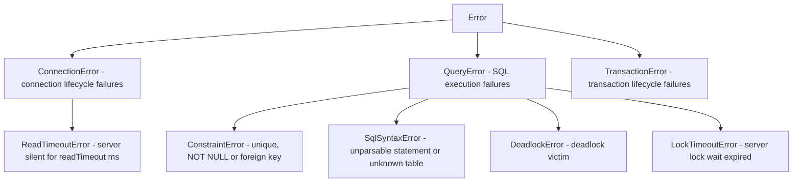

# API Reference

Complete reference for every public export of `cubrid-client`.

---

## Table of Contents

- [createClient()](#createclient)
- [CubridClient](#cubridclient)
- [CubridTransaction](#cubridtransaction)
- [Error Classes](#error-classes)
  - [ConnectionError](#connectionerror)
  - [QueryError](#queryerror)
  - [TransactionError](#transactionerror)
  - [ReadTimeoutError](#readtimeouterror)
  - [Error details](#error-details)
- [Types](#types)
  - [ClientOptions](#clientoptions)
  - [ClientConfig](#clientconfig)
  - [ConnectionFactory](#connectionfactory)
  - [ConnectionLike](#connectionlike)
  - [Queryable](#queryable)
  - [Executable](#executable)
  - [ExecutableTransactionClient](#executabletransactionclient)
  - [Streamable](#streamable)
  - [StreamOptions](#streamoptions)
  - [QueryOptions](#queryoptions)
  - [PreparedQueryable](#preparedqueryable)
  - [PreparedTransactionClient](#preparedtransactionclient)
  - [ExecuteResult](#executeresult)
  - [TransactionClient](#transactionclient-interface)
  - [TransactionCallback](#transactioncallback)
  - [ResultTransactionClient](#resulttransactionclient)
  - [QueryParam](#queryparam)
  - [QueryParams](#queryparams)
  - [QueryResultRow](#queryresultrow)
  - [QueryResult](#queryresult)
  - [ColumnInfo](#columninfo)
  - [Schema introspection types](#schema-introspection-types)

---

## createClient()

Factory function that creates a new `CubridClient` instance.

### Signature

```ts
function createClient(options: ClientOptions): CubridClient;
```

### Parameters

| Parameter | Type | Description |
|-----------|------|-------------|
| `options` | [`ClientOptions`](#clientoptions) | Connection and behavior configuration |

### Returns

A new [`CubridClient`](#cubridclient) instance. The connection is **not** opened immediately — it is established lazily on the first `query()` or `transaction()` call.

### Example

```ts
import { createClient } from "cubrid-client";

const db = createClient({
  host: "localhost",
  port: 33000,
  database: "demodb",
  user: "dba",
  password: "",
});

// Connection opens automatically on first query
const rows = await db.query("SELECT * FROM athlete LIMIT 5");
console.log(rows);

await db.close();
```

### How It Works

1. `options` are normalized into a full `ClientConfig` (defaults applied for `port`, `password`).
2. A `connectionFactory` is resolved — either from `options.connectionFactory` or the built-in `NativeCubridAdapter`.
3. A `CubridClient` is returned with lazy connection initialization.

---

## CubridClient

The main client class. Manages a shared connection for non-transactional queries and creates isolated connections for transactions.

```ts
class CubridClient implements Queryable, Executable
```

### Connection Model

- **Non-transactional queries** reuse a single shared connection (created lazily on first use).
- **Transactions** allocate a dedicated isolated connection via the `connectionFactory`, ensuring transaction isolation. The isolated connection is closed automatically when the transaction completes.

### Methods

#### `query<T>(sql, params?)`

Executes a SQL statement and returns typed result rows.

```ts
async query<T extends QueryResultRow = QueryResultRow>(
  sql: string,
  params?: QueryParams,
  options?: QueryOptions,
): Promise<T[]>
```

| Parameter | Type | Default | Description |
|-----------|------|---------|-------------|
| `sql` | `string` | — | SQL statement. Use `?` for parameter placeholders. |
| `params` | [`QueryParams`](#queryparams) | `undefined` | Positional parameter values |
| `options` | [`QueryOptions`](#queryoptions) | `undefined` | `signal` and a per-statement `readTimeout`. See [Cancelling one statement](#cancelling-one-statement) |

**Returns:** `Promise<T[]>` — Array of result rows typed as `T`.

**Throws:** [`QueryError`](#queryerror) if execution fails. A `RangeError` or `TypeError` for an invalid option, [`ReadTimeoutError`](#readtimeouterror) after `readTimeout`, and `signal.reason`, unchanged, after an abort.

**Type Parameter:** `T` defaults to `QueryResultRow` (`Record<string, unknown>`). Pass a custom type for typed results.

Queries issued at the same time, for example with `Promise.all`, run one at a time in the order issued and each returns exactly its own rows. See [Concurrent Statements on One Connection](CONNECTION.md#concurrent-statements-on-one-connection).

BLOB columns return a complete `Buffer` and CLOB columns a complete `string`, loaded before the promise settles and bounded by [`maxLobBytes`](#clientoptions). See [BLOB and CLOB columns](TYPES.md#blob-and-clob-columns).

##### Examples

```ts
// Untyped query — rows are Record<string, unknown>[]
const rows = await db.query("SELECT * FROM athlete LIMIT 10");

// Typed query — rows are User[]
type User = { id: number; name: string; email: string };
const users = await db.query<User>(
  "SELECT id, name, email FROM users WHERE active = ?",
  [true],
);
console.log(users[0].name); // TypeScript knows this is a string

// Parameterized INSERT
await db.query(
  "INSERT INTO users (name, email) VALUES (?, ?)",
  ["Alice", "alice@example.com"],
);

// DDL statements return an empty array
await db.query("CREATE TABLE IF NOT EXISTS logs (id INT AUTO_INCREMENT, msg VARCHAR(200))");
```

> **Note:** DDL and DML statements (`INSERT`, `UPDATE`, `DELETE`, `CREATE`, `DROP`, `ALTER`, etc.) are handled without a fetch phase. `query()` returns an empty array `[]` for them; call [`execute()`](#executesql-params) instead to get the affected row count and generated id.

---

#### `queryResult<T>(sql, params?)`

Executes a SQL statement like `query()` and returns its rows together with the metadata of the columns that produced them.

```ts
async queryResult<T extends QueryResultRow = QueryResultRow>(
  sql: string,
  params?: QueryParams,
  options?: QueryOptions,
): Promise<QueryResult<T>>
```

**Returns:** a [`QueryResult<T>`](#queryresult): `rows` is exactly what `query<T>()` returns, and `columns` describes every select-list column in order. `query()` itself is unchanged and still returns `T[]`.

**Throws:** [`QueryError`](#queryerror) if execution fails, including when a custom `connectionFactory` connection has no `queryResult()` method.

```ts
const { rows, columns } = await db.queryResult(
  "SELECT a.id, b.id, a.note FROM a JOIN b ON a.id = b.a_id",
);
// columns: [
//   { name: "id", type: "INT", precision: 10, scale: 0, nullable: false },
//   { name: "id", type: "INT", precision: 10, scale: 0, nullable: false },
//   { name: "note", type: "VARCHAR", precision: 100, scale: 0, nullable: true },
// ]
```

#### `execute(sql, params?)`

Runs a statement and returns how many rows it changed and, after an `INSERT`, the generated `AUTO_INCREMENT` value, instead of rows. Use it for `INSERT`, `UPDATE`, `DELETE`, `MERGE` and DDL; use [`query()`](#queryt-sql-params) for `SELECT`. `query()` is unchanged and still returns `[]` for those statements.

```ts
async execute(sql: string, params?: QueryParams, options?: QueryOptions): Promise<ExecuteResult>
```

**Returns:** [`ExecuteResult`](#executeresult) `{ affectedRows, lastInsertId? }`.

**Throws:** [`QueryError`](#queryerror) if execution fails, or if the connection returned by a custom `connectionFactory` has no `execute()` method.

```ts
const created = await db.execute("INSERT INTO users (name) VALUES (?)", ["Alice"]);
console.log(created); // { affectedRows: 1, lastInsertId: 1 }

const updated = await db.execute("UPDATE users SET name = ? WHERE id = ?", ["Alicia", 1]);
console.log(updated.affectedRows); // 1, or 0 when no row matched
```

What the server reports, checked on CUBRID 10.2, 11.0, 11.2 and 11.4 (the replies are byte for byte identical):

- `affectedRows` is the server's count for `INSERT`, `UPDATE`, `DELETE` and `MERGE`, and 0 for DDL and `SELECT`. A multi-statement string (`"INSERT ...; INSERT ..."`) reports the sum over its statements. `REPLACE` over an existing row counts the deleted row and the inserted one (2).
- `lastInsertId` is present only when the string contained an `INSERT` and the session then holds a generated value that is new. An `INSERT` into a table with no `AUTO_INCREMENT` column, or one that supplies the key itself, has none. The server keeps the last generated value for the whole [session](CONNECTION.md#session-reuse), through `COMMIT`, `ROLLBACK` and failed statements, and answers with the same bytes whether or not this statement generated one, so `execute()` reports an id only when the server's value differs from the one seen before the statement. A value that happens to repeat is therefore reported as no id, because a wrong id is worse than none: two fresh tables that both generate `1`, one straight after the other, report an id for the first and none for the second, so read the key back when you need both. After a statement that may have changed the value unseen, such as a `query()` INSERT or a failed statement, `execute()` reads the server's value once before its next `INSERT` to have that comparison, at the cost of one more round trip. A multi-row `INSERT` reports the **first** id it generated, not the last. The value is a `number` while it is a safe integer and a `bigint` beyond `Number.MAX_SAFE_INTEGER`, so no precision is lost. In a multi-statement string it is the one of the last `INSERT`.
- In autocommit mode `execute()` sends the statement without the autocommit flag, reads the value, then commits with a separate `END_TRAN` request (rolling back if anything failed), because the CAS may go to another client once the statement commits and the value stays with the session. The statement is committed before `execute()` resolves, as with `query()`, at the cost of one more round trip. Inside a transaction nothing is committed until you commit.
- Statements issued at the same time still run one at a time, in the order issued, whether they use `query()` or `execute()`.

---

#### `queryPrepared<T>(sql, params?)`, `queryResultPrepared<T>(sql, params?)`, `executePrepared(sql, params?)`

Opt-in server-side binding: the same results as `query()`, `queryResult()` and `execute()`, with the values sent as typed binds instead of SQL text.

```ts
async queryPrepared<T extends QueryResultRow = QueryResultRow>(
  sql: string,
  params?: QueryParams,
  options?: QueryOptions,
): Promise<T[]>

async queryResultPrepared<T extends QueryResultRow = QueryResultRow>(
  sql: string,
  params?: QueryParams,
  options?: QueryOptions,
): Promise<QueryResult<T>>

async executePrepared(
  sql: string,
  params?: QueryParams,
  options?: QueryOptions,
): Promise<ExecuteResult>
```

**Throws:** [`QueryError`](#queryerror) if execution fails, if a value is refused, if the number of values differs from the statement's markers, or if a custom `connectionFactory` connection does not provide the method. They never fall back to SQL literals.

```ts
const rows = await db.queryPrepared<{ id: number }>("SELECT id FROM users WHERE name = ?", [name]);
const { affectedRows } = await db.executePrepared("UPDATE users SET name = ? WHERE id = ?", [name, 1]);
```

- **Types.** [Prepared binding](TYPES.md#prepared-binding) lists each JavaScript type, what is refused and how the result can differ from the literal path.
- **Lifecycle.** Each call prepares, executes and releases its own handle, so a handle is never kept between calls or carried to another session. There is no reusable statement object.
- **Autocommit.** The statement runs in a transaction of its own that ends with an explicit commit, or a rollback if anything failed.
- **Cost.** A call takes more round trips than `query()`; see the [measurements](PERFORMANCE.md#prepared-binding). Do not expect it to be faster.

#### Cancelling one statement

Every statement method of the client, of the `transaction()` callback's `tx` and of a [`beginTransactionScope()`](#begintransactionscopeoptions) handle takes [`QueryOptions`](#queryoptions) as its optional last argument: `query`, `queryResult`, `execute`, `queryPrepared`, `queryResultPrepared` and `executePrepared`.

```ts
// Give up after 2 seconds, whatever the client's readTimeout.
const rows = await db.query("SELECT * FROM big_report", [], {
  signal: AbortSignal.timeout(2000),
});

// A tighter inactivity limit for this one statement, or 0 for none.
await db.execute("UPDATE stats SET n = n + 1", [], { readTimeout: 500 });
```

What happens depends on where the statement is when the signal aborts:

| When | Result | On the wire and the session |
|------|--------|-----------------------------|
| Already aborted when called | Rejects at once with `signal.reason` | Nothing is sent, and no connection is opened |
| Waiting behind other statements on the connection | Leaves the queue and rejects with `signal.reason` | Nothing is sent. The session and the other statements are unaffected |
| Sent: waiting for its reply, or for any FETCH, LOB_READ or END_TRAN of the same statement | Rejects with `signal.reason` as soon as the signal aborts | The CAS socket is discarded, so a late reply can never be read as another request's answer. The statement is never retried or replayed |
| Already settled | Nothing | The abort is ignored |

- **The outcome is unknown after an abort in flight.** The server may still run the statement to its end, and in autocommit mode it may be committed; nothing asks the server to stop it. Verify the outcome before running a statement that is not idempotent again, as after a [`ReadTimeoutError`](#readtimeouterror).
- **Inside a transaction an abort in flight loses the transaction.** Its connection is gone and the server rolls back the uncommitted work. The next statement and `commit()` fail with the existing connection-lost errors (a [`TransactionError`](#transactionerror) on `tx`), and nothing reaches a new session until the transaction is ended. Statements queued behind an aborted one behave as they do after a read timeout: they fail without being sent, and the next statement issued reconnects.
- **The reason is passed on unchanged.** The promise rejects with the exact `signal.reason` (an `AbortError` `DOMException` for `controller.abort()` without a reason, a `TimeoutError` for `AbortSignal.timeout()`), never wrapped in a `QueryError`. `transaction()` itself still wraps an error that its callback rethrows in a `TransactionError`, with the reason as `cause`.
- **`readTimeout`** behaves exactly like [the client's](CONNECTION.md#read-timeout), for this statement and all of its follow-up requests only: an inactivity limit that rejects with `ReadTimeoutError` and discards the socket. `0` means no timeout for this statement, even when the client has one. Time spent waiting behind other statements does not count.
- **Validation.** A `readTimeout` that the client option would refuse rejects with a `RangeError`, and a `signal` that is not an `AbortSignal` (or options that are not an object) with a `TypeError`, before anything is queued or sent.
- The abort listener is removed when the statement settles, so one signal can be passed to any number of statements.
- `stream()` has its own [`signal`](#streamoptions) and does not take `QueryOptions`. `commit()`, `rollback()` and `ping()` take no options.

---

#### `stream<T>(sql, params?, options?)`

Runs a statement and reads its rows one at a time, without holding the whole result in memory.

```ts
stream<T extends QueryResultRow = QueryResultRow>(
  sql: string,
  params?: QueryParams,
  options?: StreamOptions,
): AsyncGenerator<T, void, undefined>
```

| Parameter | Type | Default | Description |
|-----------|------|---------|-------------|
| `sql` | `string` | — | SQL statement. Use `?` for parameter placeholders. |
| `params` | [`QueryParams`](#queryparams) | `undefined` | Positional parameter values |
| `options` | [`StreamOptions`](#streamoptions) | `undefined` | `fetchSize`, `signal` and `consumerTimeout` |

**Throws:** `RangeError` at once for an invalid option. Everything else rejects the read that met it: [`QueryError`](#queryerror) for a failed statement or FETCH, [`ReadTimeoutError`](#readtimeouterror) after `readTimeout`, and `signal.reason`, unchanged, after an abort. Rows that arrived before a failure are delivered first.

```ts
for await (const row of db.stream<{ id: number }>("SELECT id FROM orders", [], {
  signal: AbortSignal.timeout(60_000),
})) {
  await process(row);
}
```

Nothing is sent until the first read, which queues the statement like any other. A statement that is not a SELECT runs and yields no rows. Only the first statement of a multi-statement string yields rows, as in `query()`.

**Memory.** The driver holds one server reply of rows and sends the next FETCH only when the consumer has read that reply, so a slow consumer slows the server down rather than filling memory. A reply holds about 16 KiB of rows, or one row when a row is larger. Reading 1,000,000 rows (477 MiB of column data) grew the heap by 0.9 MiB, against 560 MiB for `query()`; see [Performance](PERFORMANCE.md#streaming-memory).

**The connection is held until the stream ends.** On CUBRID 10.2 to 11.4 a statement that ends a transaction closes every other cursor on the session, so an open stream [keeps its turn](CONNECTION.md#concurrent-statements-on-one-connection) until its last reply has arrived or it is closed. Statements issued on this client meanwhile wait. Once the last reply has arrived the turn is released, while the consumer may still be reading those rows.

**Do not await a statement of the same client inside the loop.** The statement waits for the stream and the stream waits for the loop, so neither could ever finish. The driver cannot tell that statement from unrelated code on the connection, so it applies a limit: a statement rejects with `kind: "stream-busy"` once the consumer has asked for no row for `consumerTimeout` milliseconds, 5000 by default, while the statement waits. It sends nothing, it has the class it would otherwise fail with, and the stream stays usable.

```ts
// Wrong: rejects with kind "stream-busy" on any result larger than one reply.
for await (const order of db.stream("SELECT id FROM orders")) {
  await db.query("SELECT * FROM lines WHERE order_id = ?", [order.id]);
}

// Right: transaction() has its own connection. So does a second client.
for await (const order of db.stream("SELECT id FROM orders")) {
  await db.transaction((tx) => tx.query("SELECT * FROM lines WHERE order_id = ?", [order.id]));
}
```

That first loop can work on a small result, because the turn is released with the last reply. Do not rely on it. A consumer that pauses for longer than `consumerTimeout` while unrelated code issues statements causes the same rejection; raise the limit, or give streams a client of their own.

**Closing.** `break`, `return` and a throw from the loop body close the stream, and so does a failed read. The query handle is released, and in autocommit mode the transaction the SELECT opened is ended too, because closing the handle alone leaves its table lock held. Inside a transaction opened with [`beginTransaction()`](#begintransaction) the stream takes part in it, and the transaction stays open. Code that drives the iterator by hand must call `return()`; until then later statements get `stream-busy`. [`close()`](#close) ends an open stream, whose next read rejects.

**Aborting.** `signal` stops the stream even while the consumer is not reading: the handle is released and the turn ends at once, and the next read rejects with `signal.reason`, dropping any rows still held. A stream that waits for its turn is never sent. A reply already awaited cannot be interrupted, so the read rejects when it arrives, and `readTimeout` limits that wait. The session stays usable.

**Timeouts.** `readTimeout` applies to each request of the stream and discards the connection like any other read timeout. Time the consumer spends between reads does not count. For a limit on the whole stream use `AbortSignal.timeout()`.

**Errors keep their usual meaning.** A malformed reply drops the session. A `-72` from a FETCH marks the transaction as [rolled back](#error-details) and later statements reject until you acknowledge it. An error from a decoded value or a server error leaves the session usable.

**BLOB and CLOB columns.** `maxLobBytes` applies to **each row**, not to the whole result as in `query()`. Content is read when its row is reached, so a stream holds one row's content at a time and a result larger than the limit can be read in full. A row over the limit rejects when it is reached. See [BLOB and CLOB columns](TYPES.md#blob-and-clob-columns).

**While a stream is open** the server keeps a transaction open for it, in autocommit mode too. Its shared table lock blocks DDL on those tables, and the session keeps its CAS. Keep slow work out of the loop if other clients need them.

`stream()` is not available on the `tx` of a `transaction()` callback. [`TransactionClient`](#transactionclient-interface) is unchanged.

#### `transaction<T>(callback, options?)`

Executes a callback within an isolated transactional connection. Commits on success, rolls back on failure.

```ts
async transaction<T>(
  callback: TransactionCallback<T, ResultTransactionClient & ExecutableTransactionClient & PreparedTransactionClient>,
  options?: TransactionOptions,
): Promise<T>
```

| Parameter | Type | Description |
|-----------|------|-------------|
| `callback` | [`TransactionCallback<T, ResultTransactionClient & ExecutableTransactionClient & PreparedTransactionClient>`](#transactioncallback) | Async function receiving a [`ResultTransactionClient`](#resulttransactionclient) (a [`TransactionClient`](#transactionclient-interface) that also has `queryResult()`) that is also an [`ExecutableTransactionClient`](#executabletransactionclient) (it also has `execute()`). A callback written against `TransactionClient` is still accepted. |
| `options` | [`TransactionOptions`](#transactionoptions) | Optional `isolationLevel` and `lockTimeout` for this transaction only. Each one replaces the client's value, and the shared connection is not affected. They are applied before the transaction begins, so they cover all of it. See [Isolation Level and Lock Timeout](CONNECTION.md#isolation-level-and-lock-timeout) |

**Returns:** `Promise<T>` — The return value of the callback.

**Throws:** [`TransactionError`](#transactionerror) if the transaction fails, with the first failure in `cause`. See the [transaction lifecycle](#transaction-lifecycle) for the exceptions. An invalid option rejects with a `RangeError` before any connection is opened. A setting the connection cannot apply rejects with a `TransactionError` before the callback runs.

##### How It Works

1. A **new isolated connection** is created via `connectionFactory`.
2. The `isolationLevel` and `lockTimeout` in effect are applied to it, if any.
3. `beginTransaction()` is called on that connection.
4. The `callback` receives a [`CubridTransaction`](#cubridtransaction) instance scoped to that connection.
5. If the callback resolves successfully and has not completed the transaction itself, `commit()` is called once.
6. If the callback throws, `rollback()` is called once unless the transaction is already complete, and the error is re-thrown as a `TransactionError` (a [`ReadTimeoutError`](#readtimeouterror) is re-thrown as-is).
7. The isolated connection is **always closed**, regardless of outcome.

##### Transaction lifecycle

A callback transaction has exactly one terminal outcome. Before `commit()` or `rollback()` is sent, the client waits for queries that are still running, so the end of the transaction is the last thing sent on its connection. If such a query never settles and no `readTimeout` is set, the transaction waits with it.

| The callback... | Server sees | `transaction()` |
|---|---|---|
| Resolves | One commit | Resolves with its value |
| Throws | One rollback | Rejects, `cause` is the callback's error |
| Resolves, then the commit fails | One commit, then one rollback | Rejects, `cause` is the commit error |
| Resolves while a query it did not await is still running, and that query fails | One rollback, never a commit | Rejects, `cause` is the query's error |
| Calls `tx.commit()` and resolves | One commit | Resolves with its value |
| Calls `tx.rollback()` and resolves | One rollback | Resolves with its value |
| Calls `tx.commit()` and then throws | One commit, **no rollback: the work stays committed** | Rejects, `cause` is the callback's error |
| Calls `tx.rollback()` and then throws | One rollback | Rejects, `cause` is the callback's error |
| Calls `tx.commit()`, it fails, and the callback resolves anyway | One commit, then one rollback | Rejects, `cause` is the commit error |
| Calls `tx.rollback()`, it fails, and the callback resolves anyway | One rollback, never a commit | Rejects, `cause` is the rollback error |

`beginTransaction()` failing skips the callback, and no commit or rollback is sent because no transaction started. `transaction()` rejects with that failure as `cause`.

**Queries the callback did not await.** These rules apply to `tx.query()`, `tx.queryResult()` and `tx.execute()` alike. A query still running when a commit starts, whether automatic or from `tx.commit()`, had no one to handle its failure, so its failure fails the transaction: nothing is committed, the work is rolled back, and `transaction()` rejects with no unhandled rejection. A query the callback awaited and handled is its own decision, so catching a failed `tx.query()` and resolving still commits. The same applies when `transaction()` itself commits after a query rejected too recently for the callback to have seen it, such as `void tx.query(sql)` followed by `await Promise.resolve()`. **One case cannot be detected:** a query that was not awaited and rejected before the callback's last `await` resumed looks the same as a handled one, so the commit goes ahead (and Node.js reports the unhandled rejection unless you attached a handler). Await every statement. During a rollback, a still-running query that fails changes nothing: the work is being discarded anyway and the original failure stays as `cause`. A query that was not awaited and rejected shortly before the callback threw raises no unhandled rejection either, unless the event loop moved on in between, for example while the callback awaited another statement. Node.js has reported it by then.

**Use after completion.** Once `commit()` or `rollback()` has been called, every later `tx.query()`, `tx.queryResult()`, `tx.execute()`, `tx.commit()` and `tx.rollback()` rejects with a `TransactionError` and sends nothing to the server, including from a `tx` kept after `transaction()` settled. Only the first completion counts: a failed `commit()` or `rollback()` is not retried.

**Failures during cleanup.** A rollback or close failure never replaces the original failure. `cause` keeps the original, and the later failures are on [`rollbackError`](#transactionerror) and `closeError`. Closing the connection ends the server session, so uncommitted work is discarded even when the rollback failed. There are two cases to check:

- A [`ReadTimeoutError`](#readtimeouterror) is re-thrown unchanged, so later rollback and close failures are not reported on it.
- If the commit succeeded and only the close failed, `transaction()` rejects with the close error, as it always has: a `ConnectionError` from the built-in adapter, not a `TransactionError`. **The work is committed**, so do not retry it blindly.

##### Examples

```ts
// Simple transaction
await db.transaction(async (tx) => {
  await tx.query("INSERT INTO accounts (owner, balance) VALUES (?, ?)", ["Alice", 1000]);
  await tx.query("INSERT INTO accounts (owner, balance) VALUES (?, ?)", ["Bob", 500]);
});

// Transaction with return value
const newId = await db.transaction(async (tx) => {
  await tx.query(
    "INSERT INTO orders (customer, total) VALUES (?, ?)",
    ["Alice", 99.99],
  );
  const rows = await tx.query<{ id: number }>(
    "SELECT LAST_INSERT_ID() AS id",
  );
  return rows[0].id;
});
console.log(`Created order #${newId}`);

// Error handling — automatic rollback
try {
  await db.transaction(async (tx) => {
    await tx.query("UPDATE accounts SET balance = balance - 100 WHERE owner = ?", ["Alice"]);
    await tx.query("UPDATE accounts SET balance = balance + 100 WHERE owner = ?", ["Bob"]);

    // If this throws, both UPDATEs are rolled back
    const [alice] = await tx.query<{ balance: number }>(
      "SELECT balance FROM accounts WHERE owner = ?",
      ["Alice"],
    );
    if (alice.balance < 0) {
      throw new Error("Insufficient funds");
    }
  });
} catch (error) {
  console.error("Transaction rolled back:", error);
}
```

---

#### `beginTransactionScope(options?)`

Begins a manual transaction on a **dedicated connection** and returns a [`TransactionScope`](#transactionscope) handle that owns it. Use it when the transaction's work cannot be written as one `transaction()` callback, for example when commit is decided elsewhere.

```ts
async beginTransactionScope(options?: TransactionOptions): Promise<TransactionScope>
```

```ts
const tx = await db.beginTransactionScope({ isolationLevel: "serializable" });
try {
  await tx.query("UPDATE accounts SET balance = balance - ? WHERE id = ?", [100, 1]);
  await tx.query("UPDATE accounts SET balance = balance + ? WHERE id = ?", [100, 2]);
  await tx.commit();
} catch (error) {
  await tx.rollback().catch(() => {});
  throw error;
}
```

- Only statements sent through `tx` belong to the transaction. `db.query()` and the other client methods keep using the shared connection in autocommit, so an unrelated caller can never join it, and two scopes never share a connection.
- `options` works as for [`transaction()`](#transactiontcallback-options): client settings apply first, then these, on the new connection before the transaction begins. Invalid options throw a `RangeError` before any connection opens.
- Exactly one `commit()` or `rollback()` ends it, and either one closes its connection. Every later call on `tx`, including a second `commit()`, rejects with a [`TransactionError`](#transactionerror) without reaching the server.
- `commit()` first waits for statements of `tx` still running. If one of them failed, or the COMMIT itself is refused, it rolls back instead and rejects with a `TransactionError`; `rollbackError` and `closeError` are set when those also failed (a `ReadTimeoutError` is passed on unchanged, without them). A statement whose failure already settled before `commit()` was called is the caller's to handle and does not stop the commit. A connection that fails to close after a successful commit does not turn the commit into a failure, unlike `transaction()`, which rejects with the close error.
- [`close()`](#close) discards every scope that was not ended: it closes the scope's connection, without waiting for its statements still running, and the server rolls back the uncommitted work. Such a statement fails with a connection error, and later calls on `tx` reject with `Transaction was discarded because the client was closed.`
- A failed BEGIN closes the new connection and rejects with `Failed to begin transaction.`; no handle is returned.

**Throws:** `RangeError` for invalid options, [`TransactionError`](#transactionerror) on failure.

---

#### `beginTransaction()`

> **Deprecated.** Use [`beginTransactionScope()`](#begintransactionscopeoptions) or [`transaction()`](#transactiontcallback-options). It is kept, with its behavior unchanged, for all of 1.x.

Manually begins a transaction on the **shared connection**.

**Concurrency limitation:** `beginTransaction()`, ordinary `db.query()`/`db.execute()`, `commit()` and `rollback()` have no caller or ownership token. Packet-level serialization alone cannot distinguish the task that began a manual transaction from an unrelated asynchronous caller. **Any call using the same client during that transaction may become part of it**, including another request's read or write. Sharing one manually transacting client between concurrent requests is therefore unsafe. [`beginTransactionScope()`](#begintransactionscopeoptions) is the replacement with an ownership guarantee ([#112](https://github.com/cubrid-lab/cubrid-client/issues/112)).

```ts
async beginTransaction(): Promise<void>
```

**Throws:** [`TransactionError`](#transactionerror) on failure.

---

#### `commit()`

> **Deprecated** with [`beginTransaction()`](#begintransaction). Use the `commit()` of a [`TransactionScope`](#transactionscope).

Manually commits the current transaction on the shared connection.

```ts
async commit(): Promise<void>
```

**Throws:** [`TransactionError`](#transactionerror) on failure.

---

#### `rollback()`

> **Deprecated** with [`beginTransaction()`](#begintransaction). Use the `rollback()` of a [`TransactionScope`](#transactionscope).

Manually rolls back the current transaction on the shared connection.

```ts
async rollback(): Promise<void>
```

**Throws:** [`TransactionError`](#transactionerror) on failure.

---

#### `ping()`

Checks that the connection and its database server are alive, and returns the server version. It opens the shared connection if needed.

```ts
async ping(): Promise<string>
```

Inside a manual transaction a ping leaves the transaction open: the work before it can still be committed or rolled back. Outside a transaction it sends a commit, which ends the session's empty transaction and closes nothing the client still needs, because statements on one connection run [one at a time](CONNECTION.md#concurrent-statements-on-one-connection).

**Returns:** The server version, for example `11.4.6.1963`.

**Throws:** [`ConnectionError`](#connectionerror) if the health check fails. If it fails inside a transaction, treat that transaction as lost.

---

#### `getServerVersion()`

Returns the CUBRID server version. It opens the shared connection if needed.

```ts
async getServerVersion(): Promise<string>
```

It sends the same requests as [`ping()`](#ping), so it has the same effect on a transaction: inside a manual transaction it leaves the transaction open, and outside one it commits the session's empty transaction. It performs no caching, so it reports the server the shared connection is currently attached to, after any reconnect. Use it for compatibility checks; use `ping()` for health checks.

**Returns:** The version string as the server reports it, without a trailing NUL, for example `11.4.6.1963`. It is not parsed or normalized.

**Throws:** [`ConnectionError`](#connectionerror) if the request fails or if a custom `connectionFactory` connection has no `ping()` method (see [`ConnectionLike`](#connectionlike)). Inside a transaction, treat a failure as a lost transaction. The `debug` log entry for this call has `operation: "ping"`.

---

#### Schema introspection: `getTables()`, `getColumns()`, `getPrimaryKey()`, `getIndexes()`

Read-only, typed metadata for tables, views, columns, primary keys and indexes.

```ts
getTables(options?: SchemaOptions): Promise<SchemaTable[]>
getColumns(table: string, options?: SchemaOptions): Promise<SchemaColumn[]>
getPrimaryKey(table: string, options?: SchemaOptions): Promise<SchemaPrimaryKey | null>
getIndexes(table: string, options?: SchemaOptions): Promise<SchemaIndex[]>
```

See [Schema introspection types](#schema-introspection-types) for the result shapes. The methods are on `CubridClient` only; `TransactionClient` and the `tx` of `transaction()` do not have them. Inside a manual transaction started with `beginTransaction()` they run in that transaction like `query()`.

- **How it reads.** They run bound `SELECT` statements over the catalog views `db_class`, `db_attribute`, `db_index` and `db_index_key`, not the CAS `SCHEMA_INFO` request. The views return the same columns on CUBRID 10.2, 11.0, 11.2 and 11.4, and a catalog query needs no result handle to consume or close. `getColumns`, `getPrimaryKey` and `getIndexes` send a first query to find the table, so each call takes two or three round trips and the answer is not one atomic snapshot if other sessions change the schema meanwhile.
- **Names.** Pass the bare table name, without quotes or brackets. CUBRID stores identifiers in lower case whatever case or quoting the `CREATE` used (`CREATE TABLE "MixedCase"` creates `mixedcase`), so names are matched without regard to case. Quote characters are not stripped: `"mixedcase"` finds nothing. A name with spaces or other characters is taken literally. Names are only ever sent as bound parameters, never joined into SQL text.
- **Schema.** CUBRID calls the owner of a table its schema. `SchemaOptions.schema` selects one owner, without regard to case. Since CUBRID 11.2 two users may own a table with the same name; if the name is ambiguous and `schema` is omitted, the call rejects with a `QueryError` that lists the owners. Before 11.2 a table name is unique, so `schema` only has to match the owner (`CREATE TABLE other_user.t` there still creates a table owned by the creator).
- **Permissions.** The catalog views list only what the connected user may `SELECT`, and the server returns no error for the rest. `getTables()` leaves an inaccessible table out, and `getColumns()`, `getPrimaryKey()` and `getIndexes()` reject with a `QueryError` whose message says the table "was not found, or the connected user may not SELECT from it": the two cases cannot be told apart. A failure of the catalog query itself, such as a lost connection, is mapped like any `query()` failure.
- **Scope.** System classes (`db_class`, `_db_class`, ...) are not listed by `getTables()`. Foreign keys appear as indexes (`foreignKey: true`) without their referenced table. Auto-increment, comments, partitions, triggers, collection element types, schema diffing and DDL generation are not included.

**Throws:** `TypeError` for an empty `table` or `schema`. [`QueryError`](#queryerror) for an unknown, inaccessible or ambiguous table, or when the catalog query fails (the same mapping as `query()`, so a lost connection is reported as for `query()`).

```ts
const tables = await db.getTables(); // [{ name: "athlete", schema: "DBA", type: "table" }, ...]
const columns = await db.getColumns("athlete");
const pk = await db.getPrimaryKey("athlete"); // { name: "pk_athlete_code", columns: ["code"] }
const indexes = await db.getIndexes("athlete", { schema: "dba" });
```

---

#### `close()`

Closes the shared connection after statements and multi-query schema inspections started before it have finished. After calling `close()`, the client can no longer execute queries: a `query()`, `queryResult()`, `execute()`, `ping()`, `getServerVersion()`, `getTables()`, `getColumns()`, `getPrimaryKey()`, `getIndexes()`, `transaction()`, `beginTransactionScope()`, `beginTransaction()`, `commit()` or `rollback()` issued after `close()` is called, even in the same tick, rejects with an error whose `cause` is `Client is closed.`, and no connection is opened. A `transaction()` already started runs to its end on its own connection. A [`TransactionScope`](#transactionscope) not yet ended is discarded: its connection is closed, concurrently with the shared one and without waiting for its running statements, and the server rolls its work back; later calls on it reject. `close()` resolves once those connections are closed, including the one of a `beginTransactionScope()` still opening. If no connection was opened, closing it is a no-op.

```ts
async close(): Promise<void>
```

**Throws:** [`ConnectionError`](#connectionerror) if closing fails.

##### Example

```ts
const db = createClient({ host: "localhost", database: "demodb", user: "dba" });

try {
  const rows = await db.query("SELECT COUNT(*) AS cnt FROM athlete");
  console.log(rows);
} finally {
  await db.close(); // Always close when done
}
```

---

## CubridTransaction

A transaction-scoped client that delegates queries to the isolated transactional connection. You do **not** create this class directly — it is provided to you inside the `transaction()` callback, where it follows the [transaction lifecycle](#transaction-lifecycle).

The exported constructor stays available in 1.x for compatibility. An instance you construct yourself only forwards to the connection you gave it and has no lifecycle guards.

```ts
class CubridTransaction
  implements ResultTransactionClient, ExecutableTransactionClient, PreparedTransactionClient
```

### Methods

#### `query<T>(sql, params?)`

Same signature and behavior as [`CubridClient.query()`](#queryt-sql-params), but executes within the transaction's isolated connection.

```ts
async query<T extends QueryResultRow = QueryResultRow>(
  sql: string,
  params?: QueryParams,
  options?: QueryOptions,
): Promise<T[]>
```

**Throws:** [`TransactionError`](#transactionerror) if execution fails, or if the transaction is already complete.

#### `execute(sql, params?)`

Same signature and behavior as [`CubridClient.execute()`](#executesql-params), but runs within the transaction's isolated connection. Nothing is committed until the transaction commits, and the generated id is the one the server reports inside the open transaction.

```ts
async execute(sql: string, params?: QueryParams, options?: QueryOptions): Promise<ExecuteResult>
```

**Throws:** [`TransactionError`](#transactionerror) if execution fails.

#### `queryPrepared<T>(sql, params?)`, `queryResultPrepared<T>(sql, params?)`, `executePrepared(sql, params?)`

Same signatures and behavior as the [`CubridClient` methods](#querypreparedtsql-params-queryresultpreparedtsql-params-executepreparedsql-params), but run within the transaction's isolated connection. Nothing is committed until the transaction is.

**Throws:** [`TransactionError`](#transactionerror) if execution fails.

#### `commit()`

Commits the transaction. Called automatically by `CubridClient.transaction()` on success, so you only need it to make the work durable before the callback ends. Rejects with a [`TransactionError`](#transactionerror) if the transaction is already complete.

```ts
commit(): Promise<void>
```

#### `rollback()`

Rolls back the transaction. Called automatically by `CubridClient.transaction()` on failure, so you only need it to abandon the work without throwing. Rejects with a [`TransactionError`](#transactionerror) if the transaction is already complete.

```ts
rollback(): Promise<void>
```

---

## Error Classes

All errors extend the native `Error` class and use the standard [`ErrorOptions.cause`](https://developer.mozilla.org/en-US/docs/Web/JavaScript/Reference/Global_Objects/Error/cause) property to preserve the original driver error.

### Error Hierarchy



### Common Pattern

```ts
import { ConnectionError, QueryError, TransactionError } from "cubrid-client";

try {
  const rows = await db.query("SELECT * FROM nonexistent_table");
} catch (error) {
  if (error instanceof ConnectionError) {
    console.error("Connection problem:", error.message);
    console.error("Driver error:", error.cause); // Original driver error
  } else if (error instanceof QueryError) {
    console.error("Query failed:", error.message);
    console.error("Driver error:", error.cause);
  } else if (error instanceof TransactionError) {
    console.error("Transaction failed:", error.message);
    console.error("Driver error:", error.cause);
  }
}
```

### ConnectionError

Thrown when the client cannot establish, maintain, or close a connection.

```ts
class ConnectionError extends Error {
  name = "ConnectionError";
  cause?: Error; // Original driver error
}
```

**When thrown:**

| Situation | Example Message |
|-----------|----------------|
| Initial connection fails | `"Failed to connect to CUBRID."` |
| Closing connection fails | `"Failed to close client connection."` |
| Close on adapter fails | `"Failed to close CUBRID connection."` |

### QueryError

Thrown when a SQL statement fails to execute.

```ts
class QueryError extends Error {
  name = "QueryError";
  cause?: Error; // Original driver error
  readonly code?: number; // See "Error details"
  readonly origin?: "server" | "cas";
  readonly sqlState?: string;
  readonly kind?: CubridErrorKind;
}
```

Outside a transaction, the failures in the table below reject with a subclass of `QueryError`, so `instanceof QueryError` still holds. Its `name` is the subclass name, for example `"ConstraintError"`.

| Class | `kind` |
|-------|--------|
| `ConstraintError` | `unique-violation`, `not-null-violation`, `foreign-key-violation` |
| `SqlSyntaxError` | `syntax` |
| `DeadlockError` | `deadlock` |
| `LockTimeoutError` | `lock-timeout` |

**When thrown:**

| Situation | Example Message |
|-----------|----------------|
| SELECT fails | `"Query failed."` |
| Invalid SQL syntax | `"Failed to execute CUBRID query."` |
| Table does not exist | `"Failed to execute CUBRID query."` |

### TransactionError

Thrown when a transaction operation fails (begin, commit, rollback, or query within a transaction).

```ts
class TransactionError extends Error {
  name = "TransactionError";
  cause?: Error; // Original failure
  readonly code?: number; // See "Error details"
  readonly origin?: "server" | "cas";
  readonly sqlState?: string;
  readonly kind?: CubridErrorKind;
  rollbackError?: Error; // transaction() only: rolling back also failed
  closeError?: Error; // transaction() only: closing the connection also failed
}
```

A failure inside a transaction stays a `TransactionError`, as it was before these subclasses existed. Test `error.kind`, which has the same value in both places, or find the `ConstraintError` and the like further down `error.cause`.

**When thrown:**

| Situation | Example Message |
|-----------|----------------|
| Begin fails | `"Failed to begin transaction."` |
| Commit fails | `"Failed to commit."` |
| Rollback fails | `"Failed to rollback."` |
| Query inside transaction fails | `"Transaction query failed."` |
| Transaction callback throws | `"Transaction failed."` |
| `tx` used while a completion is running | `"Transaction is already completing."` |
| `tx` used after a commit | `"Transaction has already been committed."` |
| `tx` used after a rollback | `"Transaction has already been rolled back."` |
| `tx` used after a failed commit or rollback | `"Transaction has already failed."` |

### ReadTimeoutError

Thrown when `readTimeout` is set and the server shows no activity for that many milliseconds while a response is awaited. It reaches the caller as-is from `query()`, `transaction()`, `commit()`, `rollback()` and `ping()`, instead of being wrapped in a `QueryError` or `TransactionError`.

```ts
class ReadTimeoutError extends ConnectionError {
  name = "ReadTimeoutError";
  readonly timeoutMs: number; // The readTimeout that expired
}
```

The connection has been discarded. The outcome of the request on the server is unknown, so do not retry a write or a `COMMIT` blindly. See [Read timeout](CONNECTION.md#read-timeout).

```ts
import { ReadTimeoutError } from "cubrid-client";

try {
  await db.query("SELECT * FROM big_table");
} catch (error) {
  if (error instanceof ReadTimeoutError) {
    console.error(`No response for ${error.timeoutMs}ms`);
  }
}
```

### Accessing the Original Error

### Error details

`QueryError`, `TransactionError` and `ConnectionError` expose the same read-only properties, so a failure can be identified without parsing a message. Every property is `undefined` when it does not apply.

| Property | Type | Meaning |
|----------|------|---------|
| `code` | `number` | Numeric code of the CAS error reply. Client-side failures have none. |
| `origin` | `"server" \| "cas"` | Who assigned `code`. The database server and the CAS process number their errors in ranges that overlap, so compare a code together with its origin. Only `server` codes have a `kind`. |
| `kind` | `CubridErrorKind` | Classification of a known failure. |
| `sqlState` | `string` | Never set by this driver: CAS error replies carry no SQLSTATE and CUBRID documents no mapping from its codes. It stays available for a custom `connectionFactory` that has a real value to report. |

```ts
import { QueryError, TransactionError } from "cubrid-client";

try {
  await db.transaction(async (tx) => {
    await tx.query("INSERT INTO users (email) VALUES (?)", [email]);
  });
} catch (error) {
  if (error instanceof TransactionError && error.kind === "unique-violation") {
    return "That address is already registered.";
  }
  throw error;
}
```

`kind` is set only for the codes below. Each one was reported by live CUBRID 10.2, 11.0, 11.2 and 11.4 servers, except where noted. Any other server error keeps its `code` and `origin` and has no `kind`, including `-73` and `-76`, which the CUBRID headers name as lock timeouts but which were never observed.

| `kind` | `code` | Reported when |
|--------|--------|---------------|
| `unique-violation` | `-670` | A primary key or unique index rejected a value |
| `unique-violation` | `-886` | The same, on a server with `print_key_value_on_unique_error=yes` |
| `not-null-violation` | `-631` | `NULL` into a `NOT NULL` column. A literal `SET col = NULL` is rejected earlier as `semantic` |
| `foreign-key-violation` | `-922` | No parent row matches |
| `foreign-key-violation` | `-924` | A child row refers to the row being changed |
| `foreign-key-violation` | `-1284` | `TRUNCATE` of a referenced table (11.2 and later; earlier servers report `-924`) |
| `syntax` | `-493` | The statement cannot be parsed, or it names an unknown table |
| `semantic` | `-494` | Unknown column or function, a missing privilege, a type mismatch or a constant division by zero |
| `deadlock` | `-72` | Deadlock victim, or a lock escalation with `rollback_on_lock_escalation=yes`. The server rolled back **the whole transaction**; see below |
| `deadlock` | `-967`, `-968` | Deadlock victim while a finite lock timeout is set (table lock, row lock). Only the statement failed and the transaction stays open |
| `lock-timeout` | `-74`, `-75` | A lock wait expired (table lock, row lock). Only the statement failed and the transaction stays open |
| `interrupted` | `-4` | The server stopped the statement, for example with `cubrid killtran` |
| `authentication` | `-165`, `-171` | Unknown user, wrong password |
| `connection-lost` | `-111` | `cub_server` died, taking the transaction with it |

Failures detected by the client have a `kind` but no `code` or `origin`:

| `kind` | Reported when |
|--------|---------------|
| `connection-lost` | The socket closed, or the session that held the transaction is gone. The outcome of a request that was in flight is unknown |
| `read-timeout` | [`ReadTimeoutError`](#readtimeouterror): the client stopped waiting for a response. A server lock wait that expires is `lock-timeout` instead |
| `stream-busy` | A statement waited behind a [`stream()`](#streamtsql-params-options) whose consumer asked for no row for `consumerTimeout`. Nothing was sent. Often the statement was awaited inside the loop that reads the stream |

After any `deadlock`, roll back and retry the transaction from its start.

**After `-72` the server has already rolled the transaction back.** A statement sent next would start a new server transaction and a later commit would persist it alone, so on the same connection every later `query()`, `commit()` and `beginTransaction()` rejects without sending anything, with the same `code` and `kind`, until you acknowledge the loss:

- `rollback()` acknowledges it and resolves. This is what the usual `catch` block does, so the original error still reaches the caller.
- A rejected `commit()` also acknowledges it. It never reports success.

The connection itself stays usable: it is not closed or reopened, and it is back in **autocommit** afterwards, so call `beginTransaction()` before redoing the work. Inside `transaction()`, a callback that catches the error and carries on gets rejections from `tx.query()`, and `transaction()` itself rejects with a `TransactionError` instead of committing.

Only `-72` is treated this way. The server's reply carries no other signal: its transaction status still says active. On CUBRID 10.2, 11.0, 11.2 and 11.4, `-72` was also what `rollback_on_lock_escalation=yes` reported, and `-74`, `-75`, `-967` and `-968` left the transaction open with its earlier statements intact. A statement rejected with those codes can be followed by more statements and a commit.

All error classes preserve the original driver error via the standard `cause` property:

```ts
try {
  await db.query("INVALID SQL");
} catch (error) {
  if (error instanceof QueryError) {
    // Human-readable message from cubrid-client
    console.error(error.message); // "Failed to execute CUBRID query."

    // Original error from the underlying driver
    console.error(error.cause?.message); // Driver-specific error message
  }
}
```

---

## Types

All types are exported as TypeScript type-only exports and are available for import:

```ts
import type {
  ClientOptions,
  ClientConfig,
  ClientLogger,
  ClientLogFields,
  ClientLogLevel,
  ConnectionFactory,
  ConnectionLike,
  Executable,
  ExecutableTransactionClient,
  ExecuteResult,
  Queryable,
  IsolationLevel,
  TransactionClient,
  TransactionCallback,
  TransactionOptions,
  ResultTransactionClient,
} from "cubrid-client";

import type { QueryParam, QueryParams } from "cubrid-client";
import type { QueryResultRow } from "cubrid-client";
```

### ClientOptions

Configuration object passed to [`createClient()`](#createclient). All connection details needed to connect to a CUBRID database.

```ts
interface ClientOptions {
  host: string;
  port?: number;
  database: string;
  user: string;
  password?: string;
  connectionTimeout?: number;
  readTimeout?: number;
  maxLobBytes?: number;
  fetchSize?: number;
  timezone?: "local" | "utc";
  isolationLevel?: IsolationLevel;
  lockTimeout?: number;
  maxConnectionRetryCount?: number;
  logger?: unknown;
  connectionFactory?: ConnectionFactory;
}
```

| Field | Type | Default | Description |
|-------|------|---------|-------------|
| `host` | `string` | — | CUBRID broker hostname or IP address |
| `port` | `number` | `33000` | CUBRID broker port |
| `database` | `string` | — | Database name to connect to |
| `user` | `string` | — | Database user (e.g., `"dba"`) |
| `password` | `string` | `""` | Database password |
| `connectionTimeout` | `number` | `undefined` | Connection timeout in milliseconds |
| `readTimeout` | `number` | `undefined` | Milliseconds of server inactivity before a request fails with [`ReadTimeoutError`](#readtimeouterror) and the connection is discarded. `undefined` or `0` means no timeout for requests; the connect handshake then still gives up after 10 seconds of inactivity. Other values must be between 1 and 2147483647, or `createClient()` throws a `RangeError`. See [Read timeout](CONNECTION.md#read-timeout) |
| `maxLobBytes` | `number` | `67108864` (64 MiB) | Largest total of BLOB and CLOB content, in bytes, one query may load. A query over it rejects with a `QueryError` before any content is read, and the connection stays usable. Must be a positive integer, or `createClient()` throws a `RangeError`. See [BLOB and CLOB columns](TYPES.md#blob-and-clob-columns) |
| `fetchSize` | `number` | `100` | Rows requested in each FETCH by `query()`, `queryResult()` and `stream()`. **CUBRID 10.2, 11.0, 11.2 and 11.4 ignore this number** and answer every FETCH with about 16 KiB of rows, or one row when a row is larger, so on those servers it changes neither round trips nor memory. Must be an integer from 1 to 2147483647, or `createClient()` throws a `RangeError` |
| `timezone` | `"local" \| "utc"` | `"local"` | Zone that DATE, TIME, TIMESTAMP and DATETIME fields are decoded in, since those SQL types store no zone. `"local"` uses the Node.js process zone (the 1.x behavior), so the same value becomes a different instant under a different `TZ`. `"utc"` reads them as UTC, the zone `Date` parameters are already sent in, so values round-trip to the same instant on every host; read them with the `getUTC*()` getters. Any other value throws a `RangeError`. See [Date and time values](TYPES.md#date-and-time-values) |
| `isolationLevel` | [`IsolationLevel`](#isolationlevel) | Server default | Isolation level of every session this client opens, on the shared connection and on each `transaction()` connection, and restored on any session that replaces one. Any other value throws a `RangeError`. See [Isolation Level and Lock Timeout](CONNECTION.md#isolation-level-and-lock-timeout) |
| `lockTimeout` | `number` | Server default | Longest a statement waits for a lock, in milliseconds, on every session this client opens. `0` does not wait and `-1` has no limit. Must be an integer from `-1` to `2147483647`, or `createClient()` throws a `RangeError`. See [Isolation Level and Lock Timeout](CONNECTION.md#isolation-level-and-lock-timeout) |
| `maxConnectionRetryCount` | `number` | `undefined` | Retries after a failed first attempt to open the TCP connection to the broker (refused, unreachable, timed out). Non-negative integer, default `0`; anything else throws a `RangeError`. See [Connection retries](CONNECTION.md#connection-retries) |
| `logger` | `unknown` (see `ClientLogger`) | `undefined` | Receives redacted diagnostics for connections, queries and transactions. See [Logging](CONNECTION.md#logging) |
| `connectionFactory` | [`ConnectionFactory`](#connectionfactory) | Built-in `NativeCubridAdapter` | Custom factory for creating connections |

### ClientConfig

Normalized configuration with all defaults applied. Created internally by `normalizeConfig()`.

```ts
interface ClientConfig {
  host: string;
  port: number;
  database: string;
  user: string;
  password: string;
  connectionTimeout?: number | undefined;
  readTimeout?: number | undefined;
  maxLobBytes?: number | undefined;
  isolationLevel?: IsolationLevel | undefined;
  lockTimeout?: number | undefined;
  maxConnectionRetryCount?: number | undefined;
  logger?: unknown;
}
```

### IsolationLevel

```ts
type IsolationLevel = "read committed" | "repeatable read" | "serializable";
```

These are the only levels CUBRID 10.2 to 11.4 accept. `serializable` still allows write skew. See [what each level does](CONNECTION.md#isolation-level-and-lock-timeout).

### TransactionOptions

The second argument of [`transaction()`](#transaction). An option left out keeps the client's value.

```ts
interface TransactionOptions {
  isolationLevel?: IsolationLevel;
  lockTimeout?: number;
}
```

### ConnectionFactory

A function that creates a new connection. Used internally by `CubridClient` for both the shared connection and per-transaction isolated connections.

```ts
type ConnectionFactory = (
  config: ClientConfig,
) => ConnectionLike | Promise<ConnectionLike>;
```

**Custom factory example:**

```ts
import { createClient } from "cubrid-client";
import type { ConnectionFactory, ClientConfig, ConnectionLike } from "cubrid-client";

// Custom connection factory with logging
const myFactory: ConnectionFactory = (config: ClientConfig): ConnectionLike => {
  console.log(`Connecting to ${config.host}:${config.port}/${config.database}`);
  // Return any object that implements ConnectionLike
  return new MyCustomAdapter(config);
};

const db = createClient({
  host: "localhost",
  database: "demodb",
  user: "dba",
  connectionFactory: myFactory,
});
```

### ConnectionLike

Interface that any connection adapter must implement. This is the contract between `CubridClient` and the underlying database driver.

```ts
interface ConnectionLike {
  connect(): Promise<void>;
  query<T extends QueryResultRow = QueryResultRow>(
    sql: string,
    params?: QueryParams,
    options?: QueryOptions,
  ): Promise<T[]>;
  queryResult?<T extends QueryResultRow = QueryResultRow>(
    sql: string,
    params?: QueryParams,
    options?: QueryOptions,
  ): Promise<QueryResult<T>>;
  execute?(sql: string, params?: QueryParams, options?: QueryOptions): Promise<ExecuteResult>;
  setTransactionOptions?(options: TransactionOptions): Promise<void>;
  stream?<T extends QueryResultRow = QueryResultRow>(
    sql: string,
    params?: QueryParams,
    options?: StreamOptions,
  ): AsyncIterable<T>;
  beginTransaction(): Promise<void>;
  commit(): Promise<void>;
  rollback(): Promise<void>;
  close(): Promise<void>;
}
```

`setTransactionOptions` is optional too, but it decides whether settings work. The client calls it on a new connection before anything else when `isolationLevel` or `lockTimeout` is in effect, and only then. Without it such a client or transaction fails rather than running without the setting. An implementation must keep the setting on every session it opens, and `NativeCubridAdapter` does. Options it is not given keep their value. The built-in adapter rejects the call inside a transaction, because changing the level there would change the running transaction.

`queryResult`, `execute` and `stream` are optional so existing custom adapters keep compiling. The client passes [`QueryOptions`](#queryoptions) as the last argument of each statement method; an implementation that declares fewer parameters still compiles, and then ignores them. Calling `queryResult()` or `execute()` on a client or transaction fails when its connection does not provide it, and so does the first read of `stream()`.

### Queryable

Interface for any object that can execute queries.

```ts
interface Queryable {
  query<T extends QueryResultRow = QueryResultRow>(
    sql: string,
    params?: QueryParams,
    options?: QueryOptions,
  ): Promise<T[]>;
}
```

Both `CubridClient` and `CubridTransaction` implement this interface, so you can write functions that accept either:

```ts
import type { Queryable } from "cubrid-client";

async function getUsers(db: Queryable) {
  return db.query<{ id: number; name: string }>("SELECT id, name FROM users");
}

// Works with both client and transaction
const users1 = await getUsers(db);
const users2 = await db.transaction(async (tx) => getUsers(tx));
```

### ResultQueryable

Interface for any object that can return rows with their column metadata. `CubridClient` and `CubridTransaction` implement it. It is not part of `TransactionClient`, so 1.x code that implements that interface keeps compiling; see [`ResultTransactionClient`](#resulttransactionclient).

```ts
interface ResultQueryable {
  queryResult<T extends QueryResultRow = QueryResultRow>(
    sql: string,
    params?: QueryParams,
    options?: QueryOptions,
  ): Promise<QueryResult<T>>;
}
```

### Executable

Interface for any object that can run a statement and report its [`ExecuteResult`](#executeresult). `CubridClient` and `CubridTransaction` implement it. It is separate from `Queryable` and `TransactionClient` so code that implements those keeps compiling.

```ts
interface Executable {
  execute(sql: string, params?: QueryParams, options?: QueryOptions): Promise<ExecuteResult>;
}
```

### Streamable

Interface for any object that can read a result row by row. `CubridClient` implements it. `TransactionClient` does not extend it.

```ts
interface Streamable {
  stream<T extends QueryResultRow = QueryResultRow>(
    sql: string,
    params?: QueryParams,
    options?: StreamOptions,
  ): AsyncIterable<T>;
}
```

### StreamOptions

Options of [`stream()`](#streamtsql-params-options).

```ts
interface StreamOptions {
  fetchSize?: number;
  signal?: AbortSignal;
  consumerTimeout?: number;
}
```

| Field | Type | Default | Description |
|-------|------|---------|-------------|
| `fetchSize` | `number` | The client's [`fetchSize`](#clientoptions) | Rows requested in each FETCH, ignored by CUBRID 10.2 to 11.4 |
| `signal` | `AbortSignal` | `undefined` | Stops the stream. The next read rejects with `signal.reason` |
| `consumerTimeout` | `number` | `5000` | Milliseconds a statement issued on this connection waits while the consumer asks for no row, before it rejects with `kind: "stream-busy"`. A consumer that keeps reading is never timed out, however long the stream takes. `0` refuses such statements at once. An integer from 0 to 2147483647; this limit cannot be disabled |

### QueryOptions

The optional last argument of `query()`, `queryResult()`, `execute()`, `queryPrepared()`, `queryResultPrepared()` and `executePrepared()`, on the client, `tx` and a transaction scope. See [Cancelling one statement](#cancelling-one-statement).

```ts
interface QueryOptions {
  signal?: AbortSignal;
  readTimeout?: number;
}
```

| Field | Type | Default | Description |
|-------|------|---------|-------------|
| `signal` | `AbortSignal` | `undefined` | Cancels the statement. Rejects with `signal.reason`; once the statement was sent its connection is discarded and its outcome is unknown |
| `readTimeout` | `number` | The client's [`readTimeout`](#clientoptions) | Inactivity limit for this statement and its follow-up requests, with the client option's semantics. `0` means none for this statement. From 0 to 2147483647 |

### ExecuteResult

The outcome of [`execute()`](#executesql-params).

```ts
interface ExecuteResult {
  affectedRows: number;
  lastInsertId?: number | bigint;
}
```

| Field | Description |
|-------|-------------|
| `affectedRows` | Rows changed by `INSERT`, `UPDATE`, `DELETE` or `MERGE`, summed over a multi-statement string; 0 for DDL, `SELECT` and a statement that matched nothing. |
| `lastInsertId` | The generated `AUTO_INCREMENT` value after an `INSERT`: a `number` if it is a safe integer, otherwise a `bigint`. Absent when no value was generated. For a multi-row `INSERT` it is the first generated id. |

### TransactionClient (Interface)

Interface for a transaction-scoped client. It has not changed since 1.0, so classes and test doubles that implement it still compile.

```ts
interface TransactionClient extends Queryable {
  commit(): Promise<void>;
  rollback(): Promise<void>;
}
```

### ExecutableTransactionClient

The type `transaction()` passes to its callback and `CubridTransaction` implements: a `TransactionClient` that can also [`execute()`](#executesql-params).

```ts
interface ExecutableTransactionClient extends TransactionClient, Executable {}
```

### PreparedQueryable

Interface for any object that can run a statement with [server-side binding](TYPES.md#prepared-binding). `CubridClient` and `CubridTransaction` implement it.

```ts
interface PreparedQueryable {
  queryPrepared<T extends QueryResultRow = QueryResultRow>(
    sql: string,
    params?: QueryParams,
    options?: QueryOptions,
  ): Promise<T[]>;
  queryResultPrepared<T extends QueryResultRow = QueryResultRow>(
    sql: string,
    params?: QueryParams,
    options?: QueryOptions,
  ): Promise<QueryResult<T>>;
  executePrepared(
  sql: string,
  params?: QueryParams,
  options?: QueryOptions,
): Promise<ExecuteResult>;
}
```

### PreparedTransactionClient

A `TransactionClient` that can also bind on the server. It is a separate type so that code implementing `TransactionClient` keeps compiling.

```ts
interface PreparedTransactionClient extends TransactionClient, PreparedQueryable {}
```

### TransactionCallback

Type for the callback function passed to `transaction()`.

```ts
type TransactionCallback<
  T,
  Tx extends TransactionClient = TransactionClient,
> = (tx: Tx) => Promise<T>;
```

### ResultTransactionClient

The transaction client that `transaction()` passes to its callback: a `TransactionClient` that can also return column metadata.

```ts
interface ResultTransactionClient extends TransactionClient, ResultQueryable {}
```

`CubridClient.transaction()` accepts a `TransactionCallback<T, ResultTransactionClient & ExecutableTransactionClient & PreparedTransactionClient>`, so the callback's `tx` has `queryResult()` and `execute()`; a callback written against `TransactionClient` is still accepted.

### TransactionScope

The handle [`beginTransactionScope()`](#begintransactionscopeoptions) returns. It has the methods of the `transaction()` callback's `tx` and owns a dedicated connection; `commit()` or `rollback()` ends it and closes that connection.

```ts
interface TransactionScope
  extends ResultTransactionClient,
    ExecutableTransactionClient,
    PreparedTransactionClient {}
```

### QueryParam

Union type for all supported query parameter values.

```ts
type QueryParam =
  | string
  | number
  | boolean
  | bigint
  | Date
  | Buffer
  | null;
```

| Type | SQL Mapping | Example |
|------|-------------|---------|
| `string` | `VARCHAR` / `CHAR` / `STRING` | `"Alice"` |
| `number` | `INTEGER` / `FLOAT` / `DOUBLE` | `42`, `3.14` |
| `boolean` | `SMALLINT` (0 or 1) | `true` |
| `bigint` | `BIGINT` | `9007199254740993n` |
| `Date` | `DATETIME` / `TIMESTAMP` | `new Date()` |
| `Buffer` | `BLOB` / `BIT VARYING` | `Buffer.from("data")` |
| `null` | `NULL` | `null` |

Note: `BIGINT` columns in query results are returned as JavaScript `bigint` values (not `number`), so the full signed 64-bit range is preserved.

`SET`, `MULTISET` and `SEQUENCE` columns return JavaScript arrays, typed by the
exported `CollectionValue`. See [collection columns](TYPES.md#collection-columns)
for duplicates, order, NULL elements and the mixed-type limitation.

```ts
import type { CollectionValue } from "cubrid-client";

type Tagged = { id: number; tags: CollectionValue | null };
const rows = await db.query<Tagged>("SELECT id, tags FROM article");
```

TIMESTAMPTZ, TIMESTAMPLTZ, DATETIMETZ and DATETIMELTZ columns return the exported
`ZonedDateTime` (wall-clock fields plus the zone text, not a `Date`); see
[timezone-aware values](TYPES.md#timezone-aware-values).

Unsupported non-NULL CUBRID wire values (including OBJECT and unsupported
collection element values that do not yet have a decoder) reject the
query with a `QueryError` rather than silently appearing as SQL `null`, and the
connection stays usable. Its `cause` chain holds an error named
`UnsupportedValueError`, which identifies the column name and CAS type number. A
cell or collection length that does not match its value also
rejects, so a malformed length cannot shift the following columns; a malformed
reply also drops the connection, which rolls back an open transaction, and its
chain holds an error named `MalformedReplyError`. Both `name` values are stable,
although the classes are not exported. A genuine
SQL NULL is still returned as `null`; an empty SQL string is still `""`. JSON
columns return their text as a `string`; see [JSON columns](TYPES.md#json-columns).
See [values that cannot be decoded](TYPES.md#values-that-cannot-be-decoded).

### QueryParams

Array of query parameter values.

```ts
type QueryParams = readonly QueryParam[];
```

### QueryResultRow

Default type for result row objects. Column names become keys.

```ts
type QueryResultRow = Record<string, unknown>;
```

Override this with a custom type via the generic parameter on `query<T>()`:

```ts
type Athlete = {
  code: number;
  name: string;
  nation_code: string;
};

const athletes = await db.query<Athlete>("SELECT * FROM athlete LIMIT 5");
// athletes is Athlete[] — fully typed
```

### QueryResult

Rows together with the columns that produced them, as returned by `queryResult()`.

```ts
interface QueryResult<T extends QueryResultRow = QueryResultRow> {
  rows: T[];
  columns: ColumnInfo[];
}
```

- `columns` has one entry for every select-list column, in order. A column that holds only NULL, or a query that returns no rows, still reports its type.
- **Duplicate column names.** `SELECT a.id, b.id` gives two entries named `id` in `columns`. Each row object is keyed by name exactly as `query()` returns it, so only one value per name survives and the **last** column with that name wins. Alias the columns (`a.id AS a_id`) when you need every value; the repeated names in `columns` tell you when a collision happened.
- A statement without a result set (INSERT, UPDATE, DELETE, DDL) returns `rows: []` and `columns: []`.

### ColumnInfo

One column of a `QueryResult`.

```ts
interface ColumnInfo {
  name: string;
  type: string;
  elementType?: string;
  precision: number;
  scale: number;
  nullable: boolean;
}
```

| Field | Meaning |
|-------|---------|
| `name` | The column label: its alias, or its name when it has none. |
| `type` | The CUBRID type name the server reports, such as `INT`, `BIGINT`, `VARCHAR`, `CHAR`, `NUMERIC`, `DATETIME`, `TIMESTAMPTZ` or `NULL` (an untyped `NULL` literal), or `UNKNOWN(<id>)` for a wire type id this driver does not name. The name is the server's wire type, so a JSON column reports `VARCHAR` (see [TYPES.md](TYPES.md)). |
| `elementType` | Set only for `SET`, `MULTISET` and `SEQUENCE`, which are the `type`. It is the declared element type, or `NULL` for a collection declared without one. |
| `precision`, `scale` | The values the server reports. They depend on the type: `VARCHAR(20)` is precision 20, `NUMERIC(10,3)` is 10 and 3, `INT` is 10 and `DATETIME` is 23 and 3. Types without a meaningful size report `0`, and a `CHAR` expression such as a string literal can report `-1`. |
| `nullable` | `false` only when the server reports the column as NOT NULL. It is `true` for a nullable table column, for the right side of an outer join and for expressions. |

### Schema introspection types

Results and options of [`getTables()`, `getColumns()`, `getPrimaryKey()` and `getIndexes()`](#schema-introspection-gettables-getcolumns-getprimarykey-getindexes).

```ts
interface SchemaOptions {
  schema?: string;
}

interface SchemaTable {
  name: string;
  schema: string;
  type: "table" | "view";
}

interface SchemaColumn {
  name: string;
  position: number;
  dataType: string;
  precision: number;
  scale: number;
  nullable: boolean;
  defaultValue: string | null;
}

interface SchemaPrimaryKey {
  name: string;
  columns: string[];
}

interface SchemaIndexColumn {
  name: string | null;
  expression?: string;
  order: "asc" | "desc";
  prefixLength?: number;
}

interface SchemaIndex {
  name: string;
  unique: boolean;
  reverse: boolean;
  primaryKey: boolean;
  foreignKey: boolean;
  filter: string | null;
  columns: SchemaIndexColumn[];
}
```

| Field | Meaning |
|-------|---------|
| `SchemaTable.name`, `SchemaColumn.name`, index and column names | As the catalog stores them: lower case, except that `schema` (the owner) is upper case, for example `DBA`. |
| `SchemaTable.type` | `view` for a view (catalog class type `VCLASS`), otherwise `table`. |
| `SchemaColumn.position` | 1-based position in the table. Only instance columns are listed. |
| `SchemaColumn.dataType` | The catalog's type name, for example `INTEGER`, `BIGINT`, `STRING` (every `VARCHAR`), `CHAR`, `NUMERIC`, `DATETIME` or `SET`. It is not the wire type name of [`ColumnInfo.type`](#columninfo). |
| `SchemaColumn.precision`, `scale` | The catalog's values: `VARCHAR(10)` is 10 and 0, `NUMERIC(8,3)` is 8 and 3, `INT` is 10 and 0, and a `SET` is 0 and 0. |
| `SchemaColumn.defaultValue` | The default as the catalog's text, for example `zz` or `SYS_DATETIME`; `null` when the column has none. |
| `SchemaPrimaryKey.columns` | Column names in key order, which can differ from table order. |
| `SchemaIndexColumn.name` | `null` for a function-based index key, whose text is in `expression`. |
| `SchemaIndexColumn.prefixLength` | Set only for a prefix index such as `c(5)`. |
| `SchemaIndex.filter` | The condition of a filtered index as the catalog prints it, or `null`. |
| `SchemaIndex.primaryKey`, `foreignKey` | The primary key and each foreign key are listed by `getIndexes()` as indexes of their own. |
