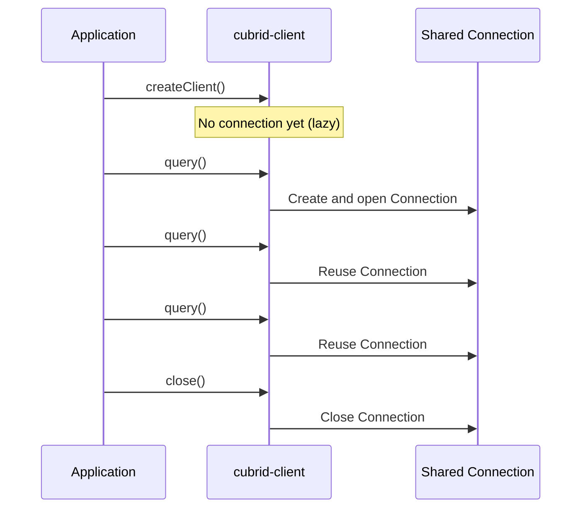
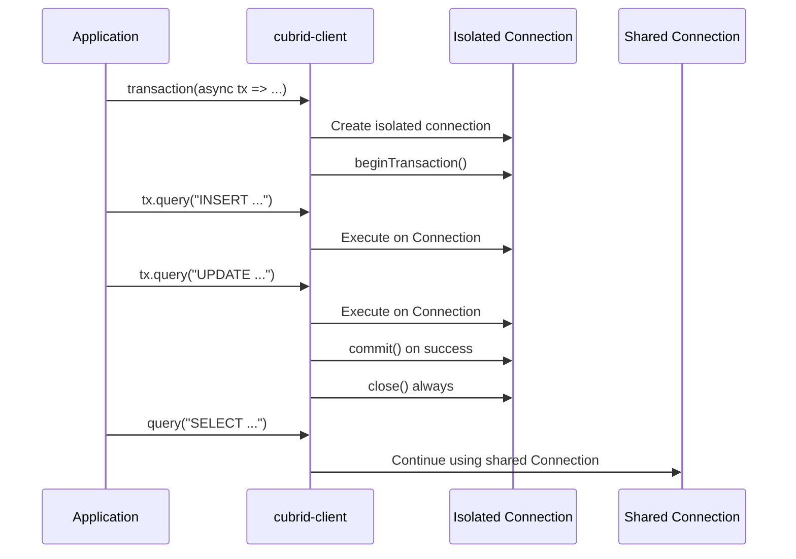

# Connection Guide

This guide covers everything you need to connect to a CUBRID database using `cubrid-client`.

## Prerequisites

- **Node.js** 18 or later
- **CUBRID** database server running (10.2, 11.0, 11.2, or 11.4)
- **CUBRID** database server running (10.2, 11.0, 11.2, or 11.4)
- **cubrid-client** includes a built-in native CAS protocol adapter — no additional driver dependencies required.

```bash
npm install cubrid-client
```

## Basic Connection

```ts
import { createClient } from "cubrid-client";

const db = createClient({
  host: "localhost",
  port: 33000,
  database: "demodb",
  user: "dba",
  password: "",
});

// Connection is established lazily — on the first query, not here.
const rows = await db.query("SELECT 1 + 1 AS result");
console.log(rows); // [{ result: 2 }]

await db.close();
```

## Connection Options

| Option | Type | Required | Default | Description |
|--------|------|----------|---------|-------------|
| `host` | `string` | Yes | — | CUBRID server hostname or IP address |
| `port` | `number` | No | `33000` | CUBRID broker port |
| `database` | `string` | Yes | — | Database name to connect to |
| `user` | `string` | Yes | — | Database user (typically `"dba"`) |
| `password` | `string` | No | `""` | Database password (empty string for no password) |
| `connectionTimeout` | `number` | No | — | Connection timeout in milliseconds |
| `readTimeout` | `number` | No | — | Milliseconds of server inactivity before a request fails. See [Read timeout](#read-timeout) |
| `maxConnectionRetryCount` | `number` | No | — | Maximum number of retry attempts on connection failure |
| `logger` | `unknown` | No | — | Logger instance (passed to the underlying driver)
| `connectionFactory` | `ConnectionFactory` | No | — | Custom factory for creating connections (advanced) |

### Full Example with All Options

```ts
const db = createClient({
  host: "192.168.1.100",
  port: 33000,
  database: "myapp",
  user: "dba",
  password: "secret",
  connectionTimeout: 5000,
  readTimeout: 30000,
  maxConnectionRetryCount: 3,
});
```

## Read timeout

`connectionTimeout` only covers opening the TCP connection. Without `readTimeout`, a query waits for as long as the server stays silent, and so does everything queued behind it on that connection. Set `readTimeout` to fail instead:

```ts
const db = createClient({
  host: "localhost",
  database: "demodb",
  user: "dba",
  readTimeout: 30000,
});
```

**It measures inactivity, not total time.** The clock restarts whenever bytes arrive, so a large result that keeps flowing is never cut off, however long it takes. A server that sends one byte per interval is therefore never timed out. With `ssl` on, the clock restarts each time a complete TLS record arrives (up to 16 KB), not on every byte. The limit applies to:

- waiting for each response, including the time the server spends executing the statement. Set it above your slowest expected statement.
- sending each request. A request the server has stopped reading fails too. Progress here is only visible as the operating system's send buffer drains, so a very short timeout can fail a large request sent over a slow link. With `ssl` on, progress is not visible at all: each request must finish sending within `readTimeout`.
- each read during connect and reconnect, and the TLS handshake when `ssl` is on.

It does not run while the connection is idle, or while a request waits its turn behind another one. A caller at the back of the queue only starts its own clock when its request is sent.

**On timeout** the request rejects with [`ReadTimeoutError`](API_REFERENCE.md#readtimeouterror) and the socket is destroyed, because a late response could otherwise be read as the answer to the next request. Then:

- The next query opens a new connection automatically, unless a transaction was open.
- Requests already queued on that connection fail straight away with a `QueryError`, without being sent. Nothing is replayed automatically, so they are safe to retry.
- Inside a transaction the session is gone and the server discards its uncommitted work. Later `query()` and `commit()` calls fail instead of continuing on a new session, until `commit()` or `rollback()` acknowledges the loss.

**The outcome of the timed-out request is unknown.** The client stops waiting, but this does not cancel the statement: the server may still finish it. An autocommit write may have been applied, and a timed-out `COMMIT` may have succeeded, so check before retrying either.

The timeout is per client and applies to the built-in native driver. A custom `connectionFactory` receives the value in its `ClientConfig` and decides what to do with it.

## Lazy Connection

`cubrid-client` uses **lazy connection** — the TCP connection to CUBRID is not established when you call `createClient()`. The actual connection is created on the **first query**.

This means:

1. `createClient()` returns synchronously with no network I/O (it only throws for an out-of-range `readTimeout`)
2. Connection errors surface when you call `.query()`, `.transaction()`, or `.beginTransaction()`
3. A single shared connection is reused across all non-transaction queries

```ts
const db = createClient({ host: "localhost", database: "demodb", user: "dba" });
// No connection yet — db is a lightweight object.

try {
  await db.query("SELECT 1"); // Connection established HERE.
} catch (error) {
  if (error instanceof ConnectionError) {
    console.error("Could not connect:", error.message);
  }
}
```

## Connection Lifecycle

### Shared Connection

Non-transaction queries (`db.query()`) share a single connection. The connection is created on the first call and reused for all subsequent queries:



### Concurrent Statements on One Connection

`query()`, `transaction()` statements, `commit()`, `rollback()`, `ping()` and `close()` can be issued at the same time, for example with `Promise.all`. The client runs the statements of one connection strictly in the order they were issued, each one finishing all its work (execute, every FETCH, handle release) before the next starts:

```typescript
// Safe: each promise gets exactly its own rows, however many FETCHes they need.
const [users, orders] = await Promise.all([
  db.query('SELECT * FROM users'),
  db.query('SELECT * FROM orders'),
]);
```

This is required rather than conservative. CUBRID closes every open cursor on a session when a transaction ends, and in autocommit mode a transaction ends with each DML statement, each failed statement, each `ping()` and each SELECT that reaches its last row. Only inside an open transaction can a session hold several live cursors, and `commit()` or `rollback()` closes them there too. The results of the live tests in `tests/integration.test.ts`:

| Broker (image tag) | Several live handles in an open transaction | Several live handles in autocommit mode |
|--------------------|---------------------------------------------|-----------------------------------------|
| 10.2, 11.0, 11.2, 11.4 | Safe to interleave FETCHes | Not safe: the others fail with `-1012` once one ends the transaction |

What this means for an application:

- **Promises settle independently.** A failed statement rejects only its own promise. The statements around it still run.
- **A `ping()` inside a manual transaction does not end it.** It sends CHECK_CAS, which reaches the database server, and then asks for the version without committing. Outside a transaction it asks for the version with autocommit on, as `query()` does.
- **Concurrency does not make one connection faster.** Statements wait for each other, so a slow query delays the ones behind it. Waiting does not count towards `readTimeout`. For queries that must run in parallel, use several clients.
- **`commit()`, `rollback()` and `close()` wait for the statements issued before them**, and apply only to those. A statement issued after `rollback()` runs outside that transaction.
- **A lost connection fails the waiting queries too.** Queries that were waiting when a request failed on the connection reject without being sent, including those issued before a new client finished connecting. They are never retried, and the first query issued afterwards opens a new session. A failed connection attempt sends nothing, so a waiting query still makes its own attempt.

### Transaction Connection

Each `db.transaction()` call creates an **isolated connection** that is independent of the shared connection. The isolated connection is automatically closed when the transaction completes:



### Manual Transaction on Shared Connection

You can also run transactions on the shared connection with `beginTransaction()`, `commit()`, and `rollback()`. This uses Connection #1:

```ts
await db.beginTransaction();
try {
  await db.query("INSERT INTO orders (item) VALUES (?)", ["Widget"]);
  await db.query("UPDATE inventory SET qty = qty - 1 WHERE item = ?", ["Widget"]);
  await db.commit();
} catch (error) {
  await db.rollback();
  throw error;
}
```

> **Warning**: Manual transactions share the same connection as regular queries. If you call `db.query()` from another async context while a manual transaction is open, those queries will execute inside the transaction. Use `db.transaction()` for isolated transactions.

## Closing Connections

Always call `db.close()` when your application shuts down:

```ts
const db = createClient({ host: "localhost", database: "demodb", user: "dba" });

try {
  // ... application logic ...
} finally {
  await db.close();
}
```

`close()` is safe to call multiple times — if no connection was established (no queries were ever made), it's a no-op.

## Connection Errors

Connection failures throw `ConnectionError`:

```ts
import { createClient, ConnectionError } from "cubrid-client";

const db = createClient({
  host: "nonexistent-host",
  database: "demodb",
  user: "dba",
});

try {
  await db.query("SELECT 1");
} catch (error) {
  if (error instanceof ConnectionError) {
    console.error("Connection failed:", error.message);
    console.error("Cause:", error.cause); // Original driver error
  }
}
```

Common causes of `ConnectionError`:

| Symptom | Likely Cause | Fix |
|---------|--------------|-----|
| `ECONNREFUSED` | CUBRID broker not running | Start the CUBRID service |
| `ENOTFOUND` | Invalid hostname | Check `host` option |
| Timeout | Firewall or wrong port | Check `port` and firewall rules |
| Auth failure | Wrong credentials | Verify `user` and `password` |

## Docker Connection

A typical Docker setup for development:

```yaml
# docker-compose.yml
services:
  cubrid:
    image: cubrid/cubrid:11.2
    ports:
      - "33000:33000"
    environment:
      - CUBRID_DB=testdb
```

```ts
const db = createClient({
  host: "localhost",
  port: 33000,
  database: "testdb",
  user: "dba",
});
```

## Custom Connection Factory

For advanced scenarios (testing, custom adapters), you can provide a custom `connectionFactory`:

```ts
import { createClient } from "cubrid-client";
import type { ConnectionLike, ClientConfig } from "cubrid-client";

function myConnectionFactory(config: ClientConfig): ConnectionLike {
  // Return any object implementing the ConnectionLike interface:
  // connect(), query(), beginTransaction(), commit(), rollback(), close()
  return new MyCustomAdapter(config);
}

const db = createClient({
  host: "localhost",
  database: "demodb",
  user: "dba",
  connectionFactory: myConnectionFactory,
});
```

This is primarily useful for:
- **Unit testing** — inject a mock connection
- **Custom drivers** — wrap a different CUBRID driver
- **Logging/metrics** — instrument connection behavior

## Environment-Based Configuration

A common pattern for production applications:

```ts
import { createClient } from "cubrid-client";

const db = createClient({
  host: process.env.CUBRID_HOST ?? "localhost",
  port: Number(process.env.CUBRID_PORT ?? 33000),
  database: process.env.CUBRID_DATABASE ?? "myapp",
  user: process.env.CUBRID_USER ?? "dba",
  password: process.env.CUBRID_PASSWORD ?? "",
  connectionTimeout: Number(process.env.CUBRID_TIMEOUT ?? 5000),
});

export default db;
```

## Next Steps

- [API Reference](./API_REFERENCE.md) — Full method signatures and type definitions
- [Troubleshooting](./TROUBLESHOOTING.md) — Common errors and solutions
