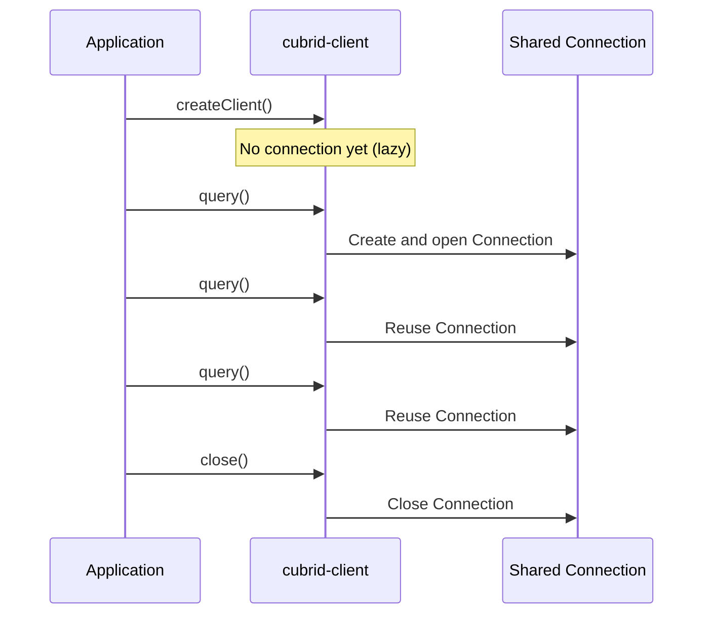
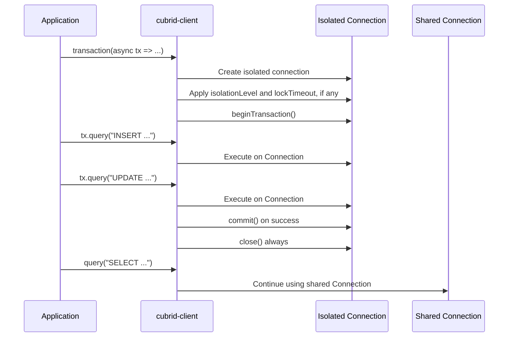

# Connection Guide

This guide covers everything you need to connect to a CUBRID database using `cubrid-client`.

## Prerequisites

- **Node.js** 18 or later
- **CUBRID** database server running (10.2, 11.0, 11.2, or 11.4)
- **CUBRID** database server running (10.2, 11.0, 11.2, or 11.4)
- **cubrid-client** includes a built-in native CAS protocol adapter — no additional driver dependencies required.

```bash
npm install cubrid-client
```

## Basic Connection

```ts
import { createClient } from "cubrid-client";

const db = createClient({
  host: "localhost",
  port: 33000,
  database: "demodb",
  user: "dba",
  password: "",
});

// Connection is established lazily — on the first query, not here.
const rows = await db.query("SELECT 1 + 1 AS result");
console.log(rows); // [{ result: 2 }]

await db.close();
```

## Connection Options

| Option | Type | Required | Default | Description |
|--------|------|----------|---------|-------------|
| `host` | `string` | Yes | — | CUBRID server hostname or IP address |
| `port` | `number` | No | `33000` | CUBRID broker port |
| `database` | `string` | Yes | — | Database name to connect to. At most 31 bytes in UTF-8, see [Credential length](#credential-length) |
| `user` | `string` | Yes | — | Database user (typically `"dba"`). At most 31 bytes in UTF-8 |
| `password` | `string` | No | `""` | Database password (empty string for no password). At most 31 bytes in UTF-8 |
| `connectionTimeout` | `number` | No | `10000` | Limit of each TCP connect in milliseconds; `0` leaves it to the operating system. See [Connection limits](#connection-limits) |
| `readTimeout` | `number` | No | — | Milliseconds of server inactivity before a request fails. See [Read timeout](#read-timeout) |
| `maxReplyBytes` | `number` | No | `1073741824` (1 GiB) | Largest single reply accepted from the server, in bytes. See [Reply size limit](#reply-size-limit) |
| `maxConnectionRetryCount` | `number` | No | — | Retries after a failed TCP connect (default `0`). See [Connection retries](#connection-retries) |
| `logger` | `unknown` | No | — | Receives redacted diagnostics (connection created, operation timing and failures). See [Logging](#logging) |
| `connectionFactory` | `ConnectionFactory` | No | — | Custom factory for creating connections (advanced) |

### Credential length

The broker reads `database`, `user` and `password` from 32-byte fields and
overwrites the last byte of each with a NUL, so it keeps at most **31 bytes** of
each, counted in UTF-8 (`Buffer.byteLength(value)`): 31 ASCII characters, but
only 15 two-byte characters such as `é` plus one ASCII byte, or 10 three-byte
characters such as `가` plus one. A NUL character ends a field early.

A longer value, or one containing a NUL character, is refused rather than cut,
because the cut value could open a different database or log in as a different
user or password. `createClient()`, `new CubridClient()` and
`new NativeCubridAdapter()` throw a `RangeError` before any connection is
opened, such as `password must be at most 31 bytes in UTF-8.` The message names
the field and the limit, never the value. CUBRID 10.2 to 11.4 also refuse to
create a user name or password longer than 31 bytes, so no valid account is
excluded.

Earlier versions cut a longer value to 32 bytes, and the broker then kept 31,
so any longer password that began with the right 31 bytes logged in.

### Full Example with All Options

```ts
const db = createClient({
  host: "192.168.1.100",
  port: 33000,
  database: "myapp",
  user: "dba",
  password: "secret",
  connectionTimeout: 5000,
  readTimeout: 30000,
  maxConnectionRetryCount: 3,
});
```

## Logging

Pass `logger` to `createClient()` to receive redacted diagnostics. The object
needs any of `debug`, `info` and `error` methods, each called as
`(message, fields)`; `console` works as is. Other values are ignored. A logger
that throws, or returns a promise that rejects, never affects a request and is
never awaited.

```ts
const client = createClient({ host: "localhost", database: "demodb", user: "dba", logger: console });
```

| Level | Event | Fields |
|-------|-------|--------|
| `info` | A connection was created (`operation: "connection"`) | `host`, `port`, `database` |
| `info` | A connection was destroyed by `destroy()` (`operation: "destroy"`), only for a connection that has `destroy()` | `operation` |
| `debug` | `connect`, `query`, `queryResult`, `stream`, `beginTransaction`, `commit`, `rollback`, `close` or `ping` succeeded. A `stream` reports once, when it ends or closes early | `operation`, `durationMs`; `paramCount` and `rowCount` for `query` and `stream` |
| `error` | The same operations failed | `operation`, `durationMs`, `errorName`; `paramCount` for `query` |
| `error` | A connection could not be created (`operation: "connection"`; the original error is rethrown unchanged) | `operation`, `host`, `port`, `database`, `durationMs`, `errorName` |

A pool (`createPool()`) also reports `pool.create` and `pool.destroy` at `info`,
with `reason` on `pool.destroy`, and `pool.acquire-timeout` at `error`; see
[CubridPool logging](API_REFERENCE.md#logging).

Fields never contain SQL text, bound parameter values, row data, passwords or
error messages (servers can echo SQL in them). `errorName` is the error's class
(one of this library's errors or a standard `Error` subclass, otherwise
`Error`), not its mutable `name`. Events are emitted for the
shared client connection and for each `transaction()` connection, including
with a custom `connectionFactory`. No protocol-level events are emitted. The
option is declared `unknown`, so existing 1.x code keeps compiling; the
`ClientLogger`, `ClientLogFields` and `ClientLogLevel` types describe the
contract.

## Connection retries

`maxConnectionRetryCount` is the number of retries after a failed first attempt to open the TCP connection to the broker or CAS: connection refused, host unreachable, or `connectionTimeout` expired. It defaults to `0` (no retry) and must be a non-negative integer, or `createClient()` throws a `RangeError`. Delays between attempts double from 100 ms up to 2 s, so the cumulative backoff is at most `maxConnectionRetryCount` times 2 s. That is not a bound on the total time to connect: `connectionTimeout` stops applying once the TCP connection is open. From then on a broker that never answers the handshake, the OpenDatabase reply or the TLS handshake is bounded by `readTimeout`, or by a 10-second inactivity limit when `readTimeout` is unset (see [Read timeout](#read-timeout)). Such a failure is not retried.

```ts
const client = createClient({
  host: "localhost",
  database: "demodb",
  user: "dba",
  connectionTimeout: 2000,
  maxConnectionRetryCount: 3,
});
```

Only that step is retried. A retry never runs SQL again and never replays a request whose outcome is unknown:

- Rejected credentials or a database error in the handshake fail at once.
- A failure after the socket opened (a broker closing the connection, a TLS failure, a malformed reply, `readTimeout`) fails at once.
- A request or transaction that fails after it was sent is not retried.
- There is no fallback to another host.

When every attempt fails, the last failure is kept as the innermost `cause`. The outer error depends on the operation that triggered the connection: `client.query()` rejects with a `QueryError`, `client.transaction()` and the transaction methods with a `TransactionError`, and `client.ping()` with a `ConnectionError`. Read `error.cause` (and its `cause`) for the `Failed to connect to host:port` error.

## Connection limits

Each stage of a connection has its own limit. None of them replaces another, and
only the ones marked as such apply by default.

| Stage | What bounds it | Default | On expiry |
|-------|----------------|---------|-----------|
| **Socket**: opening each TCP connection, to the broker and to the CAS it redirects to | `connectionTimeout` | 10 s (`0`: the operating system's limit, about 2 min on Linux) | Fails without sending anything; retried by `maxConnectionRetryCount` |
| **Socket**: a peer that vanished while the connection was idle | TCP keepalive, always on: first probe after 60 s idle, then the operating system's interval and count | On | The next request fails as a lost connection |
| **Handshake**: broker reply, TLS handshake, OpenDatabase, session settings | `readTimeout`, or 10 s of inactivity when it is unset (#196) | 10 s | `ReadTimeoutError`; not retried |
| **Read**: each request after the handshake, while the server is silent | `readTimeout` or a per-statement `readTimeout` | None | `ReadTimeoutError`; the socket is destroyed |
| **Reply**: the size of one reply from the server | `maxReplyBytes` | 1 GiB | Rejects before the body is read; the connection is closed. See [Reply size limit](#reply-size-limit) |
| **Queue**: a statement waiting for its turn behind others on the same connection | Nothing by default. A `signal` removes it; a stalled `stream()` refuses it after `consumerTimeout` | None | Rejects without sending anything |
| **Shutdown**: `close()` | Waits for the statement running and those queued before it, then sends CON_CLOSE | None | — |
| **Shutdown**: `destroy()` | Does not wait for anything | Immediate | See [Destroying a client](#destroying-a-client) |

Every socket also has `TCP_NODELAY` set, because each request is one write that
waits for its reply. Neither setting can be changed in 1.x.

**Keepalive is not a read timeout.** It only notices a peer that is gone, such as
a host that crashed or a network path that broke, and only after the idle delay
plus several unanswered probes, which takes minutes. A server that is alive but
slow, or a statement that runs for an hour, keeps answering keepalive probes: use
`readTimeout`, a per-statement `signal`, or `destroy()` to bound those.

`connectionTimeout` had no default in 1.3 and earlier: an unreachable host then waited
for the operating system's limit. A TCP connect that takes longer than 10
seconds now fails; set a larger value, or `0`, if your network needs it.

## Reply size limit

Every reply from the server starts with its length. `maxReplyBytes` is the
largest length the client accepts, in bytes; it defaults to 1 GiB and may be set
from `1048576` (1 MiB) to `2147483647`, or `createClient()` throws a
`RangeError`. A reply is never allocated from its length up front: memory grows
as its bytes arrive, so the limit is what stops a corrupt or hostile length from
growing it further.

```ts
// Accept no reply over 64 MiB, so no single row can cost more.
const db = createClient({ host, database, user, maxReplyBytes: 64 * 1024 * 1024 });
```

**What one reply holds.** Measured on CUBRID 10.2 and 11.4 with this client
(#251):

| Reply | Largest measured | Bounded by |
|-------|------------------|------------|
| Rows (the first result window, and each FETCH) | About 16 KiB of rows, or **one whole row** when a row is larger: 10 MiB for a row of ten 1 MiB VARCHARs, 192 MiB for one 192 MiB VARCHAR, 800 MiB for a row of four 200 MiB VARCHARs | The largest row. `fetchSize` does not change it, see [`fetchSize`](API_REFERENCE.md#clientoptions) |
| Column metadata | 155 KiB (10.2) and 161 KiB (11.4) for a 1600-column `SELECT *` | The number and names of the columns |
| `executeMany()` results | 15 MiB on 10.2 for one request of about 116000 INT sets that all failed on a duplicate key | The sets in one request, which carries 1 MiB of parameters at most, and the length of each failed set's error message |
| BLOB and CLOB content (LOB_READ) | 80 KiB (10.2) and 128 KiB (11.4) | The client's 128 KiB request, whatever the LOB's size |
| A BIT VARYING value | 128 MiB | The type: at most 1073741823 bits |
| A VARCHAR value | 192 MiB; 256 MiB failed on a stock 11.4 broker | The CAS process memory limit, see below |

So `maxReplyBytes` limits the size of **one row**, not of a result: a result of a
million small rows arrives in many small replies. The exception is
`executeMany()`, whose reply reports every set of a request: a limit of a few
MiB can reject a large batch that fails, so leave it at 32 MiB or more if you
use `executeMany()`. On a stock broker no reply
can come near 1 GiB: a CAS that grows past `APPL_SERVER_MAX_SIZE_HARD_LIMIT`
(1024 MB by default) is restarted by the broker, which closed the connection
while the server built a 256 MiB VARCHAR insert or a 1140 MiB row. With that
limit raised to 2047 on 11.4, the server sent the 1140 MiB row as one reply, which the
default rejects and `maxReplyBytes: 2147483647` reads.

**Why the default stays at 1 GiB.** A row of several large VARCHARs is valid and
reached 800 MiB in one reply on a stock server, so a lower default would reject
data that 1.x reads today. The default is therefore not lowered in 1.x. Lower it
when you know your rows are smaller, to bound what one corrupt or hostile reply
can cost; raise it only for rows over 1 GiB, which also need the server's limit
raised.

**Memory.** A reply's bytes arrive in pieces that are joined once it is
complete, so reading it briefly takes up to twice its size, and decoding a row
then adds the decoded values. Measured with `process.memoryUsage()` around one `query()` on
11.4, the resident size grew by 77 MiB for a 64 MiB VARCHAR row and by 1.8 GiB
for an 800 MiB row, before garbage collection. Size the limit against the memory
one connection may take, times the connections a process opens. `query()` keeps every row of
the result, so its memory is bounded by the result's size, not by this limit;
`stream()` holds one reply and the row being read, so this limit bounds it.

**It is not `maxLobBytes`.** The two cover different bytes and neither replaces
the other:

- `maxReplyBytes` bounds one reply of any kind, and so the inline values of one
  row. BLOB and CLOB content never counts: it arrives in replies of 128 KiB at most, so a
  3 MiB BLOB reads under a 1 MiB `maxReplyBytes`.
- [`maxLobBytes`](TYPES.md#blob-and-clob-columns) bounds the total BLOB and CLOB
  content one `query()` loads, or one row of a `stream()`. It is checked before
  any content is read, and the connection stays usable.

**On a reply over the limit** the statement rejects before the reply's body is
read, with a `QueryError`, a `TransactionError` in a transaction, or a
`ConnectionError` from `ping()`. Its cause says
`The server's reply of N bytes is over the maxReplyBytes limit of M bytes, so the
connection was closed without reading it`. The rest of the reply is still on its
way, so the connection is closed and never reused:

- The statement's outcome is unknown, as after a [read timeout](#read-timeout):
  an autocommit write may have been applied.
- The next statement opens a new session. Nothing is retried, and no byte of the
  rejected reply is read as another statement's answer.
- Inside a transaction the session is gone and the server rolls back its
  uncommitted work, as after a lost connection.

Nothing is truncated: a row is read whole or not at all. To read a row larger
than the limit, raise it, or select its large columns in separate statements.

## Read timeout

`connectionTimeout` only covers opening the TCP connection. Without `readTimeout`, the connect handshake gives up after 10 seconds of server inactivity (see below), but a query waits for as long as the server stays silent, and so does everything queued behind it on that connection. Set `readTimeout` to fail instead:

```ts
const db = createClient({
  host: "localhost",
  database: "demodb",
  user: "dba",
  readTimeout: 30000,
});
```

**It measures inactivity, not total time.** The clock restarts whenever bytes arrive, so a large result that keeps flowing is never cut off, however long it takes. A server that sends one byte per interval is therefore never timed out. With `ssl` on, the clock restarts each time a complete TLS record arrives (up to 16 KB), not on every byte. The limit applies to:

- waiting for each response, including the time the server spends executing the statement. Set it above your slowest expected statement.
- sending each request. A request the server has stopped reading fails too. Progress here is only visible as the operating system's send buffer drains, so a very short timeout can fail a large request sent over a slow link. With `ssl` on, progress is not visible at all: each request must finish sending within `readTimeout`.
- each read during connect and reconnect, the [session check](#session-reuse) before a request, and the TLS handshake when `ssl` is on.

**The connect handshake has a default limit.** When `readTimeout` is unset (or `0`), the broker handshake, the TLS handshake and the OpenDatabase exchange still fail with a `ReadTimeoutError` after 10 seconds of server inactivity, so `connect()` and the queries behind it cannot wait forever on a silent broker. That default applies only to the handshake and never to later requests. A set `readTimeout` replaces it, so use a larger value to allow a slower handshake. A handshake timeout is not retried by `maxConnectionRetryCount`.

It does not run while the connection is idle, or while a request waits its turn behind another one. A caller at the back of the queue only starts its own clock when its request is sent.

**On timeout** the request rejects with [`ReadTimeoutError`](API_REFERENCE.md#readtimeouterror) and the socket is destroyed, because a late response could otherwise be read as the answer to the next request. Then:

- The next query opens a new connection automatically, unless a transaction was open.
- Requests already queued on that connection fail straight away with a `QueryError`, without being sent. Nothing is replayed automatically, so they are safe to retry.
- Inside a transaction the session is gone and the server discards its uncommitted work. Later `query()` and `commit()` calls fail instead of continuing on a new session, until `commit()` or `rollback()` acknowledges the loss.

**The outcome of the timed-out request is unknown.** The client stops waiting, but this does not cancel the statement: the server may still finish it. An autocommit write may have been applied, and a timed-out `COMMIT` may have succeeded, so check before retrying either.

The timeout is per client and applies to the built-in native driver. A custom `connectionFactory` receives the value in its `ClientConfig` and decides what to do with it.

### Per-statement timeout and cancellation

One statement can override the client's limit, or be cancelled with an `AbortSignal`, without changing the client (#150):

```ts
await db.query("SELECT * FROM big_report", [], { readTimeout: 120000 }); // longer for this one
await db.query("SELECT 1 FROM db_root", [], { readTimeout: 0 }); // no limit for this one
await db.query("SELECT * FROM t", [], { signal: AbortSignal.timeout(2000) }); // total-time limit
```

A per-statement `readTimeout` has the same inactivity semantics and the same consequences as the client option above, for that statement and its FETCH, LOB_READ and END_TRAN requests only. A `signal` that aborts after the statement was sent discards the socket in the same way and rejects with `signal.reason`, so everything above about queued requests, transactions and the unknown outcome applies too. A statement aborted while still waiting for its turn is simply removed: nothing is sent and the session is kept. See [Cancelling one statement](API_REFERENCE.md#cancelling-one-statement). The built-in driver honors these options; a custom `connectionFactory` receives them as the last argument of each statement method.

## Lazy Connection

`cubrid-client` uses **lazy connection** — the TCP connection to CUBRID is not established when you call `createClient()`. The actual connection is created on the **first query**.

This means:

1. `createClient()` returns synchronously with no network I/O (it only throws for an out-of-range `readTimeout`)
2. Connection errors surface when you call `.query()`, `.transaction()`, or `.beginTransaction()`
3. A single shared connection is reused across all non-transaction queries

```ts
const db = createClient({ host: "localhost", database: "demodb", user: "dba" });
// No connection yet — db is a lightweight object.

try {
  await db.query("SELECT 1"); // Connection established HERE.
} catch (error) {
  if (error instanceof ConnectionError) {
    console.error("Could not connect:", error.message);
  }
}
```

## Connection Lifecycle

### Shared Connection

Non-transaction queries (`db.query()`) share a single connection. The connection is created on the first call and reused for all subsequent queries:



### Session Reuse

A connection keeps one CAS session across statements, in autocommit mode too. Anything the session holds therefore carries over to the next statement until the session is replaced: the [`isolationLevel` and `lockTimeout` options](#isolation-level-and-lock-timeout), `SET TRANSACTION LOCK TIMEOUT`, `SET TRANSACTION ISOLATION LEVEL`, session variables such as `SET @x = 1`, the last generated `AUTO_INCREMENT` value, and the measured backslash mode.

When a statement finishes a transaction the CAS may close its socket afterwards, so the client checks before the next request:

- It sends one CHECK_CAS round trip. This runs no SQL, and it holds the CAS for the request that follows, so the CAS cannot be taken away between the two. A request inside an open transaction needs no check.
- If the CAS answered, the request runs on the same session.
- If it did not, for example after a broker restart or because the CAS went to another client, the client opens a new session and sends the request there. This happens at most once per request, before the request is first sent, so the request is not at risk of running twice. No SQL is ever replayed.

A replaced session starts from the server's defaults, so `SET` commands and session variables from the old one are gone. The client does not track or repeat those. The `isolationLevel` and `lockTimeout` options are different: every new session [receives them before its first statement](#isolation-level-and-lock-timeout). Inside a transaction a replaced session is a [lost transaction](#read-timeout), and the client does not continue on a new one.

The broker's `KEEP_CONNECTION` decides how long a client holds its CAS. Measured on CUBRID 10.2, 11.0, 11.2 and 11.4 with `AUTO` (the default) and `ON`; those brokers refuse to start with `OFF`:

| `KEEP_CONNECTION` | Between statements | When every CAS is taken |
|-------------------|--------------------|-------------------------|
| `AUTO` | The client keeps its CAS | The broker closes the socket of a client that is out of a transaction and gives its CAS to the waiting client. The first client gets a new session on its next request. |
| `ON` | The client keeps its CAS until it closes | A new client waits until a CAS is free, so idle open clients can block it. Set `MAX_NUM_APPL_SERVER` above your number of open clients. A waiting client fails after `readTimeout`, or after 10 seconds if that is unset. |

### Isolation Level and Lock Timeout

Set these on the client to cover every connection it opens, or on one `transaction()` call to cover that transaction only. An option on `transaction()` replaces the client's value for that option and leaves the other one as it is:

```ts
const db = createClient({
  host: "localhost",
  database: "demodb",
  user: "dba",
  isolationLevel: "repeatable read",
  lockTimeout: 5000, // milliseconds
});

// repeatable read, and no waiting for locks
await db.transaction(async (tx) => {
  await tx.query("UPDATE accounts SET balance = balance - 10 WHERE id = 1");
}, { lockTimeout: 0 });
```

Without these options the client sends nothing and the server's configured defaults apply. On a stock server those are `read committed` and an unlimited lock wait.

`lockTimeout` is in milliseconds, and it is the longest one statement waits for a lock. `0` does not wait and `-1` waits without a limit, which is how to undo a finite client setting for one transaction. A statement that runs out of time rejects with `kind` `"lock-timeout"`: a `LockTimeoutError` from `db.query()`, a `TransactionError` from `tx.query()`. Any other value throws a `RangeError`, because the server would quietly read a negative number as an unlimited wait.

**What each level does.** Measured with two sessions on CUBRID 10.2, 11.0, 11.2 and 11.4, which all behaved the same:

| `isolationLevel` | Server level | Sees rows committed by others after its first read | Update of a row someone else changed and committed since its first read |
|------------------|--------------|-----------------------------------------------------|---------------------------------------------------------------------------|
| `read committed` | 4 | Yes, on the next statement | Applies to the current row |
| `repeatable read` | 5 | No, it reads one snapshot | Fails with `code` `-1158` |
| `serializable` | 6 | No, it reads one snapshot | Fails with `code` `-1158` |

- **No level shows uncommitted rows.** The servers refuse every other level, including read uncommitted, so these three are the only values accepted.
- **`serializable` behaved exactly like `repeatable read` in every comparison, and it does not make transactions serializable.** Two transactions that each read the same rows and then change different ones can both commit, which is a write skew. If your rules depend on rows you only read, take a lock by writing to a row both transactions share.
- **`-1158` fails the statement, not the transaction.** The transaction stays open and can still commit its other work. The error has `code` `-1158` and no `kind`: a `QueryError` from `db.query()`, a `TransactionError` from `tx.query()`. To apply the change on current data, retry the whole transaction.

**Where the settings live.** They belong to the session, and the client applies them when it opens one, so they hold however the session came to be replaced:

| Event | What the server does | What the client does |
|-------|----------------------|----------------------|
| A new session opens, or replaces one after a broker restart, a stopped or killed CAS, a database server restart, or the CAS going to another client | Starts from its defaults, every time | Sends the settings before anything else runs on that session |
| A setting cannot be applied to a new session | | Drops that session and rejects the statement without sending it. The next statement tries a new session. A statement never runs on a session without the settings |
| `commit()`, `rollback()`, a failed statement, an autocommit statement | Keeps the settings | Nothing to do |
| A connection closes | The next client on that CAS gets the defaults, whether the socket was closed cleanly or cut | Nothing to reset. `transaction()` options end with the transaction's connection |

Setting up a session costs one `SET_DB_PARAMETER` round trip per option and one CHECK_CAS, because that reply leaves the CAS free to go to another client until the check holds it. On a broker with no free CAS, a client that loses its CAS in that moment gets a rejection, not a session without the settings.

**Choose the option over `SET`.** `SET TRANSACTION ISOLATION LEVEL` and `SET TRANSACTION LOCK TIMEOUT` sent with `query()` still work, but they reach only the current session: they are gone after a replacement, and `transaction()` does not inherit them because it uses its own connection. Sending them inside a transaction changes the running transaction at once, without committing, so its earlier reads and later reads can follow different levels. The options are applied before a transaction starts, which is why there is no way to change them through `tx`.

**Reading the values back.** Ask the server inside the transaction or on the client:

```ts
const level = await db.transaction(async (tx) => {
  await tx.query("GET TRANSACTION ISOLATION LEVEL TO cc_level");
  const [row] = await tx.query<{ level: number }>("SELECT cc_level AS level");
  return row.level; // 4, 5 or 6
});
```

`GET TRANSACTION LOCK TIMEOUT` works the same way and reports seconds, with `-1` for no limit.

**Manual transactions** run under the client's settings. `beginTransaction()` takes no options: it uses the one shared connection, so a setting passed to it would also apply to every caller sharing the client. Use `transaction()` when one unit of work needs its own settings.

**Custom connections.** The settings reach a connection through its optional [`setTransactionOptions()`](API_REFERENCE.md#connectionlike). If a connection from a `connectionFactory` does not have that method, a client or transaction with settings fails instead of running without them, and nothing else changes for connections used without settings.

### Autocommit

There is no autocommit option. Autocommit is the state of a connection with no transaction open, and CUBRID decides it per request, from a flag on each statement. The broker has nothing to remember: on 10.2, 11.0, 11.2 and 11.4 `SET_DB_PARAMETER` accepts the autocommit parameter but changes nothing, the statement's own flag still decides, and reading the parameter back fails with `-1011`.

- Outside a transaction each statement commits on its own.
- `beginTransaction()` turns autocommit off for the connection, and `commit()` or `rollback()` turns it back on.
- `transaction()` does the same on its own connection, so it never changes autocommit on the shared one.
- **After a reconnect** autocommit is unchanged, because the client keeps this state itself and sends it with every statement. With no transaction open, the next statement runs on the new session and commits on its own. Inside a transaction the client refuses to continue on a new session, because the earlier statements are gone. It rejects until you call `rollback()`, which leaves the connection in autocommit.

A permanent "autocommit off" mode is left out on purpose: on the shared connection it would keep a transaction open that every async caller joins. See [Manual Transaction on Shared Connection](#manual-transaction-on-shared-connection).

### Concurrent Statements on One Connection

`query()`, `transaction()` statements, `commit()`, `rollback()`, `ping()` and `close()` can be issued at the same time, for example with `Promise.all`. The client runs the statements of one connection strictly in the order they were issued, each one finishing all its work (execute, every FETCH, handle release) before the next starts:

```typescript
// Safe: each promise gets exactly its own rows, however many FETCHes they need.
const [users, orders] = await Promise.all([
  db.query('SELECT * FROM users'),
  db.query('SELECT * FROM orders'),
]);
```

This is required rather than conservative. CUBRID closes every open cursor on a session when a transaction ends, and in autocommit mode a transaction ends with each DML statement, each failed statement, each `ping()` and each SELECT that reaches its last row. Only inside an open transaction can a session hold several live cursors, and `commit()` or `rollback()` closes them there too. The results of the live tests in `tests/integration.test.ts`:

| Broker (image tag) | Several live handles in an open transaction | Several live handles in autocommit mode |
|--------------------|---------------------------------------------|-----------------------------------------|
| 10.2, 11.0, 11.2, 11.4 | Safe to interleave FETCHes | Not safe: the others fail with `-1012` once one ends the transaction |

What this means for an application:

- **Promises settle independently.** A failed statement rejects only its own promise. The statements around it still run.
- **A `ping()` inside a manual transaction does not end it.** It sends CHECK_CAS, which reaches the database server, and then asks for the version without committing. Outside a transaction it asks for the version with autocommit on, as `query()` does, after the same [session check](#session-reuse).
- **Concurrency does not make one connection faster.** Statements wait for each other, so a slow query delays the ones behind it. Waiting does not count towards `readTimeout`. For queries that must run in parallel, use several clients.
- **An open [`stream()`](API_REFERENCE.md#streamtsql-params-options) holds its turn between reads**, until its last reply has arrived or it closes, because of the table above. The statements behind it wait, and its consumer decides for how long. A statement rejects with `kind: "stream-busy"` once the consumer has asked for no row for `consumerTimeout`. So never await a statement of the same client inside the loop: that statement could never run.
- **`commit()`, `rollback()` and `close()` wait for the statements issued before them**, and apply only to those. The exception is `close()`, which ends an open stream rather than wait for its consumer. A statement issued after `rollback()` runs outside that transaction.
- **A lost connection fails the waiting queries too.** Queries that were waiting when a request failed on the connection reject without being sent, including those issued before a new client finished connecting. They are never retried, and the first query issued afterwards opens a new session. A failed connection attempt sends nothing, so a waiting query still makes its own attempt.

### Transaction Connection

Each `db.transaction()` call creates an **isolated connection** that is independent of the shared connection. The isolated connection is automatically closed when the transaction completes:



### Manual Transaction on Shared Connection

You can also run transactions on the shared connection with `beginTransaction()`, `commit()`, and `rollback()`. This uses Connection #1:

```ts
await db.beginTransaction();
try {
  await db.query("INSERT INTO orders (item) VALUES (?)", ["Widget"]);
  await db.query("UPDATE inventory SET qty = qty - 1 WHERE item = ?", ["Widget"]);
  await db.commit();
} catch (error) {
  await db.rollback();
  throw error;
}
```

> **Warning**: Manual transactions share the same connection as regular queries. If you call `db.query()` from another async context while a manual transaction is open, those queries will execute inside the transaction. Use `db.transaction()` for isolated transactions.

## Closing Connections

Always call `db.close()` when your application shuts down:

```ts
const db = createClient({ host: "localhost", database: "demodb", user: "dba" });

try {
  // ... application logic ...
} finally {
  await db.close();
}
```

`close()` is safe to call multiple times — if no connection was established (no queries were ever made), it's a no-op. A closed client stays closed: a query issued after `close()` is called, even in the same tick, rejects and never opens a new connection.

`close()` is graceful: it waits for the statement running on the shared
connection, for those queued before it and for schema lookups, then sends
CON_CLOSE. With no `readTimeout`, a server that never answers makes it wait
forever. It does not wait for `transaction()` callbacks (#246).

### Destroying a client

`destroy()` tears every connection of the client down at once, without waiting
for anything. Use it when `close()` would wait too long: a server that stopped
answering, a deadline on process shutdown, or a request you must abandon.

```ts
const closing = db.close();
const deadline = setTimeout(() => void db.destroy(), 5000);
await closing; // settles once destroy() has run, if it had to
clearTimeout(deadline);
```

What it guarantees, for the built-in driver:

- **Out of band.** It does not queue behind the request in flight. Every socket
  closes at once, including one still connecting, in the broker or TLS handshake,
  or waiting between connect retries. Nothing is sent first, not even CON_CLOSE.
- **What rejects.** A statement in flight rejects with kind `connection-lost`.
  Its outcome on the server is unknown: an autocommit write may have been applied.
  Statements queued behind it, and every later call, reject with kind
  `connection-lost` without being sent. Open streams end with that error.
  `close()`, before or after, resolves.
- **No replay, no late replies.** Nothing is retried or sent again. A destroyed
  connection never opens another session, so a reply that arrives late is never
  read as the answer to another request.
- **Transactions.** Every connection the client opened is destroyed: the shared
  one, `beginTransactionScope()` handles (discarded) and `transaction()`
  callbacks. No COMMIT is sent after `destroy()`, so a callback that goes on
  fails with a `TransactionError`. A COMMIT already in flight has an unknown
  outcome. The server rolls back an open transaction once it notices the client
  is gone, which may be only after the statement it is running finishes, so its
  locks can outlive `destroy()` by that long.
- **Idempotent.** It stops new calls as `close()` does, resolves at once, and
  calling `destroy()` or `close()` again resolves too.

A custom `connectionFactory` connection without a `destroy()` method is closed
instead, without waiting for its `close()`. A connection is reached only once the
factory has returned it: an async factory that is still running is destroyed
when it returns, so one that awaits its own `connect()` keeps waiting until then. `CubridPool` has no `destroy()` yet;
`pool.close()` waits for running statements.

## Connection Errors

Connection failures throw `ConnectionError`:

```ts
import { createClient, ConnectionError } from "cubrid-client";

const db = createClient({
  host: "nonexistent-host",
  database: "demodb",
  user: "dba",
});

try {
  await db.query("SELECT 1");
} catch (error) {
  if (error instanceof ConnectionError) {
    console.error("Connection failed:", error.message);
    console.error("Cause:", error.cause); // Original driver error
  }
}
```

Common causes of `ConnectionError`:

| Symptom | Likely Cause | Fix |
|---------|--------------|-----|
| `ECONNREFUSED` | CUBRID broker not running | Start the CUBRID service |
| `ENOTFOUND` | Invalid hostname | Check `host` option |
| Timeout | Firewall or wrong port | Check `port` and firewall rules |
| Auth failure | Wrong credentials | Verify `user` and `password` |

## Docker Connection

A typical Docker setup for development:

```yaml
# docker-compose.yml
services:
  cubrid:
    image: cubrid/cubrid:11.2
    ports:
      - "33000:33000"
    environment:
      - CUBRID_DB=testdb
```

```ts
const db = createClient({
  host: "localhost",
  port: 33000,
  database: "testdb",
  user: "dba",
});
```

## Custom Connection Factory

For advanced scenarios (testing, custom adapters), you can provide a custom `connectionFactory`:

```ts
import { createClient } from "cubrid-client";
import type { ConnectionLike, ClientConfig } from "cubrid-client";

function myConnectionFactory(config: ClientConfig): ConnectionLike {
  // Return any object implementing the ConnectionLike interface:
  // connect(), query(), beginTransaction(), commit(), rollback(), close()
  return new MyCustomAdapter(config);
}

const db = createClient({
  host: "localhost",
  database: "demodb",
  user: "dba",
  connectionFactory: myConnectionFactory,
});
```

This is primarily useful for:
- **Unit testing** — inject a mock connection
- **Custom drivers** — wrap a different CUBRID driver
- **Logging/metrics** — instrument connection behavior

## Environment-Based Configuration

A common pattern for production applications:

```ts
import { createClient } from "cubrid-client";

const db = createClient({
  host: process.env.CUBRID_HOST ?? "localhost",
  port: Number(process.env.CUBRID_PORT ?? 33000),
  database: process.env.CUBRID_DATABASE ?? "myapp",
  user: process.env.CUBRID_USER ?? "dba",
  password: process.env.CUBRID_PASSWORD ?? "",
  connectionTimeout: Number(process.env.CUBRID_TIMEOUT ?? 5000),
});

export default db;
```

## Next Steps

- [API Reference](./API_REFERENCE.md) — Full method signatures and type definitions
- [Troubleshooting](./TROUBLESHOOTING.md) — Common errors and solutions
