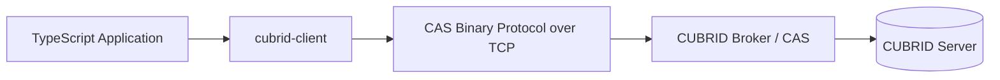
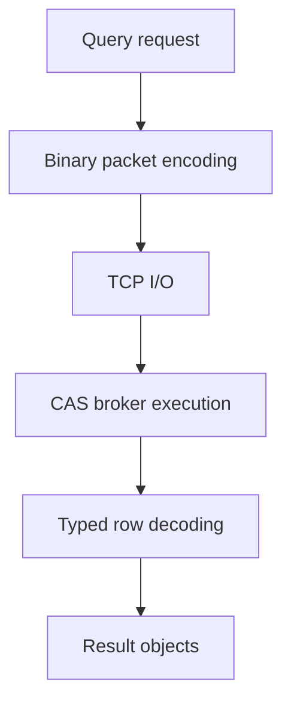
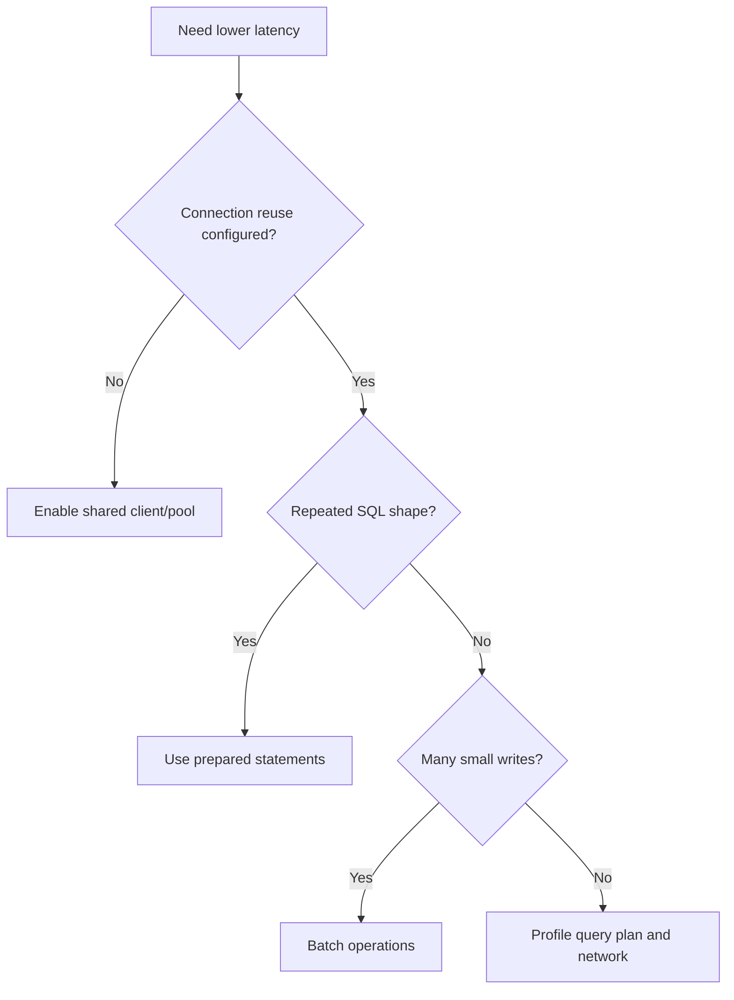

# Performance Guide

This document summarizes `cubrid-client` benchmark behavior and practical tuning guidance.

## Overview

`cubrid-client` is a TypeScript driver that talks directly to CUBRID via CAS binary protocol.

## Benchmark Results

Source: [cubrid-benchmark](https://github.com/cubrid-lab/cubrid-benchmark)

Environment: Intel Core i5-9400F @ 2.90GHz, 6 cores, Linux x86_64, Docker containers.

Workload: TypeScript `cubrid-client` vs `mysql2`, 100 rows x 3 rounds.

| Scenario | CUBRID (cubrid-client) | MySQL (mysql2) | Ratio (CUBRID/MySQL) |
|---|---:|---:|---:|
| insert_sequential | 6.18s | 14.85s | 0.4x |
| select_by_pk | 6.57s | 13.89s | 0.5x |
| select_full_scan | 5.60s | 14.71s | 0.4x |
| update_indexed | 6.32s | 14.87s | 0.4x |

In this benchmark shape, CUBRID is faster than MySQL in every tested TypeScript scenario.

## Performance Characteristics

- Direct CAS binary protocol implementation keeps request/response handling efficient.
- Driver design minimizes intermediate allocations in hot encode/decode paths.
- Stable latency appears on mixed read/write micro-benchmarks.
- Performance is sensitive to round-trip count when workloads are highly chatty.

## Streaming memory

`query()` needs memory proportional to the whole result. `stream()` holds one server reply, about 16 KiB of rows or one row when a row is larger. Measured with `process.memoryUsage()` after a forced garbage collection and with `process.resourceUsage().maxRSS`, in a new Node.js 24 process per run, reading a table of 1,000,000 rows of about 500 bytes (477 MiB of column data) from a local Docker server:

| Server | Method | Heap growth after GC | Peak RSS | Time |
|---|---|---:|---:|---:|
| 10.2 | `stream()` | 0.9 MiB | 86 MiB | 7.6 s |
| 10.2 | `query()` | 560 MiB | 775 MiB | 6.9 s |
| 11.0 | `stream()` | 0.9 MiB | 88 MiB | 6.8 s |
| 11.0 | `query()` | 560 MiB | 798 MiB | 5.5 s |
| 11.2 | `stream()` | 0.9 MiB | 88 MiB | 7.2 s |
| 11.2 | `query()` | 560 MiB | 797 MiB | 5.6 s |
| 11.4 | `stream()` | 0.9 MiB | 88 MiB | 6.3 s |
| 11.4 | `query()` | 560 MiB | 791 MiB | 5.8 s |

The stream's heap stayed between 0.8 and 0.9 MiB above its starting point at every 100,000th row. Its peak RSS is about 20 MiB above the idle process. These are single runs, not benchmarks: the times only show that streaming costs no large slowdown.

The live test `memory stays bounded on a result much larger than the limit asserted` in `tests/integration.test.ts` keeps this checked on every server version.

## Optimization Tips

- Reuse a single client/pool per process instead of reconnecting per request. An autocommit statement stays on the client's session; the client adds one CHECK_CAS round trip before it instead of opening a new session (see [Session Reuse](CONNECTION.md#session-reuse)).
- Batch writes when possible to reduce CAS round-trips.
- Use prepared statements for repeated query shapes.
- Keep payload size lean by selecting only required columns.

## Running Benchmarks

1. Clone `https://github.com/cubrid-lab/cubrid-benchmark`.
2. Start Docker-based benchmark databases as described in the repo.
3. Run the TypeScript suite for `cubrid-client` and `mysql2`.
4. Use 100 rows x 3 rounds for parity with the published results.
5. Export timing tables and compare ratio trends across scenarios.

Use the benchmark repo scripts and README for exact execution commands.
