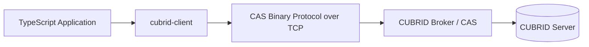
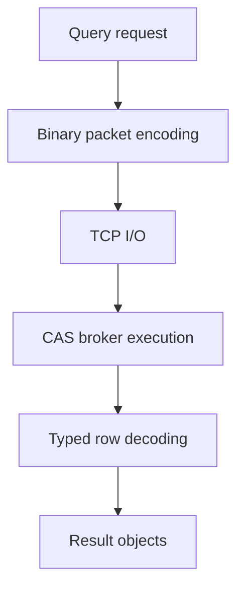
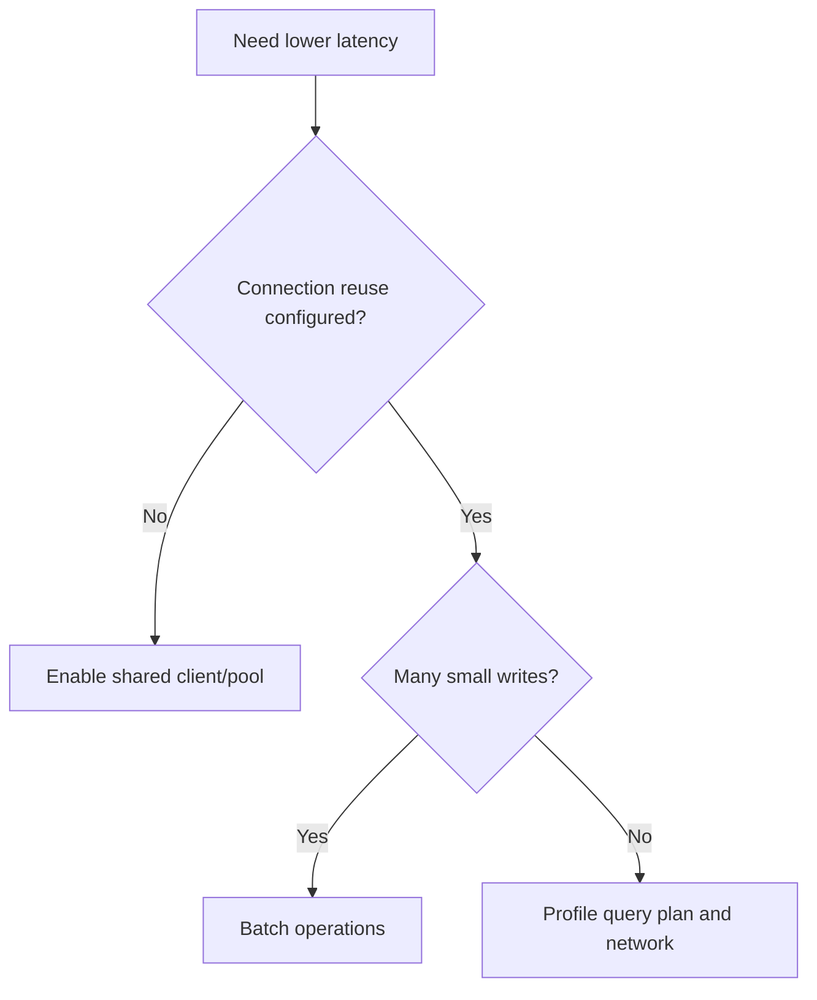

# Performance Guide

This document summarizes `cubrid-client` benchmark behavior and practical tuning guidance.

## Overview

`cubrid-client` is a TypeScript driver that talks directly to CUBRID via CAS binary protocol.





## Benchmark Results

Source: [cubrid-benchmark](https://github.com/cubrid-lab/cubrid-benchmark)

Environment: Intel Core i5-9400F @ 2.90GHz, 6 cores, Linux x86_64, Docker containers.

Workload: TypeScript `cubrid-client` vs `mysql2`, 100 rows x 3 rounds.

| Scenario | CUBRID (cubrid-client) | MySQL (mysql2) | Ratio (CUBRID/MySQL) |
|---|---:|---:|---:|
| insert_sequential | 6.18s | 14.85s | 0.4x |
| select_by_pk | 6.57s | 13.89s | 0.5x |
| select_full_scan | 5.60s | 14.71s | 0.4x |
| update_indexed | 6.32s | 14.87s | 0.4x |

In this benchmark shape, CUBRID is faster than MySQL in every tested TypeScript scenario.

## Performance Characteristics

- Direct CAS binary protocol implementation keeps request/response handling efficient.
- Driver design minimizes intermediate allocations in hot encode/decode paths.
- Stable latency appears on mixed read/write micro-benchmarks.
- Performance is sensitive to round-trip count when workloads are highly chatty.

## Streaming memory

`query()` needs memory proportional to the whole result. `stream()` holds one server reply, about 16 KiB of rows or one row when a row is larger. Measured with `process.memoryUsage()` after a forced garbage collection and with `process.resourceUsage().maxRSS`, in a new Node.js 24 process per run, reading a table of 1,000,000 rows of about 500 bytes (477 MiB of column data) from a local Docker server:

| Server | Method | Heap growth after GC | Peak RSS | Time |
|---|---|---:|---:|---:|
| 10.2 | `stream()` | 0.9 MiB | 86 MiB | 7.6 s |
| 10.2 | `query()` | 560 MiB | 775 MiB | 6.9 s |
| 11.0 | `stream()` | 0.9 MiB | 88 MiB | 6.8 s |
| 11.0 | `query()` | 560 MiB | 798 MiB | 5.5 s |
| 11.2 | `stream()` | 0.9 MiB | 88 MiB | 7.2 s |
| 11.2 | `query()` | 560 MiB | 797 MiB | 5.6 s |
| 11.4 | `stream()` | 0.9 MiB | 88 MiB | 6.3 s |
| 11.4 | `query()` | 560 MiB | 791 MiB | 5.8 s |

The stream's heap stayed between 0.8 and 0.9 MiB above its starting point at every 100,000th row. Its peak RSS is about 20 MiB above the idle process. These are single runs, not benchmarks: the times only show that streaming costs no large slowdown.

The live test `memory stays bounded on a result much larger than the limit asserted` in `tests/integration.test.ts` keeps this checked on every server version.

## Optimization Tips

- Reuse a single client/pool per process instead of reconnecting per request. An autocommit statement stays on the client's session; the client adds one CHECK_CAS round trip before it instead of opening a new session (see [Session Reuse](CONNECTION.md#session-reuse)).
- Batch writes when possible to reduce CAS round-trips.
- Keep payload size lean by selecting only required columns.



## Prepared binding

`queryPrepared()`, `queryResultPrepared()` and `executePrepared()` are not a
speed feature. In autocommit mode one call sends four requests (PREPARE,
EXECUTE, END_TRAN, then the handle release) where `query()` sends two, and
nothing is reused between calls. On a reused session both also send the
CHECK_CAS probe first, so five against three (see
[Round trips per call](#round-trips-per-call)). Measured with `scripts/bench-prepared.ts` on
CUBRID 11.4.6.1963 in Docker, 100 rounds per workload, each round running both
paths in alternating order, on a shared host whose load average stayed above
20:

| Workload | Literal median | Prepared median | Literal p95 | Prepared p95 |
| --- | ---: | ---: | ---: | ---: |
| select by primary key | 1.47 ms | 1.90 ms | 3.55 ms | 6.79 ms |
| select 1000 rows | 2.85 ms | 3.19 ms | 3.79 ms | 7.14 ms |
| update by primary key | 50.11 ms | 50.07 ms | 147.83 ms | 108.55 ms |
| insert one row | 170.81 ms | 180.74 ms | 524.95 ms | 641.64 ms |

Reads cost about 0.3 to 0.4 ms more per call. Writes are dominated by the
commit on this host, so the difference there is within its noise. Treat these
as relative numbers from one loaded machine, not a capacity figure, and repeat
the measurement on your own server:

```bash
CUBRID_TEST_PORT=33000 node --import tsx scripts/bench-prepared.ts 300
```

## Batch execution

`executeMany()` replaces round trips, not server work. Inserting N rows with a
loop of `execute()` in autocommit mode sends 5 requests per row (the CHECK_CAS
probe, PREPARE_AND_EXECUTE, GET_LAST_INSERT_ID, END_TRAN and the handle release),
with one commit per row: 5N requests and N commits. `executeMany()` sends
CHECK_CAS, PREPARE, one EXECUTE_ARRAY per ~1 MiB of encoded values
(`ceil(encoded size / 1 MiB)`, one request for typical rows), END_TRAN and the
handle release, with one commit for the whole batch. Both counts were measured on
the wire with `scripts/bench-round-trips.ts` (see
[Round trips per call](#round-trips-per-call)):

| Rows | `execute()` loop requests | `executeMany()` requests | Commits (loop / batch) |
| ---: | ---: | ---: | ---: |
| 10 | 50 | 5 | 10 / 1 |
| 100 | 500 | 5 | 100 / 1 |
| 1000 | 5000 | 5 | 1000 / 1 |

That is the claim to rely on. How much time it saves depends on what one round
trip and one commit cost on your server. The timings below are from one host
where each commit was very slow, so they mostly measure commits and should not be
read as a speedup: `scripts/bench-execute-many.ts` on CUBRID 11.4.6.1963 in
Docker (`cubrid/cubrid:11.4`), 3 rounds per size, both paths in alternating
order into an emptied 3-column table, on a shared 6-CPU host with a load average
of about 17 throughout. The `execute()` loop cost about 360 to 440 ms per row
there, which is the host and the container's log flush, not the driver.

| Rows | `execute()` loop median | `executeMany()` median |
| ---: | ---: | ---: |
| 10 | 3567.3 ms | 457.0 ms |
| 100 | 37641.3 ms | 350.2 ms |
| 1000 | 435797.9 ms | 475.1 ms |

Repeat the measurement on your own server before drawing conclusions:

```bash
CUBRID_TEST_PORT=33000 node --import tsx scripts/bench-execute-many.ts 3 10,100,1000
```

## Round trips per call

Every request to the CAS is one network round trip, sent one after another on
a session. `scripts/bench-round-trips.ts` counts them by function code: a local
TCP relay between the driver and the broker reads each framed request and pairs
it with its reply, so the counts come from the wire and the driver runs
unchanged.

Environment: CUBRID 11.4.6.1963 (`cubrid/cubrid:11.4`, broker defaults:
`STATEMENT_POOLING=ON`, `KEEP_CONNECTION=AUTO`) in Docker on the same host,
Node.js 24.14.0, driver at `d1e2f27`, 50 rounds, each round running every call
once on its own warmed client. The host is a shared 6-CPU machine whose load
average stayed between 17 and 20 throughout, so read the request counts first:
they do not depend on load. Timings include the relay's extra hop.

| Call | Requests | Sequence | Median | p95 |
| --- | ---: | --- | ---: | ---: |
| cold: new client, `query()` SELECT by key | 3 + TCP connect | OPEN_DATABASE, PREPARE_AND_EXECUTE, CLOSE_REQ_HANDLE | 2.89 ms | 5.34 ms |
| `query()` SELECT by key | 3 | CHECK_CAS, PREPARE_AND_EXECUTE, CLOSE_REQ_HANDLE | 1.80 ms | 3.01 ms |
| `query()` SELECT 1000 rows | 4 | CHECK_CAS, PREPARE_AND_EXECUTE, FETCH, CLOSE_REQ_HANDLE | 6.25 ms | 50.66 ms |
| `execute()` INSERT | 5 | CHECK_CAS, PREPARE_AND_EXECUTE, GET_LAST_INSERT_ID, END_TRAN, CLOSE_REQ_HANDLE | 467.67 ms | 953.68 ms |
| `execute()` UPDATE by key | 4 | CHECK_CAS, PREPARE_AND_EXECUTE, END_TRAN, CLOSE_REQ_HANDLE | 467.00 ms | 777.38 ms |
| `queryPrepared()` SELECT by key | 5 | CHECK_CAS, PREPARE, EXECUTE, END_TRAN, CLOSE_REQ_HANDLE | 2.14 ms | 4.29 ms |
| `executePrepared()` INSERT | 6 | CHECK_CAS, PREPARE, EXECUTE, GET_LAST_INSERT_ID, END_TRAN, CLOSE_REQ_HANDLE | 473.43 ms | 675.74 ms |
| `executeMany()` INSERT of 10 rows | 5 | CHECK_CAS, PREPARE, EXECUTE_ARRAY, END_TRAN, CLOSE_REQ_HANDLE | 464.73 ms | 674.68 ms |
| `transaction()`: SELECT + INSERT, commit | 8 + TCP connect | OPEN_DATABASE, PREPARE_AND_EXECUTE, CLOSE_REQ_HANDLE, GET_LAST_INSERT_ID, PREPARE_AND_EXECUTE, GET_LAST_INSERT_ID, CLOSE_REQ_HANDLE, END_TRAN | 430.22 ms | 926.81 ms |
| `stream()` 1000 rows, `fetchSize` 100 | 4 | CHECK_CAS, PREPARE_AND_EXECUTE, FETCH, CLOSE_REQ_HANDLE | 5.01 ms | 51.67 ms |
| `stream()` stopped after 1 of 1000 rows | 4 | CHECK_CAS, PREPARE_AND_EXECUTE, END_TRAN, CLOSE_REQ_HANDLE | 3.86 ms | 50.18 ms |
| reconnect: `query()` after the socket was dropped | 3 + TCP connect | OPEN_DATABASE, PREPARE_AND_EXECUTE, CLOSE_REQ_HANDLE | 2.86 ms | 11.58 ms |
| `pool.query()` SELECT by key | 3 | CHECK_CAS, PREPARE_AND_EXECUTE, CLOSE_REQ_HANDLE | 1.50 ms | 2.55 ms |
| `pool.execute()` INSERT | 5–6 | CHECK_CAS, GET_LAST_INSERT_ID, PREPARE_AND_EXECUTE, GET_LAST_INSERT_ID, END_TRAN, CLOSE_REQ_HANDLE | 427.29 ms | 991.16 ms |

Every count was identical in all 50 rounds except `pool.execute()`: the pool's
one session also ran `pool.query()`, and an `execute()` that follows another
statement first reads the session's last insert id, so it sent 6 requests after
a `pool.query()` and 5 otherwise. The CON_CLOSE of the cold client and of the
connection `transaction()` opens reached the relay after the call returned and
is left out. A dropped socket sends no CHECK_CAS: the driver sees the close and
opens a new session before the statement.

Round trip of each request at the relay, from its last byte to the reply's last
byte (the broker's share, without the driver's):

| Function code | Median | p95 |
| --- | ---: | ---: |
| CHECK_CAS | 0.18 ms | 0.49 ms |
| CLOSE_REQ_HANDLE | 0.09 ms | 0.31 ms |
| GET_LAST_INSERT_ID | 0.12 ms | 0.37 ms |
| PREPARE_AND_EXECUTE | 0.81 ms | 2.00 ms |
| PREPARE | 0.61 ms | 1.17 ms |
| EXECUTE | 0.25 ms | 0.54 ms |
| FETCH | 0.38 ms | 0.96 ms |
| OPEN_DATABASE | 0.58 ms | 1.92 ms |
| END_TRAN (commit) | 412.27 ms | 707.78 ms |

On this host a commit costs about 400 ms (the container's log flush under load),
so every write is a commit and every read is three or four sub-millisecond
exchanges.

```bash
CUBRID_TEST_PORT=33000 node --import tsx scripts/bench-round-trips.ts 50
```

### Deferring the handle release (#248): investigated, not adopted

Every statement ends with CLOSE_REQ_HANDLE, sent and awaited before the call
returns. The proposal was to send it later, together with another request.

**Thresholds, set before any prototype.** A change to handle release had to:

- remove at least one request from every call of the path it targets, counted by
  `scripts/bench-round-trips.ts`; and
- lower that path's median by at least 10 % in the same benchmark on the same
  server.

Regression budget: no path gains a request, no path's median gets more than 5 %
worse, the unit suite and the live suite on CUBRID 10.2 and 11.4 stay green, no
public API changes, and every rule in
[ENGINEERING_INVARIANTS.md](ENGINEERING_INVARIANTS.md) still holds.

**What the protocol offers.** There is no batch request. What exists is an
argument list: PREPARE and PREPARE_AND_EXECUTE accept handle ids after their
autocommit byte, and the CAS frees each of them before it compiles the new
statement (`fn_prepare_internal()` in `src/broker/cas_function.c`, lines 346–358
at `v11.4.6.1963` and 320–332 at `v10.2.18`; PREPARE_AND_EXECUTE passes its
prepare arguments through the same function).

- END_TRAN does not free handles under the default `STATEMENT_POOLING=ON`: commit
  only ends the query results (`ux_end_tran()` in `src/broker/cas_execute.c`,
  `hm_srv_handle_qresult_end_all()`, line 1207 at `v11.4.6.1963`, line 990 at
  `v10.2.18`). They are freed when the client disconnects or the CAS goes to
  another client (`hm_srv_handle_free_all(true)`, `src/broker/cas.c` line 1478
  at `v11.4.6.1963`). So skipping the release is not an option: handles would pile
  up to `MAX_PREPARED_STMT_COUNT` (2000).
- CLOSE_REQ_HANDLE sent without its autocommit byte, as this driver sends it,
  ends no transaction (`fn_close_req_handle()`, line 1082 at `v11.4.6.1963`), so
  moving it would change no transaction boundary.
- Both official drivers defer only statements that return no result set. JDBC
  11.3.1.0050 (`UStatement.close()`) sends CLOSE_REQ_HANDLE at once for SELECT,
  CALL, GET_STATS and EVALUATE and queues the others, which
  `UConnection.prepareInternal()` appends to the next PREPARE;
  `UConnection.clientSocketClose()` empties the queue. CCI (`cubrid-cci`
  `bd45c0c`, `qe_close_req_handle_internal()` in `src/cci/cci_query_execute.c`)
  makes the same split and appends the queue to PREPARE and PREPARE_AND_EXECUTE.

**What it could save, measured above.** Deferring as the official drivers do
moves one request off `execute()`, `executePrepared()`, `executeMany()` and the
INSERT in `transaction()`. Each of those is a commit: one CLOSE_REQ_HANDLE costs
0.09 ms at the relay against a median of 430 to 475 ms, about 0.02 %, far below
the 10 % threshold. Reads would gain nothing, because both official drivers
release a SELECT at once. Deferring SELECT handles too would follow no official
driver, so it was not tried.

**What it would risk.** A deferred id names a handle on one physical session.
Today the PREPARE_AND_EXECUTE request is encoded before `sendAndRecv()` sends the
CHECK_CAS probe that may replace the session, so the ids would have to be added
inside the connection's queue, after that probe, and dropped on every
reconnect, `discardSession()`, `destroy()` and failed exchange, and kept when an
abort stops a request before it is sent. The release reply also feeds the count
of out-of-transaction replies that detects a transaction the server ended. That
is new state on the path every statement takes, for no measurable gain.

**Decision.** Eager release stays. No prototype was built, because the
measured upper bound is below the threshold, and the source was not changed.


## Socket reader

Until #253, every framed read attached `data`, `error`, `close` and `end`
listeners to the socket and removed them again: 8 listener calls per reply, or
16 when the reply arrived in pieces. Since #253 each socket has one
`FrameReader` (`src/protocol/frame-reader.ts`) that keeps a single data listener
and queues the socket's bytes for one read at a time. The change was made only
after profiling it against a gain threshold that was fixed before the design.

**Threshold.** Replace the reader only if, in each of three confirmation runs, a
prototype of the new reader (an upper bound on the saving) cut client CPU time
or median latency per primary-key SELECT by at least 10% against the per-read
reader, by more than the gap between two identical per-read clients (A/A) in
the same run. FETCH windows and a 64 MiB row could not get worse beyond that
A/A gap. A FETCH saving counted only beyond what a three-line fix of the old
reader gets (`per-read-nocopy`: it skips copying a chunk that already covers a
read).

**Microbenchmark** (`scripts/bench-reader.ts`): `CASConnection.recv()` against an
in-memory socket, with each chunk delivered from its own macrotask the way a
real socket delivers it. Node.js 24.14, medians of 5 rounds, CPU time per frame:

| Reply | per-read | per-read-nocopy | framed (shipped) |
|---|---:|---:|---:|
| 64 B, one chunk | 9.29 µs | 8.94 µs | 4.69 µs |
| 64 B, three chunks | 21.15 µs | 20.98 µs | 12.16 µs |
| 1000-row FETCH (~100 KiB), 64 KiB chunks | 63.78 µs | 47.03 µs | 37.76 µs |
| 1000-row FETCH (~100 KiB), 16 KiB chunks | 62.50 µs | 56.53 µs | 48.81 µs |
| 64 MiB, 64 KiB chunks | 37.5 ms | 38.4 ms | 37.7 ms |

**Live** (`scripts/bench-reader-live.ts`): one client per reader against
CUBRID 11.4.6.1963 in Docker, 20 blocks per reader in rotating order, on a
shared 6-CPU host with a load average between 16 and 24. Each cell is the
change in client CPU time per operation against the mean of the two per-read
clients. Latency is in the text below the tables.

The prototype gate. These runs decided whether the design went ahead:

| Run | A/A | select by primary key (3 frames) | 10000 rows (72 frames) | 64 MiB row |
|---|---:|---:|---:|---:|
| 4 | −1.2% | −14.6% | −16.5% | −5.1% |
| 5 | −2.4% | −13.2% | −15.7% | −5.9% |
| 6 | −4.3% | −11.9% | −23.9% | −1.9% |

The shipped reader, measured the same way after implementation:

| Run | A/A | select by primary key | 10000 rows | 64 MiB row |
|---|---:|---:|---:|---:|
| 1 | +3.2% | −15.0% | −19.3% | −5.0% |
| 2 | −1.0% | −8.9% | −16.9% | +4.1% |
| 3 | −0.8% | −11.0% | −18.7% | −4.6% |

- **CPU.** The prototype met the threshold in every run. The shipped reader saves
  about 30 µs of client CPU per primary-key SELECT (0.280 → 0.248 ms, −11.6%
  over the three runs). It met 10% in two runs and missed with −8.9% in run 2,
  the run with the highest host load.
- **FETCH.** Against `per-read-nocopy`, the shipped reader saves a further 4–13%
  of CPU on FETCH windows. About half of the FETCH saving is that copy.
- **Latency.** Median latency per primary-key SELECT stayed within ±4%, which
  is the noise; the round trip, not the client, bounds it. FETCH windows were
  5–8% faster.
- **64 MiB row.** No regression beyond the A/A gap in either latency or CPU.

So the gain is CPU headroom for busy processes, not faster queries.

The new reader also addresses two things the profile found:

- The old reader shared one receive buffer across sockets, and a broker
  redirect left the broker socket's surplus in it. A broker that sent more than
  the 4-byte redirect port therefore had its stray frame read as the CAS
  socket's OPEN_DATABASE reply (#280). 1.4.0 fixed this with a guard that
  discards another socket's buffered bytes (#283). Each socket now has its own
  reader, which replaces that guard, and a replaced socket's bytes are dropped
  with it.
- The old reader relied on each chunk being emitted from its own I/O callback.
  A stream that emitted two chunks in one tick, with DATA_LENGTH ending in the
  first, lost the second. This did not reproduce on `net.Socket` or `TLSSocket`
  on Node.js 24, but the new reader does not depend on it.

Two behaviors changed, and both apply only to a server that breaks the protocol:

- Bytes that arrive with no read waiting are queued in order and read as the
  next reply. Before, most of them were lost.
- Past 64 KiB of such bytes (`SURPLUS_LIMIT`), the reader pauses the socket
  until the next read. While it is paused, Node.js holds back the socket's
  `end` event, so a server that hangs up then is noticed on the next request,
  not before it.

```bash
node --import tsx --expose-gc scripts/bench-reader.ts 5
CUBRID_TEST_PORT=33000 node --import tsx scripts/bench-reader-live.ts 20
```

## Running Benchmarks

1. Clone `https://github.com/cubrid-lab/cubrid-benchmark`.
2. Start Docker-based benchmark databases as described in the repo.
3. Run the TypeScript suite for `cubrid-client` and `mysql2`.
4. Use 100 rows x 3 rounds for parity with the published results.
5. Export timing tables and compare ratio trends across scenarios.

Use the benchmark repo scripts and README for exact execution commands.
